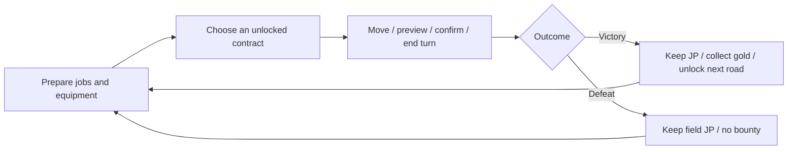
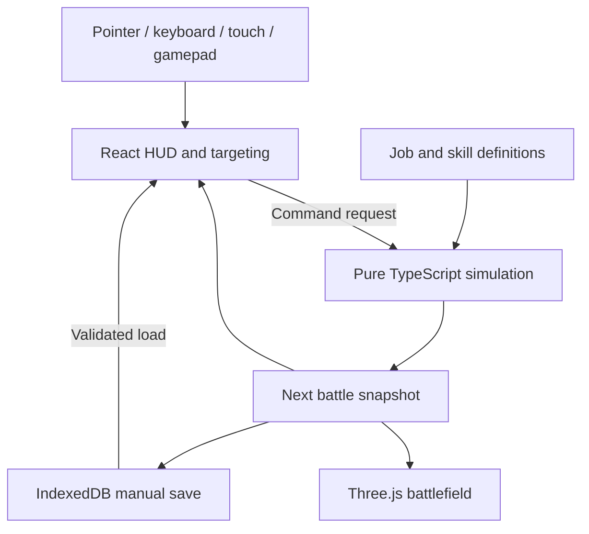

# Echoes of the Shattered Crown

An original isometric tactical RPG about a mercenary company, a fractured world, and the cost of making it whole again.

[](https://github.com/CptNope/Echoes-of-the-Shattered-Crown/actions/workflows/pages.yml)

**[Play on GitHub Pages](https://cptnope.github.io/Echoes-of-the-Shattered-Crown/)** · [Documentation](docs/README.md) · [Changelog](CHANGELOG.md) · [Contributing](CONTRIBUTING.md)


> **Current edition: 0.3 — The silent belfry.** Prepare a persistent roster at camp, complete four linked Veyr contracts, learn secondary skills with JP, and provision shared equipment. Challenge Orren in the fourth contract for a unique relic; all eight jobs now have detailed illustrated sprites. The full story campaign and remaining mastery systems are still future work.

## Contents

- [What you can play](#what-you-can-play)
- [Quick start](#quick-start)
- [Your first battle](#your-first-battle)
- [Controls](#controls)
- [Technology and architecture](#technology-and-architecture)
- [Project layout](#project-layout)
- [Saves and privacy](#saves-and-privacy)
- [GitHub Pages and Actions](#github-pages-and-actions)
- [Documentation](#documentation)
- [Development status](#development-status)
- [Contributing and licensing](#contributing-and-licensing)

## What you can play

| System       | Available now                                                                              | Current boundary                                                       |
| ------------ | ------------------------------------------------------------------------------------------ | ---------------------------------------------------------------------- |
| Expedition   | Company camp, four gated contracts, repeatable rewards                                     | A Veyr contract route, not a world-map story campaign                  |
| Company      | Persistent roster, lifetime/spent JP, permanent learned skills                             | No character level separate from jobs or mastery/passive slots         |
| Loadouts     | Eight jobs, native primary skills, learned secondary skills                                | Advanced jobs initially locked; some skill definitions are shared      |
| Equipment    | Ten items (nine purchasable), three slots, proficiencies, shared inventory, gold purchases | No crafting, selling, upgrades, rarity rolls or gear appearance models |
| Tactics      | Elevation, facing, range, LOS, guard, critical hits, riposte, status and momentum          | Grid-sampled LOS and no facing-selection command                       |
| Environments | Four 9×9 Veyr map variants, ice and grass ignition                                         | Shared regional art; no new biomes, weather or destructible scenery    |
| Presentation | Detailed eight-job atlas, close portraits, lit 3D ruins and procedural score               | Full action animation sets and orchestral music remain planned         |
| Persistence  | Company + active battle, previous-save backup, v1 migration                                | Manual browser-local saves; no cloud sync, autosave or export          |
| Input        | Pointer, touch, battle keyboard/gamepad mapping, reduced motion and text sizing            | Physical devices and full controller-driven camp navigation unverified |

See [the belfry boss guide](docs/THE_SILENT_BELFRY.md) and [character art pipeline](docs/SPRITE_ART.md) for this expansion.

See [company and progression](docs/COMPANY_AND_PROGRESSION.md) for the contract loop, JP economy and item reference.

## Quick start

Use **Node.js 24** to match CI, npm, and a browser with WebGL support. This project was validated with Node 24.

```sh
git clone https://github.com/CptNope/Echoes-of-the-Shattered-Crown.git
cd Echoes-of-the-Shattered-Crown
npm ci
npm run dev
```

Open the Local URL printed by Vite. If its default port is unavailable, use `npm run dev -- --port 4187`.

| Command                                         | Purpose                                                   |
| ----------------------------------------------- | --------------------------------------------------------- |
| `npm ci`                                        | Install locked dependency versions                        |
| `npm run dev`                                   | Start the local development server                        |
| `npm test`                                      | Run 31 deterministic engine and battle-scenario tests     |
| `npm run build`                                 | Strict TypeScript check for `src/`, then generate `dist/` |
| `npx vite preview --host 127.0.0.1 --port 4187` | Preview a production build locally                        |
| `node scripts/verify-pages.mjs`                 | Check a build produced with the Pages base path           |

Serve the game over HTTP or HTTPS. Opening `index.html` with `file://` is unsupported. There is no backend to provision, required secret, or `.env` file to create.

## Your first battle

1. At camp, open **Company** to select primary/secondary jobs and equipment. Unassigned boots and a copper focus are in shared inventory.
2. Choose **Contracts → The shrine of Veyr → Deploy company**. Everyone enters at full health and energy.
3. Move once and use an ability once, in either order. Select a highlighted tile, inspect the preview and confirm.
4. End the turn; ending without an ability grants guard. Defeat all four enemies.
5. **Return to company camp** to retain JP, collect 60 gold and unlock the drowned causeway. Train a skill for 60 spendable JP or purchase equipment, then deploy again.



**Save manually before leaving.** Save company/Save battle includes the whole expedition. A new company resets unsaved progress; retrying a contract discards that attempt's gains and restores the pre-deployment roster. Empty damage centers can spend an action without hitting anyone.

## Controls

| Input              | Action                                                                   |
| ------------------ | ------------------------------------------------------------------------ |
| Click / tap        | Choose commands and tiles; inspect or confirm                            |
| `Q` / `E`          | Rotate by 90 degrees                                                     |
| Scroll / `+` / `-` | Zoom                                                                     |
| Arrows             | Move the tile cursor along map axes                                      |
| `Enter`            | Confirm selected movement or ability                                     |
| `M` / `1`          | Move / Weapon strike                                                     |
| `Space`            | End turn; defend if no ability was used                                  |
| `Escape`           | Cancel targeting or close a dialog                                       |
| Standard gamepad   | D-pad/stick: tile; X: Move; A: confirm; B: cancel; Y: end; LB/RB: rotate |

Battle keyboard shortcuts apply on the battlefield; camp uses normal focusable buttons and form controls. Phone camp layouts include a fixed deployment action.

Phone layouts have quick commands beside the board and on-screen camera buttons. The adapter reads the first gamepad using standard button indices. Keyboard directions remain map-relative after camera rotation. See [the player guide](docs/PLAYER_GUIDE.md).

## Technology and architecture

| Layer      | Technology                                | Responsibility                                                                  |
| ---------- | ----------------------------------------- | ------------------------------------------------------------------------------- |
| Simulation | Strict TypeScript                         | Legal commands, movement, damage, statuses, initiative, AI and outcomes         |
| Content    | Typed records                             | Jobs, skills, stats, costs, prerequisites                                       |
| Rendering  | Three.js                                  | Orthographic board, illustrated billboards, lighting, highlights, interpolation |
| Interface  | React                                     | HUD, dialogs, input adapters, targeting, settings, battle state                 |
| Saves      | IndexedDB through `idb`                   | Versioned manual snapshots and previous-save recovery                           |
| Audio      | Web Audio                                 | Original synthesized sketch and command tones                                   |
| Tooling    | Vite, TypeScript, `tsx`, Node test runner | Development, build and deterministic checks                                     |
| Deployment | GitHub Actions + Pages                    | Validate, upload, publish and verify live assets                                |



The engine owns outcomes. The renderer cannot decide hits, damage or initiative. Replaying the same legal commands from the same initial seed produces the same simulation state. See [architecture](docs/ARCHITECTURE.md).

## Project layout

```text
.
├── .github/workflows/pages.yml  # Test, build, deploy, verify
├── docs/                       # Guides, diagrams, references, screenshot
├── scripts/verify-pages.mjs     # Local and live asset checks
├── src/
│   ├── campaign.ts             # Company progression, rewards and migration
│   ├── Camp.tsx                # Contracts, training and outfitter UI
│   ├── equipment.ts            # Catalog, proficiency and gear bonuses
│   ├── encounters.ts           # Contract definitions and gates
│   ├── campaign.test.ts        # Progression and four-map scenarios
│   ├── Portrait.tsx            # Shared original sprite portrait
│   ├── camp.css                # Responsive company camp
│   ├── data.ts                 # Jobs, skills, JP, prerequisites
│   ├── engine.ts               # Pure simulation and AI
│   ├── engine.test.ts          # Rules and scenario tests
│   ├── scene.ts                # Three.js terrain and character billboards
│   ├── main.tsx                # React interface and inputs
│   ├── sprites.ts              # Cached transparent atlas and fallback
│   ├── storage.ts              # IndexedDB snapshots and recovery
│   ├── audio.ts                # Procedural score and tones
│   └── style.css               # Responsive interface
├── CHANGELOG.md
├── CONTRIBUTING.md
├── DESIGN.md                   # Initial design and staged plan
├── PROJECT_BRIEF.md            # Preserved original requirements
├── VALIDATION.md               # Historical Phase 1 validation
├── index.html
├── package.json
├── package-lock.json
├── tsconfig.json
└── vite.config.ts              # Optional hosting base path
```

`dist/` and `node_modules/` are generated and ignored. The private Site hosting binding is excluded from GitHub.

## Saves and privacy

Manual snapshots contain company profiles, learned skills, JP spending, inventory, gold, completed contracts, the current stage and active battle. The browser stores them in the echoes-crown IndexedDB database. Saving atomically retains a previous valid manual snapshot as backup. Old v1 battle saves migrate to the new v2 expedition format without changing their active combat resources or RNG state.

Saves do not synchronize across devices, profiles or origins. The private Site and cptnope.github.io have separate saves. Clearing site data removes them. Settings remain session-only. Google Fonts are optional external requests; gameplay and storage require no backend. Offline/PWA and portable save export remain planned. See [data and saves](docs/DATA_AND_SAVES.md).

## GitHub Pages and Actions

The [workflow](.github/workflows/pages.yml) builds for `/Echoes-of-the-Shattered-Crown/` and publishes **only `dist/`**. Markdown documentation renders on GitHub; a separate documentation website is not generated.

| Trigger                       | Validation                                     | Deployment                    |
| ----------------------------- | ---------------------------------------------- | ----------------------------- |
| Push to `main`                | Tests, TypeScript/Vite build, asset-path check | Publish and check live assets |
| Pull request targeting `main` | Tests, build, asset-path check                 | None                          |
| Manual run on `main`          | Same as a push                                 | Publish and check live assets |

**Settings → Pages → Source** must be **GitHub Actions**. Deployment uses the workflow token and OIDC identity, with no personal token. The [initial Pages run](https://github.com/CptNope/Echoes-of-the-Shattered-Crown/actions/runs/44233777082) passed deployment and live checks. See [deployment](docs/DEPLOYMENT.md) for reproduction and recovery.

## Documentation

| Read this                                                  | To understand                                                   |
| ---------------------------------------------------------- | --------------------------------------------------------------- |
| [Documentation index](docs/README.md)                      | Reading paths and source-of-truth map                           |
| [Company and progression](docs/COMPANY_AND_PROGRESSION.md) | Contract loop, JP spending, shared inventory and all nine items |
| [Player guide](docs/PLAYER_GUIDE.md)                       | Roster, first battle, menus, controls and tactics               |
| [Combat rules](docs/COMBAT.md)                             | Exact movement, damage, initiative, statuses and AI             |
| [Jobs and abilities](docs/JOBS_AND_ABILITIES.md)           | Eight jobs, nine abilities, unlocks and loadouts                |
| [Architecture](docs/ARCHITECTURE.md)                       | Module boundaries, state flow and engine contracts              |
| [Data and saves](docs/DATA_AND_SAVES.md)                   | Records, IndexedDB, validation and recovery                     |
| [Development](docs/DEVELOPMENT.md)                         | Setup, conventions and extension recipes                        |
| [Testing](docs/TESTING.md)                                 | Coverage, browser checks, CI and verification gaps              |
| [Deployment](docs/DEPLOYMENT.md)                           | Pages pipeline, permissions and troubleshooting                 |
| [Art and audio](docs/ART_AND_AUDIO.md)                     | Original assets and presentation pipeline                       |
| [Roadmap](docs/ROADMAP.md)                                 | Milestones and 20-job development roster                        |
| [Troubleshooting](docs/TROUBLESHOOTING.md)                 | Runtime, saves, input and hosting issues                        |
| [Changelog](CHANGELOG.md)                                  | Changes linked to actual repository history                     |
| [Contributing](CONTRIBUTING.md)                            | Contribution scope and review expectations                      |

## Development status

Version 0.3 extends the company-management milestone: four linked contracts, permanent secondary-skill learning, equipment and carried progression. Phase 2 still needs full mastery/passive/reaction/movement slots and more distinct advanced skill boards. Phase 3's world map, branching story, recruitment and town systems remain planned.

The suite has **31 tests**, including full deterministic simulations of all four maps, economic and equipment invariants, rewards and v1 migration. Browser checks cover all eight job sprites, boss awakening, first-clear relic settlement, buying/equipping, manual save/load, migrated resource preservation, learning across a job change, result settlement and second-contract deployment. Result/learning checks use isolated local fixtures, not a claim of a full manual campaign playthrough. Physical mobile devices, Safari, gamepad hardware and 60 FPS remain uncertified. See [testing](docs/TESTING.md).

## Contributing and licensing

Start with [CONTRIBUTING.md](CONTRIBUTING.md). Keep rules independent of rendering, preserve determinism, and add meaningful regression coverage for rule changes.

Artwork and musical material were authored for this project. Packages and fonts retain their own licenses. **No repository-level project license has been selected or added**; public access does not itself grant a separate redistribution license. See [ownership and licenses](docs/ART_AND_AUDIO.md#ownership-and-licenses).
