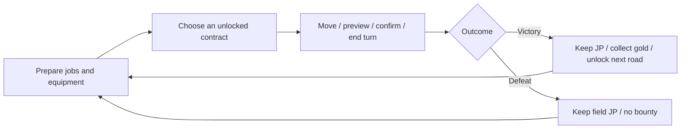
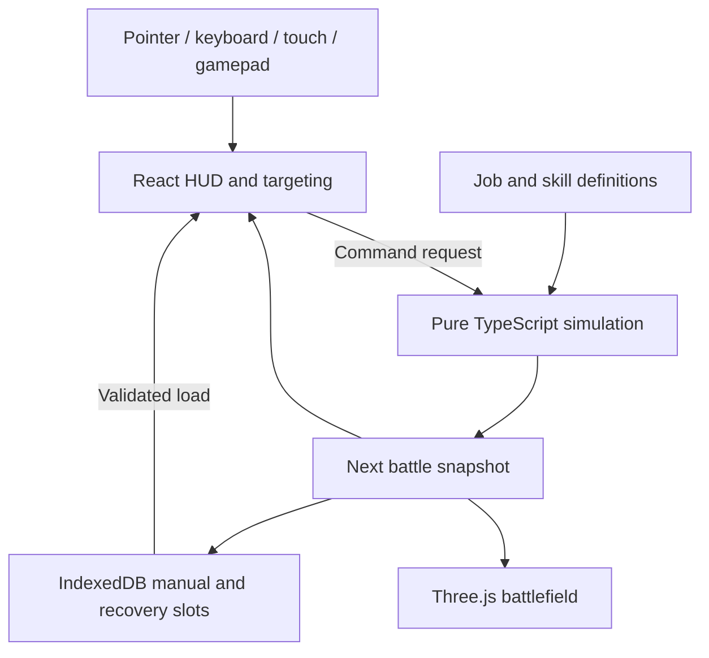
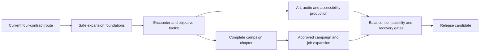

# Echoes of the Shattered Crown

An original isometric tactical RPG about a mercenary company, a fractured world, and the cost of making it whole again.

[](https://github.com/CptNope/Echoes-of-the-Shattered-Crown/actions/workflows/pages.yml)

**[Play on GitHub Pages](https://cptnope.github.io/Echoes-of-the-Shattered-Crown/)** · [Documentation](docs/README.md) · [Expansion roadmap](docs/ROADMAP.md) · [ADRs](docs/adr/README.md) · [Authoring studio plan](docs/studio/README.md) · [Changelog](CHANGELOG.md) · [Contributing](CONTRIBUTING.md)

**[Open the working level studio](https://cptnope.github.io/Echoes-of-the-Shattered-Crown/studio.html)** · [Pilot guide](docs/LEVEL_STUDIO.md). Paint terrain/elevation/collision, place actors, design layered combat SFX, compose sixteen-step music, paint layered idle/walk/attack/cast animations with flood fill, eyedropper, flips, nudges and cel copy/paste, playtest edits and export/import their source JSON. [Sound-effects guide](docs/SOUND_EFFECTS_STUDIO.md) / [Music guide](docs/MUSIC_PATTERN_STUDIO.md) / [Pixel guide](docs/PIXEL_ANIMATION_STUDIO.md) / [Action clips](docs/ACTION_CLIP_STUDIO.md) / [Native game sprites](docs/NATIVE_SPRITE_STUDIO.md). Edit shipped 887 × 1774 character sheets at their original resolution, with all 32 frames and full RGBA retained.


> **Current edition: 0.8 — Steel and spellcraft.** Lead four companions through four linked contracts, build eight-job loadouts with thirteen active abilities and permanent supports, and challenge the Bellkeeper. Automatic recovery and portable JSON backups keep company and battle progress between sessions. Eight job sheets now provide 256 frames for idle, walk, attack, cast, hurt, guard, victory and downed states. Three effect atlases add 96 spell and attack frames plus bounded particles for all thirteen abilities. The full story campaign remains future work.

## Contents

- [What you can play](#what-you-can-play)
- [Quick start](#quick-start)
- [Your first battle](#your-first-battle)
- [Controls](#controls)
- [Technology and architecture](#technology-and-architecture)
- [Project layout](#project-layout)
- [Saves and privacy](#saves-and-privacy)
- [GitHub Pages and Actions](#github-pages-and-actions)
- [Documentation](#documentation)
- [Architecture decisions](#architecture-decisions)
- [Development status](#development-status)
- [Expansion plan](#expansion-plan)
- [Detailed expansion blueprints](#detailed-expansion-blueprints)
- [Complete game-authoring studio](#complete-game-authoring-studio)
- [Contributing and licensing](#contributing-and-licensing)

Read [combat effects and particles](docs/COMBAT_EFFECTS.md), explore the [animation workbench](https://cptnope.github.io/Echoes-of-the-Shattered-Crown/animation-review.html) or read the [animation pipeline](docs/ANIMATION_PIPELINE.md).

## What you can play

| System       | Available now                                                                              | Current boundary                                                          |
| ------------ | ------------------------------------------------------------------------------------------ | ------------------------------------------------------------------------- |
| Expedition   | Company camp, four gated contracts, repeatable rewards                                     | A Veyr contract route, not a world-map story campaign                     |
| Company      | Persistent roster, lifetime/spent JP, permanent learned skills                             | No character level separate from jobs; no respecialization/refunds        |
| Loadouts     | Eight jobs, native primary skills, learned secondary skills                                | Advanced jobs initially locked; some skill definitions are shared         |
| Equipment    | Ten items (nine purchasable), three slots, proficiencies, shared inventory, gold purchases | No crafting, selling, upgrades, rarity rolls or gear appearance models    |
| Tactics      | Elevation, facing, range, LOS, guard, critical hits, riposte, status and momentum          | Grid-sampled LOS and no facing-selection command                          |
| Environments | Four 9×9 Veyr map variants, ice and grass ignition                                         | Shared regional art; no new biomes, weather or destructible scenery       |
| Presentation | 256 character frames, 96 effect frames, bounded combat particles, lit 3D ruins and procedural score               | Directional art, longer cycles and orchestral music remain planned            |
| Persistence  | Company + active battle, previous-save backup, v1 migration                                | Manual + automatic browser recovery and JSON export/import; no cloud sync |
| Input        | Pointer, touch, battle keyboard/gamepad mapping, reduced motion and text sizing            | Physical devices and full controller-driven camp navigation unverified    |

See [backups and recovery](docs/BACKUPS_AND_RECOVERY.md) for reopening after a closed tab and moving a company between browsers.

See [advanced abilities](docs/ADVANCED_ABILITIES.md) for the new tactics and preview rules.

See [job mastery and support abilities](docs/MASTERY_AND_SUPPORTS.md) for the new learning and loadout system.

See [the belfry boss guide](docs/THE_SILENT_BELFRY.md) and [character art pipeline](docs/SPRITE_ART.md) for this expansion.

See [company and progression](docs/COMPANY_AND_PROGRESSION.md) for the contract loop, JP economy and item reference.

## Quick start

Use **Node.js 24** to match CI, npm, and a browser with WebGL support. This project was validated with Node 24.

```sh
git clone https://github.com/CptNope/Echoes-of-the-Shattered-Crown.git
cd Echoes-of-the-Shattered-Crown
npm ci
npm run dev
```

Open the Local URL printed by Vite. If its default port is unavailable, use `npm run dev -- --port 4187`.

| Command                                         | Purpose                                                   |
| ----------------------------------------------- | --------------------------------------------------------- |
| `npm ci`                                        | Install locked dependency versions                        |
| `npm run dev`                                   | Start the local development server                        |
| `npm test`                                      | Run 62 deterministic combat, save, animation and effect tests     |
| `npm run docs:catalog` | Regenerate all current content and asset reference tables |
| `npm run docs:verify` | Check links, tables, backlog, catalog and design-plan integrity |
| `npm run docs:plan` | Validate proposed slice, decision, mission, job and route references |
| `npm run docs:adr` | Validate architecture decision records, index and replacement history |
| `npm run docs:studio` | Check authoring requirements, work items, artifacts and blueprint examples |
| `npm run docs:studio:examples` | Validate proposal pixel/audio/level/transaction/package examples |
| `npm run build`                                 | Strict TypeScript check for `src/`, then generate `dist/` |
| `npx vite preview --host 127.0.0.1 --port 4187` | Preview a production build locally                        |
| `node scripts/verify-pages.mjs`                 | Check a build produced with the Pages base path           |

Serve the game over HTTP or HTTPS. Opening `index.html` with `file://` is unsupported. There is no backend to provision, required secret, or `.env` file to create.

## Your first battle

1. At camp, open **Company** to select primary/secondary jobs and equipment. Unassigned boots and a copper focus are in shared inventory.
2. Choose **Contracts → The shrine of Veyr → Deploy company**. Everyone enters at full health and energy.
3. Move once and use an ability once, in either order. Select a highlighted tile, inspect the preview and confirm.
4. End the turn; ending without an ability grants guard. Defeat all four enemies.
5. **Return to company camp** to retain JP, collect 60 gold and unlock the drowned causeway. Train a skill for 60 spendable JP or purchase equipment, then deploy again.



**Keep a checkpoint and a file backup.** Automatic recovery follows game changes; reopening offers Resume recovery. Use Backups to export/import a portable JSON file. Manual saves stay separate. Save company/Save battle includes the whole expedition. A new company resets unsaved progress; retrying a contract discards that attempt's gains and restores the pre-deployment roster. Empty damage centers can spend an action without hitting anyone.

## Controls

| Input              | Action                                                                   |
| ------------------ | ------------------------------------------------------------------------ |
| Click / tap        | Choose commands and tiles; inspect or confirm                            |
| `Q` / `E`          | Rotate by 90 degrees                                                     |
| Scroll / `+` / `-` | Zoom                                                                     |
| Arrows             | Move the tile cursor along map axes                                      |
| `Enter`            | Confirm selected movement or ability                                     |
| `M` / `1`          | Move / Weapon strike                                                     |
| `Space`            | End turn; defend if no ability was used                                  |
| `Escape`           | Cancel targeting or close a dialog                                       |
| Standard gamepad   | D-pad/stick: tile; X: Move; A: confirm; B: cancel; Y: end; LB/RB: rotate |

Battle keyboard shortcuts apply on the battlefield; camp uses normal focusable buttons and form controls. Phone camp layouts include a fixed deployment action.

Phone layouts have quick commands beside the board and on-screen camera buttons. The adapter reads the first gamepad using standard button indices. Keyboard directions remain map-relative after camera rotation. See [the player guide](docs/PLAYER_GUIDE.md).

## Technology and architecture

| Layer      | Technology                                | Responsibility                                                                  |
| ---------- | ----------------------------------------- | ------------------------------------------------------------------------------- |
| Simulation | Strict TypeScript                         | Legal commands, movement, damage, statuses, initiative, AI and outcomes         |
| Content    | Typed records                             | Jobs, skills, stats, costs, prerequisites                                       |
| Rendering  | Three.js                                  | Orthographic board, illustrated billboards, lighting, highlights, interpolation |
| Interface  | React                                     | HUD, dialogs, input adapters, targeting, settings, battle state                 |
| Saves      | IndexedDB through `idb`                   | Versioned manual snapshots and previous-save recovery                           |
| Audio      | Web Audio                                 | Original synthesized sketch and command tones                                   |
| Tooling    | Vite, TypeScript, `tsx`, Node test runner | Development, build and deterministic checks                                     |
| Deployment | GitHub Actions + Pages                    | Validate, upload, publish and verify live assets                                |



The engine owns outcomes. The renderer cannot decide hits, damage or initiative. Replaying the same legal commands from the same initial seed produces the same simulation state. See [how all systems connect](docs/SYSTEMS_GUIDE.md), the [source-derived catalog](docs/REFERENCE_CATALOG.md), and [architecture](docs/ARCHITECTURE.md).

## Project layout

```text
.
├── .github/workflows/pages.yml  # Test, build, deploy, verify
├── docs/                       # Guides, diagrams, references, screenshot
├── scripts/verify-pages.mjs     # Local and live asset checks
├── scripts/verify-docs.mjs      # Links, tables and backlog dependency checks
├── scripts/generate-reference.ts # Source-derived catalog
├── src/
│   ├── campaign.ts             # Company progression, rewards and migration
│   ├── Camp.tsx                # Contracts, training and outfitter UI
│   ├── equipment.ts            # Catalog, proficiency and gear bonuses
│   ├── encounters.ts           # Contract definitions and gates
│   ├── campaign.test.ts        # Progression and four-map scenarios
│   ├── Portrait.tsx            # Shared original sprite portrait
│   ├── camp.css                # Responsive company camp
│   ├── data.ts                 # Jobs, skills, JP, prerequisites
│   ├── engine.ts               # Pure simulation and AI
│   ├── engine.test.ts          # Rules and scenario tests
│   ├── scene.ts                # Three.js terrain and character billboards
│   ├── main.tsx                # React interface and inputs
│   ├── sprites.ts              # Cached transparent atlas and fallback
│   ├── animation.ts            # Character clip selection
│   ├── animation-art.ts        # Character sheet cache and loader
│   ├── combat-effects.ts       # Pure effect recipes and planning
│   ├── effect-renderer.ts      # Bounded sprites, particles and fallback
│   ├── effect-art.ts           # Effect atlas loading
│   ├── supports.ts             # Mastery, lessons and equipped bonuses
│   ├── portable.ts             # Bounded JSON export/import
│   ├── BackupDialog.tsx        # File review and restoration
│   ├── storage.ts              # IndexedDB snapshots and recovery
│   ├── audio.ts                # Procedural score and tones
│   └── style.css               # Responsive interface
├── CHANGELOG.md
├── CONTRIBUTING.md
├── DESIGN.md                   # Initial design and staged plan
├── PROJECT_BRIEF.md            # Preserved original requirements
├── VALIDATION.md               # Historical Phase 1 validation
├── index.html
├── package.json
├── package-lock.json
├── tsconfig.json
└── vite.config.ts              # Optional hosting base path
```

`dist/` and `node_modules/` are generated and ignored. The private Site hosting binding is excluded from GitHub.

## Saves and privacy

Manual snapshots contain company profiles, learned skills, JP spending, inventory, gold, completed contracts, the current stage and active battle. The browser stores them in the echoes-crown IndexedDB database. Saving atomically retains a previous valid manual snapshot as backup. Old v1 battle saves migrate to the new v2 expedition format without changing their active combat resources or RNG state.

Saves do not synchronize across devices, profiles or origins. The private Site and cptnope.github.io have separate saves. Clearing site data removes them. Settings remain session-only. Google Fonts are optional external requests; gameplay and storage require no backend. Portable JSON export/import is available through Backups; offline/PWA remains planned. See [data and saves](docs/DATA_AND_SAVES.md).

## GitHub Pages and Actions

The [workflow](.github/workflows/pages.yml) builds for `/Echoes-of-the-Shattered-Crown/` and publishes **only `dist/`**. Markdown documentation renders on GitHub; a separate documentation website is not generated.

| Trigger                       | Validation                                     | Deployment                    |
| ----------------------------- | ---------------------------------------------- | ----------------------------- |
| Push to `main`                | Tests, TypeScript/Vite build, asset-path check | Publish and check live assets |
| Pull request targeting `main` | Tests, build, asset-path check                 | None                          |
| Manual run on `main`          | Same as a push                                 | Publish and check live assets |

**Settings → Pages → Source** must be **GitHub Actions**. Deployment uses the workflow token and OIDC identity, with no personal token. The [initial Pages run](https://github.com/CptNope/Echoes-of-the-Shattered-Crown/actions/runs/44233777082) passed deployment and live checks. See [deployment](docs/DEPLOYMENT.md) for reproduction and recovery.

## Documentation

Start with the [current systems guide](docs/SYSTEMS_GUIDE.md) for end-to-end flows and the [generated catalog](docs/REFERENCE_CATALOG.md) for every current job, skill, support, item, contract, clip and effect recipe. Expansion proposals live in the [roadmap library](docs/roadmap/README.md).

| Read this                                                  | To understand                                                  |
| ---------------------------------------------------------- | -------------------------------------------------------------- |
| [Documentation index](docs/README.md)                      | Reading paths and source-of-truth map                          |
| [Company and progression](docs/COMPANY_AND_PROGRESSION.md) | Contract loop, JP spending, shared inventory and all ten items |
| [Player guide](docs/PLAYER_GUIDE.md)                       | Roster, first battle, menus, controls and tactics              |
| [Combat rules](docs/COMBAT.md)                             | Exact movement, damage, initiative, statuses and AI            |
| [Jobs and abilities](docs/JOBS_AND_ABILITIES.md)           | Eight jobs, thirteen abilities, unlocks and loadouts           |
| [Architecture](docs/ARCHITECTURE.md)                       | Module boundaries, state flow and engine contracts             |
| [Data and saves](docs/DATA_AND_SAVES.md)                   | Records, IndexedDB, validation and recovery                    |
| [Development](docs/DEVELOPMENT.md)                         | Setup, conventions and extension recipes                       |
| [Testing](docs/TESTING.md)                                 | Coverage, browser checks, CI and verification gaps             |
| [Deployment](docs/DEPLOYMENT.md)                           | Pages pipeline, permissions and troubleshooting                |
| [Art and audio](docs/ART_AND_AUDIO.md)                     | Original assets and presentation pipeline                      |
| [Expansion roadmap](docs/ROADMAP.md) | M0–M12 gates, 160 work items and a twenty-job production plan |
| [Current system flows](docs/SYSTEMS_GUIDE.md) | How company, combat, AI, saves, presentation and delivery connect |
| [Generated catalog](docs/REFERENCE_CATALOG.md) | Source-derived tables for all current content and animation recipes |
| [Troubleshooting](docs/TROUBLESHOOTING.md)                 | Runtime, saves, input and hosting issues                       |
| [Changelog](CHANGELOG.md)                                  | Changes linked to actual repository history                    |
| [Contributing](CONTRIBUTING.md)                            | Contribution scope and review expectations                     |

## Architecture decisions

The [ADR section](docs/adr/README.md) records durable architectural choices, alternatives, consequences and revisit conditions. It includes a [template](docs/adr/template.md), nine Accepted records (eight retrospectively documenting the current implementation) and three Proposed contracts for variable maps, editable game packages and shared music/SFX authoring. Original decision dates are left unknown where history was not recorded.

Use the [open decision register](docs/roadmap/DECISION_REGISTER.md) for roadmap questions and ADRs for concrete architecture choices/history. Proposed records do not change the current game or save format. Run npm run docs:adr for numbering, metadata, index and supersession checks; the command also runs through docs:verify in Actions.

## Development status

Version 0.8 extends the company-management milestone: four linked contracts, permanent secondary-skill learning, equipment and carried progression. Phase 2 now includes mastery and three support slots for the existing eight jobs; each advanced job now has an additional distinct active ability; the remaining job roster and further skill-board depth are still planned. Phase 3's world map, branching story, recruitment and town systems remain planned.

The suite has **114 tests**, including full deterministic simulations of all four maps, economic and equipment invariants, rewards and v1 migration. Browser checks cover file export/import, closed-tab recovery, all eight job sprites, boss awakening, first-clear relic settlement, buying/equipping, manual save/load, migrated resource preservation, learning across a job change, result settlement and second-contract deployment. Result/learning checks use isolated local fixtures, not a claim of a full manual campaign playthrough. Physical mobile devices, Safari, gamepad hardware and 60 FPS remain uncertified. See [testing](docs/TESTING.md).

## Expansion plan

The [master roadmap](docs/ROADMAP.md) separates the implemented v0.8 baseline from proposed campaign-scale work. It includes M0–M12 acceptance gates, recommended next increments, dependencies and scope options. The [160-item backlog](docs/roadmap/BACKLOG.md) spans sixteen tracks with stable IDs, priorities, relative size and concrete acceptance evidence. These are plans, not delivery-date commitments.

| Planning guide | What it covers |
| --- | --- |
| [Engine and systems](docs/roadmap/ENGINE_AND_SYSTEMS.md) | Variable maps/rosters, objectives, resolved events, transactions and migrations |
| [Content and campaign](docs/roadmap/CONTENT_PLAN.md) | Twenty-job roster, regional concepts, recruits, quests, factions and encounter patterns |
| [Art and audio production](docs/roadmap/ART_AUDIO_PRODUCTION.md) | Directional animation arithmetic, environment kits, effects, music and asset budgets |
| [Quality and release](docs/roadmap/RELEASE_AND_QUALITY.md) | Tests, accessibility, devices, balance, risks, offline updates and rollback |



Documentation checks run in Actions. Use npm run docs:catalog after changing content, then npm run docs:verify to check links, tables, fenced diagrams, backlog dependencies and catalog freshness. Mermaid syntax is also parsed during this documentation expansion's verification; the built-in repository checker covers structural blocks and references.

## Detailed expansion blueprints

The [design-brief library](docs/roadmap/README.md#detailed-design-briefs) adds three production slices, eighteen acceptance scenarios, sixteen open decisions, six mission blueprints, twelve proposed jobs and 36 prototype abilities. A convergent campaign/quest outline covers all four rescue/breach and archive-choice combinations. [Technical contracts](docs/roadmap/TECHNICAL_CONTRACTS.md) explain proposed map, roster, objective, event and settlement data.

These remain proposals. A separate planning-manifest check validates references and route structure; it does not add runtime content or certify balance. Start with [production slices](docs/roadmap/PRODUCTION_SLICES.md) or explore [missions](docs/roadmap/ENCOUNTER_BLUEPRINTS.md) and [jobs/abilities](docs/roadmap/JOB_ABILITY_BLUEPRINTS.md).

## Complete game-authoring studio

The [studio plan](docs/studio/README.md) extends the roadmap into a complete tactical-RPG authoring toolset: levels/objectives, rules/jobs/AI, economy, campaign/dialogue, UI/controls, layered pixel art, animation, environment assets, particles, music composition, original sound-effect design, ambience/voice, mixing and custom engine/code extensions.

| Plan | What it establishes |
| --- | --- |
| [Authoring workflows](docs/studio/AUTHORING_WORKFLOWS.md) | Real editor operations, source models, undo/recovery and domain coverage |
| [Music and SFX studio](docs/studio/AUDIO_STUDIO.md) | Piano roll/arranger plus synth/sample/recording/waveform tools, buses and event cues |
| [Project/artifact format](docs/studio/PROJECT_FORMAT.md) | Rich sources, stable IDs and separate project/game/save/asset/source formats |
| [Build and playable export](docs/studio/RUNTIME_BUILD_EXPORT.md) | Shared preview/export runtime and default complete-game bundle |
| [Automation and extensions](docs/studio/AUTOMATION_AND_EXTENSION_API.md) | UI/API/CLI editing parity and buildable custom rule/runtime sources |
| [Studio roadmap](docs/studio/STUDIO_ROADMAP.md) | Eighty planned work items, twenty-four requirements and ten acceptance gates |
| [Round-trip acceptance](docs/studio/ACCEPTANCE_AND_ROUNDTRIP.md) | Thirty-two scenarios, including a complete authored game reimported and edited again |

Default proposed export: **playable game plus editable project/source payload**. Preserve pixel layers, animation timelines, music notes, SFX graphs, recordings and code; offer a separate clearly labeled play-only build. These are planned tools, not implemented studio features. npm run docs:studio checks planning coverage and references; docs:verify includes it in Actions.

The [editor blueprint library](docs/studio/blueprints/README.md) now adds six detailed tool specifications and six checked design examples. It covers actual field/port/clock/transaction contracts and bounded prototype exit evidence, while keeping future tooling distinct from the current playable game.

## Contributing and licensing

Start with [CONTRIBUTING.md](CONTRIBUTING.md). Keep rules independent of rendering, preserve determinism, and add meaningful regression coverage for rule changes.

Artwork and musical material were authored for this project. Packages and fonts retain their own licenses. **No repository-level project license has been selected or added**; public access does not itself grant a separate redistribution license. See [ownership and licenses](docs/ART_AND_AUDIO.md#ownership-and-licenses).

The [advanced authoring contracts](docs/studio/specs/advanced-blueprints.json) add rules/AI formulas, campaign/economy/UI editing, VFX/material/environment tools, project migration/merge behavior and five toolkit release gates. Four more checked examples link these contracts to the existing requirements, work items and acceptance cases. They remain proposals; the game runtime stays v0.8.
