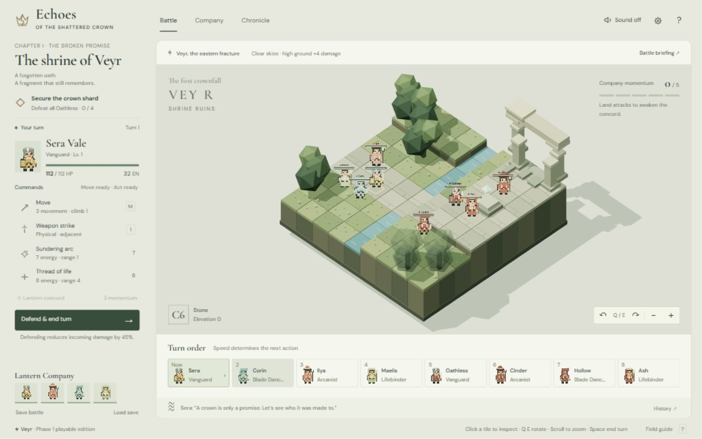
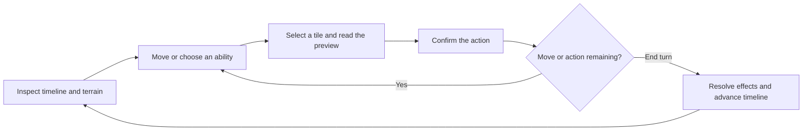
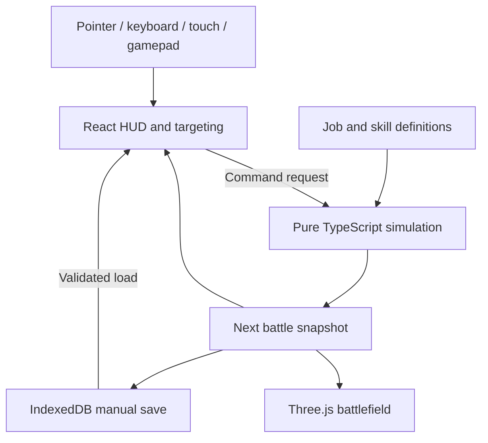

# Echoes of the Shattered Crown

An original isometric tactical RPG about a mercenary company, a fractured world, and the cost of making it whole again.

[](https://github.com/CptNope/Echoes-of-the-Shattered-Crown/actions/workflows/pages.yml)

**[Play on GitHub Pages](https://cptnope.github.io/Echoes-of-the-Shattered-Crown/)** · [Documentation](docs/README.md) · [Changelog](CHANGELOG.md) · [Contributing](CONTRIBUTING.md)



> **Current edition: Phase 1 — Veyr.** One playable battle with four companions, four AI enemies, four starting jobs, and foundations for cross-class builds. The full campaign and the rest of the original brief remain future development.

## Contents

- [What you can play](#what-you-can-play)
- [Quick start](#quick-start)
- [Your first battle](#your-first-battle)
- [Controls](#controls)
- [Technology and architecture](#technology-and-architecture)
- [Project layout](#project-layout)
- [Saves and privacy](#saves-and-privacy)
- [GitHub Pages and Actions](#github-pages-and-actions)
- [Documentation](#documentation)
- [Development status](#development-status)
- [Contributing and licensing](#contributing-and-licensing)

## What you can play

Command the Lantern Company at Veyr, where an Oathless patrol guards a crown shard. Cross the stream, contest the terrace, freeze a route or ignite grass to punish a position.

| System             | Available now                                                                         | Current boundary                                                    |
| ------------------ | ------------------------------------------------------------------------------------- | ------------------------------------------------------------------- |
| Encounter          | Complete 4-versus-4 battle, victory, defeat and replay                                | One map; no campaign loop                                           |
| Battlefield        | Orthographic terrain, elevations, quarter-turn camera rotation, zoom                  | No free pan or continuous rotation control                          |
| Tactics            | Movement costs, facing, range, line of sight, previews, guard, critical hits, riposte | Tile-sampled line of sight; no facing-selection command             |
| Abilities          | Nine definitions, healing, revival, area magic and timeline support                   | Availability depends on loadout; no purchased skill boards          |
| Terrain            | Frozen water, burning grass, damage hazards                                           | No destructible obstacles, raised terrain or weather                |
| Jobs               | Eight definitions, four starting jobs, primary/secondary loadouts, JP, prerequisites  | No equipment or mastery-slot system; advanced jobs initially locked |
| Presentation       | Original pixel sprites, lit 3D ruins, procedural music sketch                         | Full action animation sets and orchestral score remain planned      |
| Persistence        | Manual IndexedDB save/load and previous-save backup                                   | No autosave, cloud sync or save export                              |
| Input and settings | Pointer, touch, keyboard, standard gamepad mapping, text sizing, reduced motion       | Real mobile devices and physical gamepads are not certified         |

## Quick start

Use **Node.js 24** to match CI, npm, and a browser with WebGL support. This project was validated with Node 24.

```sh
git clone https://github.com/CptNope/Echoes-of-the-Shattered-Crown.git
cd Echoes-of-the-Shattered-Crown
npm ci
npm run dev
```

Open the Local URL printed by Vite. If its default port is unavailable, use `npm run dev -- --port 4187`.

| Command                                         | Purpose                                                   |
| ----------------------------------------------- | --------------------------------------------------------- |
| `npm ci`                                        | Install locked dependency versions                        |
| `npm run dev`                                   | Start the local development server                        |
| `npm test`                                      | Run 17 deterministic engine and battle-scenario tests     |
| `npm run build`                                 | Strict TypeScript check for `src/`, then generate `dist/` |
| `npx vite preview --host 127.0.0.1 --port 4187` | Preview a production build locally                        |
| `node scripts/verify-pages.mjs`                 | Check a build produced with the Pages base path           |

Serve the game over HTTP or HTTPS. Opening `index.html` with `file://` is unsupported. There is no backend to provision, required secret, or `.env` file to create.

## Your first battle

1. Open **Company** to choose primary and secondary jobs while the activation counter is still 1.
2. Choose **Move**, select a highlighted tile, inspect its cost and confirm.
3. Choose an ability, select its target tile, inspect the preview and confirm. Move and act can happen in either order.
4. End the turn. Ending without an ability grants guard.
5. Watch the timeline, keep Maelis in healing range, and defeat all four Oathless.



**Save manually before leaving.** A fresh replay resets the roster and JP but does not overwrite your saved snapshot. Empty tiles are legal damage targets; confirming one can spend an action without hitting a unit.

## Controls

| Input              | Action                                                                   |
| ------------------ | ------------------------------------------------------------------------ |
| Click / tap        | Choose commands and tiles; inspect or confirm                            |
| `Q` / `E`          | Rotate by 90 degrees                                                     |
| Scroll / `+` / `-` | Zoom                                                                     |
| Arrows             | Move the tile cursor along map axes                                      |
| `Enter`            | Confirm selected movement or ability                                     |
| `M` / `1`          | Move / Weapon strike                                                     |
| `Space`            | End turn; defend if no ability was used                                  |
| `Escape`           | Cancel targeting or close a dialog                                       |
| Standard gamepad   | D-pad/stick: tile; X: Move; A: confirm; B: cancel; Y: end; LB/RB: rotate |

Phone layouts have quick commands beside the board and on-screen camera buttons. The adapter reads the first gamepad using standard button indices. Keyboard directions remain map-relative after camera rotation. See [the player guide](docs/PLAYER_GUIDE.md).

## Technology and architecture

| Layer      | Technology                                | Responsibility                                                            |
| ---------- | ----------------------------------------- | ------------------------------------------------------------------------- |
| Simulation | Strict TypeScript                         | Legal commands, movement, damage, statuses, initiative, AI and outcomes   |
| Content    | Typed records                             | Jobs, skills, stats, costs, prerequisites                                 |
| Rendering  | Three.js                                  | Orthographic board, pixel billboards, lighting, highlights, interpolation |
| Interface  | React                                     | HUD, dialogs, input adapters, targeting, settings, battle state           |
| Saves      | IndexedDB through `idb`                   | Versioned manual snapshots and previous-save recovery                     |
| Audio      | Web Audio                                 | Original synthesized sketch and command tones                             |
| Tooling    | Vite, TypeScript, `tsx`, Node test runner | Development, build and deterministic checks                               |
| Deployment | GitHub Actions + Pages                    | Validate, upload, publish and verify live assets                          |



The engine owns outcomes. The renderer cannot decide hits, damage or initiative. Replaying the same legal commands from the same initial seed produces the same simulation state. See [architecture](docs/ARCHITECTURE.md).

## Project layout

```text
.
├── .github/workflows/pages.yml  # Test, build, deploy, verify
├── docs/                       # Guides, diagrams, references, screenshot
├── scripts/verify-pages.mjs     # Local and live asset checks
├── src/
│   ├── data.ts                 # Jobs, skills, JP, prerequisites
│   ├── engine.ts               # Pure simulation and AI
│   ├── engine.test.ts          # Rules and scenario tests
│   ├── scene.ts                # Three.js terrain and pixel sprites
│   ├── main.tsx                # React interface and inputs
│   ├── storage.ts              # IndexedDB snapshots and recovery
│   ├── audio.ts                # Procedural score and tones
│   └── style.css               # Responsive interface
├── CHANGELOG.md
├── CONTRIBUTING.md
├── DESIGN.md                   # Initial design and staged plan
├── PROJECT_BRIEF.md            # Preserved original requirements
├── VALIDATION.md               # Historical Phase 1 validation
├── index.html
├── package.json
├── package-lock.json
├── tsconfig.json
└── vite.config.ts              # Optional hosting base path
```

`dist/` and `node_modules/` are generated and ignored. The private Site hosting binding is excluded from GitHub.

## Saves and privacy

Battle snapshots live in the browser profile's `echoes-crown` IndexedDB database. Save keeps a previous valid manual snapshot as backup; load tries manual first, then backup. Neither is an autosave.

Saves do not synchronize across devices, profiles or origins. The private Site and `cptnope.github.io` have separate saves. Clearing site data removes them. Interface settings are session-only. Google Fonts requests are external and optional; combat and storage do not need a backend. PWA installation and offline caching are not implemented. See [data and saves](docs/DATA_AND_SAVES.md).

## GitHub Pages and Actions

The [workflow](.github/workflows/pages.yml) builds for `/Echoes-of-the-Shattered-Crown/` and publishes **only `dist/`**. Markdown documentation renders on GitHub; a separate documentation website is not generated.

| Trigger                       | Validation                                     | Deployment                    |
| ----------------------------- | ---------------------------------------------- | ----------------------------- |
| Push to `main`                | Tests, TypeScript/Vite build, asset-path check | Publish and check live assets |
| Pull request targeting `main` | Tests, build, asset-path check                 | None                          |
| Manual run on `main`          | Same as a push                                 | Publish and check live assets |

**Settings → Pages → Source** must be **GitHub Actions**. Deployment uses the workflow token and OIDC identity, with no personal token. The [initial Pages run](https://github.com/CptNope/Echoes-of-the-Shattered-Crown/actions/runs/44233777082) passed deployment and live checks. See [deployment](docs/DEPLOYMENT.md) for reproduction and recovery.

## Documentation

| Read this                                        | To understand                                       |
| ------------------------------------------------ | --------------------------------------------------- |
| [Documentation index](docs/README.md)            | Reading paths and source-of-truth map               |
| [Player guide](docs/PLAYER_GUIDE.md)             | Roster, first battle, menus, controls and tactics   |
| [Combat rules](docs/COMBAT.md)                   | Exact movement, damage, initiative, statuses and AI |
| [Jobs and abilities](docs/JOBS_AND_ABILITIES.md) | Eight jobs, nine abilities, unlocks and loadouts    |
| [Architecture](docs/ARCHITECTURE.md)             | Module boundaries, state flow and engine contracts  |
| [Data and saves](docs/DATA_AND_SAVES.md)         | Records, IndexedDB, validation and recovery         |
| [Development](docs/DEVELOPMENT.md)               | Setup, conventions and extension recipes            |
| [Testing](docs/TESTING.md)                       | Coverage, browser checks, CI and verification gaps  |
| [Deployment](docs/DEPLOYMENT.md)                 | Pages pipeline, permissions and troubleshooting     |
| [Art and audio](docs/ART_AND_AUDIO.md)           | Original assets and presentation pipeline           |
| [Roadmap](docs/ROADMAP.md)                       | Milestones and 20-job development roster            |
| [Troubleshooting](docs/TROUBLESHOOTING.md)       | Runtime, saves, input and hosting issues            |
| [Changelog](CHANGELOG.md)                        | Changes linked to actual repository history         |
| [Contributing](CONTRIBUTING.md)                  | Contribution scope and review expectations          |

## Development status

Phase 1 is playable. Parts of Phase 2 and advanced combat are foundations, not completed milestones. Remaining work includes equipment, permanent learned skills and mastery slots, progression across encounters, campaign content, full animations, PWA/offline, save migrations/export, accessibility completion and real-device profiling.

The suite contains **17 tests**, including a complete deterministic simulated battle. Browser checks covered desktop, tablet and phone viewport sizes, then movement and turn advancement on Pages. Physical mobile devices, Safari, a physical gamepad and a 60 FPS target have not been certified. See [testing](docs/TESTING.md).

## Contributing and licensing

Start with [CONTRIBUTING.md](CONTRIBUTING.md). Keep rules independent of rendering, preserve determinism, and add meaningful regression coverage for rule changes.

Artwork and musical material were authored for this project. Packages and fonts retain their own licenses. **No repository-level project license has been selected or added**; public access does not itself grant a separate redistribution license. See [ownership and licenses](docs/ART_AND_AUDIO.md#ownership-and-licenses).
