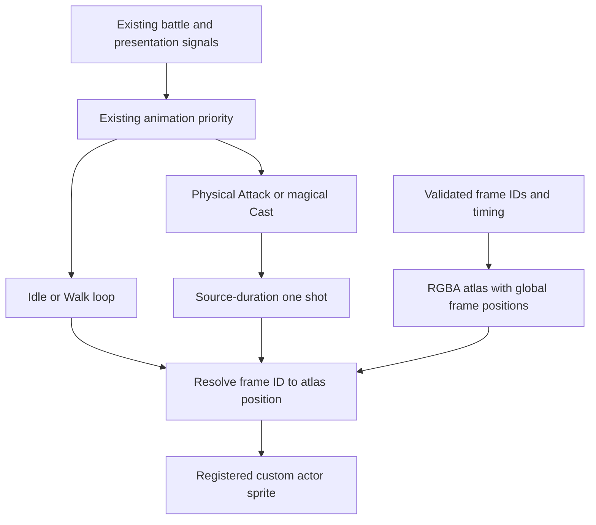

# Action clips in the pixel studio

[Pixel editor](PIXEL_ANIMATION_STUDIO.md) · [Level studio](LEVEL_STUDIO.md) · [Animation runtime](ANIMATION_PIPELINE.md)

The Pixels editor can author independent **Idle**, **Walk**, **Attack** and **Cast** clips. Each owns 1–4 frames, with at most sixteen source frames. This extends the pixel pilot; direction sets and separate hurt/guard/victory/downed artwork remain planned.

## Convert and edit

1. Select **Create action clips** in an existing pixel project.
2. Original frames become Idle. Walk, Attack and Cast receive independent copies with fresh stable IDs. No new poses are invented; paint the copies to create distinct art.
3. Choose **Animation clip**. Its timeline, onion skin, duplication/deletion/reordering and audition use that clip's frames.
4. Idle and Walk loop. Attack and Cast play once and hold their last frame until presentation ends. Each uses source frame durations.
5. Apply, save/export and playtest. Movement selects Walk; physical skills select Attack; magical/support skills select Cast.

Frames belong to exactly one action. Duplication creates an independent owned frame. Deletion cannot empty a clip. Stable references survive atlas reordering. Palette/layers and pivot remain shared across the document.

## Runtime selection

Actions begin after the actor reaches its visual destination. Custom action presentation lasts the sum of source durations; it does not delay combat resolution. Hurt, guard and victory use Idle artwork. Downed holds the final Idle frame with the existing rotated presentation. Reduced motion holds the first selected-clip frame, except the static downed pose.

The preview inspector reports current state and last active walk/attack/cast clip. These are presentation diagnostics, not combat commands or extra RNG rolls.

## Compatibility and export

Optional **clips** in pixel-source version 1 has exactly idle/walk/attack/cast keys with ordered stable frame IDs. Every source frame must be assigned once. Missing, shared, orphaned, empty and overfull references reject.

Old sources without clips retain their shared-loop behavior and four-frame limit. Import does not convert them automatically. Earlier studio builds reject the new field; use the current studio for enhanced projects.

PNG packs every source frame in atlas order, up to 256×24. Clip playback order, layers, pivot and timing remain in project JSON. Atlas order and clip playback order need not match.

The existing 128 KiB UTF-8 limit applies to export and import. Rich projects use compact JSON when pretty formatting would exceed it. Formatting changes never remove source fields.

## Verification and limits

Eight added tests cover conversion/independence, strict references, owned operations, timing boundaries, legacy behavior, 16-frame RGBA packing and file limits, atomic project/history round trips, and real physical/magical command classification without extra RNG. The suite has 166 tests.

Browser checks should edit states, audition, export/reimport, then trigger movement, weapon attacks and spells while observing the inspector. Direction editing, multiple actor documents, image-file import and standalone complete-game packaging remain planned.
