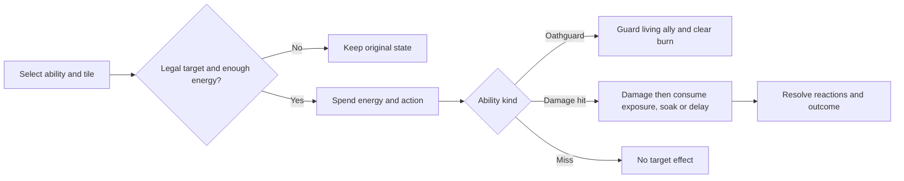

# Advanced job abilities

[Documentation index](README.md) · [Jobs and abilities](JOBS_AND_ABILITIES.md) · [Mastery](MASTERY_AND_SUPPORTS.md)

Version 0.5 adds one distinct native ability to each advanced job. Primary jobs grant these abilities immediately. Secondary sets require permanent learning, at the existing 60-JP price from an unlocked teaching job. Enemies using those primary jobs also gain their new abilities.

| Job          | Ability       | Energy | Range | Power | Area        | Tactical use                                     |
| ------------ | ------------- | -----: | ----: | ----: | ----------- | ------------------------------------------------ |
| Shadowrunner | Gloam pursuit |      9 |     2 |    30 | Single      | Consume Exposure for a strong physical follow-up |
| Runewarden   | Oathguard     |      8 |     3 |     0 | Single ally | Guard an ally and cleanse burn                   |
| Storm Herald | Rain of glass |      8 |     4 |    12 | Cross       | Soak enemies before lightning attacks            |
| Chronoweaver | Stolen hour   |      9 |     4 |    14 | Single      | Damage and delay an enemy activation             |

## Resolution rules

**Gloam pursuit** adds 12 damage before guard/synergy/critical multipliers when the target is exposed. The ordinary Exposure bonus of 7 also applies. A successful hit consumes Exposure; a miss preserves it. There is no teleport, extra movement or guaranteed hit.

**Oathguard** targets a living ally, including the caster. It grants the existing 45% guard reduction and clears burn. It cannot revive, does not remove other statuses and does not extinguish burning terrain. Multiple sources of guard do not stack. Guard lasts until the recipient's next activation; a self-cast remains active through the caster's end turn. The preview shows damage reduction rather than a timeline effect.

**Rain of glass** deals spirit-based magical damage to enemies in its cross. Successful hits apply three activations of soak, refreshing an existing shorter or longer duration to three. Allies are spared. Terrain remains unchanged: rain does not flood tiles, extinguish grass or freeze water. Glasslight bolt can then use the ordinary 1.5× wet-target multiplier. New companies give Ilya this skill with her starter Storm Herald secondary; older saves preserve their existing learned collection.

**Stolen hour** deals spirit damage and adds 30 to a surviving target's readiness on a successful hit. It does not apply slow, undo an action or change the target's speed. Lethal hits do not delay a fallen target. The ordinary range, line-of-sight, energy and once-per-activation action rules apply to all four abilities.

## Enemy behavior and feedback

Storm Heralds and Chronoweavers prefer ranged positioning. The planner values surviving-target delay and rain setup when a nearby ally can cast lightning. It can cast Oathguard on a threatened ally who will not immediately lose guard to an activation, and use Borrowed dawn for a sufficiently delayed ally. It still uses approximate one-step scoring, not a coordinated multi-turn search or a complete reaction forecast.

The tile inspection panel displays active burn, slow, exposure and soak counters, plus guard. Buff previews distinguish 45% protection from the 35-tick Borrowed dawn advance. Damage previews include Gloam pursuit's conditional bonus but still precede support reactions and critical rolls.

## Saves, training and mastery

The save format remains v2 and needs no new unit fields. Existing learned skills, support ownership, equipment and active battles remain valid. New native skills become available when their job is primary; old secondary learned sets do not silently gain the new IDs. The existing v1 migration builds the migrated secondary set from current job definitions.

Mastery is derived from all current native skills, so an expanded job board may need its new skill learned before it displays as mastered. Already purchased support lessons stay owned, equipped and effective. Additional ordinary learning can increase the JP needed to afford the support lesson; spending never lowers lifetime JP or job unlocks. Older app versions cannot read saves containing the new skill IDs, so downgrading is unsupported.
