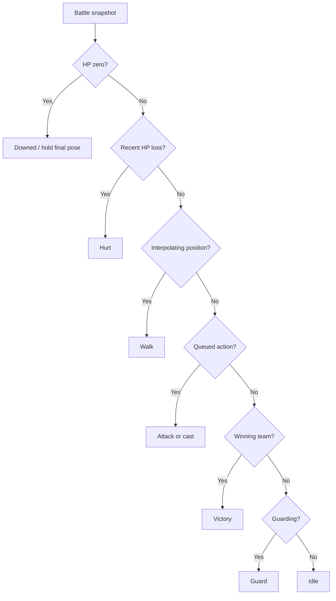

# Character animation pipeline

[Documentation index](README.md) · [Original portrait atlas](SPRITE_ART.md) · [Exact generation prompts](animation-prompts.json) · [Live workbench](https://cptnope.github.io/Echoes-of-the-Shattered-Crown/animation-review.html)

Version 0.7 adds eight job sheets, each containing 32 painted frames: **256 frames in total**. The built-in OpenAI image-generation tool generated each transparent PNG using the project's original company atlas as its visual reference. This describes provenance, not a license grant.

## Asset contract

| Property | Production value |
| --- | --- |
| Jobs | Vanguard, Blade Dancer, Arcanist, Lifebinder, Shadowrunner, Runewarden, Storm Herald, Chronoweaver |
| Source masters | Eight 887 × 1774 RGBA PNG files, delivered separately as echoes-animation-masters.zip |
| Runtime | Eight WebP files in public/art/animations, 6,234,008 bytes combined |
| Grid | Four columns, eight rows, four frames per clip |
| Cell size | 221.75 × 221.75 pixels; use fractional UVs, not integer division |
| Metadata | manifest.json: dimensions, ground anchors, idle scale, bounds, opacity counts, SHA-256 hashes |
| View | Single three-quarter view, camera-facing billboards; enemies mirrored and warm tinted |
| Identity | Appearance follows primary job; companions and enemies sharing a job share its sheet |
| Original atlas | Retained for portraits, initial loading and failure fallback |

## Clip table

Rows and frame numbers are zero based. All clips have four frames.

| Row | State | Frame duration | Playback | Trigger |
| --- | --- | --- | --- | --- |
| 0 | Idle | 220 ms | Loop | Living unit at rest |
| 1 | Walk | 100 ms | Loop during interpolation | Position changes |
| 2 | Attack | 110 ms | Once, 440 ms | Physical skill |
| 3 | Cast | 140 ms | Once, 560 ms | Other skill elements, including support/healing |
| 4 | Hurt | 95 ms | Once, 380 ms | HP decreases |
| 5 | Guard | 240 ms | Loop | Guard flag |
| 6 | Victory | 220 ms | Loop | Surviving unit on winning team |
| 7 | Downed | 150 ms | Once, hold final frame | HP reaches zero |

A loaded downed unit starts on its final pose. Revival returns to a living state. Reduced motion uses stable representative poses; walk becomes idle and downed holds frame four. No animation completion changes damage, resources, RNG, readiness or turn order.



## Renderer and event contract

[src/animation.ts](../src/animation.ts) owns pure clip selection. [src/scene.ts](../src/scene.ts) changes texture UVs and ground registration; it does not allocate textures per frame. A shared image/source per job gives each actor independent UV transforms, with texture resources disposed at battlefield teardown.

Valid skills record optional Battle.lastAction with unit, skill and turn. This carries a cosmetic cue across an AI turn snapshot. Repeated snapshots and initial save loads do not replay old cues. Existing v2 saves without the field remain valid. Invalid cues are rejected by save validation. Physical versus cast animation follows skill element, including learned secondary abilities.

The manifest and present jobs load lazily using Vite's base URL. The original atlas and procedural fallback keep the game usable during loading or a failed request. Artwork is not fetched from a generation service at runtime. Static portrait art stays separate.

Ground anchors use high-alpha pixels within the middle of each cell. A job's idle silhouette height sets a consistent scale across all its clips; collapsed bodies remain shorter. Registration reduces foot sliding but does not make generated poses anatomically identical. Four-frame hand-painted motion has visible pose changes; this is a development art set.

## Rebuild and verification

Extract the master archive next to the project folder, or provide its directory:

```sh
npm ci
npm run art:build -- ../echoes-animation-masters
npm run art:verify
npm test
npm run build
```

The build script encodes the unmodified generated PNGs with [Sharp WebP output](https://sharp.pixelplumbing.com/api-output/#webp), quality 90 and alpha quality 100. It derives registration and hashes from the decoded runtime files. It does not draw replacement frames. Commit all eight WebP files and the matching manifest together. Master PNG SHA-256 values in the manifest identify the delivered sources.

Local verification decodes all sheets, checks grid metadata, alpha occupancy, 32 distinct cell hashes per job, and file checksums. Pages verification checks deployed bytes against the manifest too. These checks detect missing/changed assets; artistic quality still needs a visual review.

## Review workbench

Open animation-review.html locally or on Pages. Select a character, pause, or step all clips through frames one to four. The company canvas cycles through eight states; Record creates a twelve-second WebM reel where supported. Reduced motion is available explicitly and respects the system preference initially.

The lower fixture section uses the production battlefield renderer with isolated snapshots. Its buttons exercise movement, cues, damage, guard, down/revive and victory without touching saved companies. Frame indices and GPU texture counts are visible for review. Fixtures are visual checks, not proof of legal combat commands; deterministic command and save behavior are tested separately.

## Current boundaries

There are no directional/back-view sheets, dedicated run/item clips, gear variants, weapon-specific attacks or bespoke character portraits beyond the current job identities. Cast is a generic job pose, including support abilities. Additional directions and longer motion cycles remain future production work.

AI actions can deliver movement and damage in the same rules snapshot; the renderer queues an actor's action until its travel finishes, while the target can recoil immediately. This is cosmetic sequencing and does not delay authoritative combat resolution.

