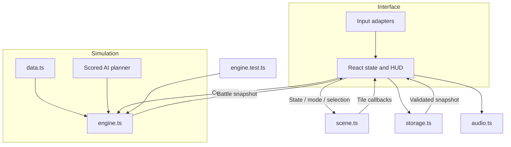
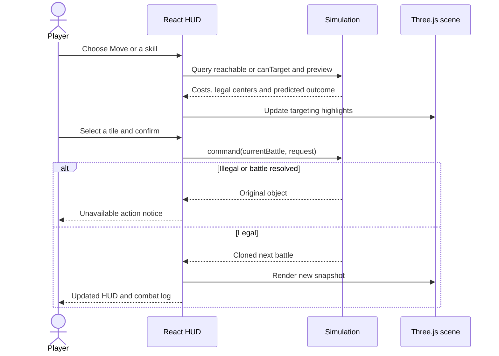

# Architecture

[Documentation index](README.md) · [Development](DEVELOPMENT.md) · [Data and saves](DATA_AND_SAVES.md) · [Complete system flows](SYSTEMS_GUIDE.md)

## Decision history

See the [ADR index](adr/README.md) for the rationale behind the current simulation, browser stack, company/battle split, stable content IDs, local saves, cosmetic effects, art pipeline and Pages delivery. Existing implementation choices are recorded retrospectively with unknown original dates rather than invented approval history.

[ADR-0010](adr/0010-proposed-variable-board-and-roster-contract.md) is Proposed and links open D-01/D-02/D-12; it does not replace current fixed board/roster invariants. New material reversals should have a successor ADR and explicit compatibility evidence.

## Boundaries

The separate [level studio pilot](LEVEL_STUDIO.md) owns LevelProject source, revisioned edits and checkpoints in studio-project.ts. It compiles fresh Battle snapshots for the existing engine/scene and does not call campaign persistence or settlement.

React owns an Expedition containing a Company profile, a battle snapshot and camp/battle stage, plus presentation state. The pure engine validates gameplay commands and computes a next snapshot. Three.js renders that state and sends tile-selection callbacks upward. Camera movement, animation frames and audio never decide a combat outcome.

| Module                           | Owns                                                                        | Must not own                                                    |
| -------------------------------- | --------------------------------------------------------------------------- | --------------------------------------------------------------- |
| `campaign.ts`                    | Profile projection, settlement, training, purchases and v1 migration        | DOM or renderer-owned outcomes                                  |
| `Camp.tsx`                       | Contract selection, roster, learning and outfitter controls                 | Independent economic or combat formulas                         |
| `equipment.ts` / `encounters.ts` | Gear, proficiency, bonuses, mission metadata and gates                      | Mutable progression                                             |
| `data.ts`                        | Typed job/skill records, JP levels, unlock checks                           | Browser state or mutable battle outcomes                        |
| `engine.ts`                      | Map/roster creation, legal actions, rules, seeded rolls, AI, validation     | DOM, React, WebGL, real-time animation                          |
| `main.tsx`                       | HUD, dialogs, input mapping, notices, targeting, UI settings, scheduling    | Independent damage or movement formulas                         |
| `scene.ts`                       | Terrain geometry, sprite textures, camera, visual interpolation, highlights | Hits, damage, resource spending or turn advancement             |
| `storage.ts`                     | Atomic manual/backup records and decoded fallback load                      | Combat resolution (migration is delegated to campaign decoding) |
| `animation.ts / animation-art.ts` | Character clip selection and cached image loading | Combat timing or outcome decisions |
| `combat-effects.ts` | Pure effect recipes, target geometry and visual sampling | Resource spending or gameplay RNG |
| `effect-renderer.ts / effect-art.ts` | Pooled effects, atlas UVs, particles, fallback and teardown | Authoritative hit or status resolution |
| `portable.ts / BackupDialog.tsx` | Validated export/import and candidate review | Silent replacement before restore approval |
| `audio.ts`                       | AudioContext, synthesized notes and playback timer                          | Gameplay time or random combat rolls                            |

## Command lifecycle

The application uses original-object identity as the rejected-command signal. Never mutate the input snapshot inside a new rule: it would undermine both that signal and deterministic tests. `structuredClone()` supplies a small, simple immutable transition boundary; this implementation has no event bus, replay file format or ECS framework.

## Engine surface

| Export                                              | Purpose                                                             |
| --------------------------------------------------- | ------------------------------------------------------------------- |
| `createBattle(seed?)`                               | Construct the Veyr map and eight-unit roster; default seed 74319    |
| `command(state, request)`                           | Apply a move, skill or turn ending                                  |
| `aiTurn(state)`                                     | Compute one enemy activation using the same rules                   |
| `reachable(state, unit)`                            | Map reachable coordinates to movement costs                         |
| `canTarget(state, unit, skill, x, z)`               | Validate a target center and resources                              |
| `preview(state, attacker, defender, skill)`         | Predicted amount, accuracy, flank, height and lightning combination |
| `lineOfSight(state, from, to)`                      | Discrete obstacle/height sampling                                   |
| `availableSkills(unit)`                             | Merge primary, secondary and shared skills                          |
| `changeJob(state, id, primary, secondary)`          | Preserve JP and enforce the initial-turn loadout gate               |
| `validateSave(raw)`                                 | Safely reject incompatible or malformed snapshots                   |
| `activeUnit`, `living`, `tileAt`, `distance`, `key` | Small queries and coordinate helpers                                |

These are application functions, not a stable public package API. Types are exported for composition and testing; a future change can refine their contracts along with tests and documentation.

## Determinism

The seed is part of `Battle`. Accuracy and critical checks advance it inside the engine. Neither `Math.random()` nor wall-clock time participates in simulation. Given identical content definitions, initial state and ordered commands, repeated simulation should produce identical snapshots.

Rendering uses time for bobbing, camera easing and shard rotation; audio uses a timer; enemy turns use a cancellable delay. Those affect presentation only. The save wrapper's timestamp is metadata outside the deterministic battle. Tie-breaking currently uses string `localeCompare()`; cross-runtime lockstep certification has not been performed.

## Enemy scheduling and menus

React schedules the next enemy activation only while the result is `playing`, the active team is enemy and no dialog is open. Its effect cleanup cancels stale timeouts. The planner computes position and ability choices synchronously over the small board. Menus pause the delay rather than running AI in the background. There is no worker-thread AI or multi-turn search.

## Rendering lifecycle

`Battlefield` creates one WebGL renderer, an orthographic camera, terrain/marker groups and actor sprites. `ResizeObserver` adjusts the frustum to the host aspect ratio. A requestAnimationFrame loop interpolates the camera and unit positions. `update()` refreshes highlights, sprite classes, health labels and relevant tile colors from state. `dispose()` cancels the loop, removes observers/listeners, disposes graphics resources and clears the host.

Original sprites are camera-facing billboards backed by CanvasTextures. Grid interaction raycasts the tile meshes; visual scenery does not replace rule-level LOS. Foreground fading is view-based rather than exact character occlusion.

## Decisions and extension pressure

| Decision                      | Why it fits this slice                                      | Revisit when                                                                     |
| ----------------------------- | ----------------------------------------------------------- | -------------------------------------------------------------------------------- |
| React local state             | One battle and a few dialogs need no extra store dependency | Campaign, inventory and cross-screen state grow                                  |
| Cloned snapshots              | Clear validation and tests on eight units                   | Profiling shows cloning dominates large encounters                               |
| Typed content records         | Simple additions and compile-time IDs                       | Modding or external content validation becomes a requirement                     |
| 9×9 fixed encounter           | Keeps one authored battlefield coherent                     | Adding maps; coordinate dimensions must reach renderer, validator and input code |
| Procedural art/audio          | Original, reproducible assets without extracted material    | Full animation and authored music production                                     |
| Versioned expedition snapshot | Captures company, deployment baseline, active rules and RNG | More migration versions, export or a branching story campaign                    |

The engine is separate from rendering, but content loading is not yet generalized. New maps, jobs or statuses require coordinated edits; they are not arbitrary drop-in JSON plugins. See [development recipes](DEVELOPMENT.md).

## Company boundary in 0.2

`campaign.ts` keeps pre-deployment profiles separate from field units. Departure restores resources and projects owned gear/learned skills into a fresh encounter. Settlement copies earned field progress back and pays a contract once; retry projects the original profile again. `unitStats()` derives gear-adjusted values for both UI and engine queries. Save includes both layers and supports the legacy v1 battle wrapper. See [company progression](COMPANY_AND_PROGRESSION.md) and [data and saves](DATA_AND_SAVES.md).

| Campaign export                                           | Contract                                                                            |
| --------------------------------------------------------- | ----------------------------------------------------------------------------------- |
| `createExpedition()`                                      | Starter company, inventory and camp stage                                           |
| `depart(game, encounterId)`                               | Check route gate, project roster and increment deployment serial                    |
| `returnToCamp(game)`                                      | Settle a terminal battle exactly once, retain field progress and pay victory bounty |
| `retryContract(game)`                                     | Restore the saved deployment profile and start another attempt                      |
| `setMemberJob(game, id, primary, secondary)`              | Camp-only job selection with prerequisite checks and incompatible-gear removal      |
| `train(game, id, job, skill)`                             | Spend that job's unspent JP once to permanently learn an ability                    |
| `equip(game, id, slot, item)`                             | Camp-only proficiency and shared-copy reservation                                   |
| `purchase(game, item)`                                    | Camp-only purchase without overdrawing gold or exceeding item caps                  |
| `validateExpedition`, `decodeSave`, `migrateLegacyBattle` | Current format compatibility, wrapper decoding and supported v1 migration           |

`createBattle(seed, encounterId)` still returns an independent bare combat fixture with no equipped items; company deployment overlays the roster and derived maximum HP. This keeps engine tests independent from inventory. Enemy jobs do not require player unlock progression.

## Character art and belfry extension

`sprites.ts` owns async atlas loading, alpha-bound normalization, per-job/team canvas caching and procedural fallback. `Portrait.tsx` renders closer square crops and redraws after load. `scene.ts` refreshes live textures after load, uses faction ground markers and displays attack/damage feedback without altering rules. The approximately 2.7 MB atlas is served under the same base path as the app.

The optional `Battle.bossAwakened` flag belongs to encounter state. Rule resolution triggers Orren’s awakening once; it does not depend on animation or elapsed wall time. First-clear relic settlement belongs to the company layer.

## Mastery and supports

`supports.ts` defines eight lessons, mastery requirements, support-derived bonuses and validation. `campaign.ts` owns JP purchases and camp-only slot changes; `engine.ts` consumes bonuses and resolves nonrecursive reactions after damage. Optional profile/unit fields preserve v2 compatibility. Mastery is derived rather than stored. Six support test cases cover learning, ownership/slots, real stats, reaction timing, lethal retaliation and malformed/older saves.

## Recovery and portable files

`portable.ts` validates, serializes and parses the bounded JSON envelope without browser dependencies. `BackupDialog.tsx` owns file selection, local download, candidate review and focus management. `storage.ts` serializes recovery writes and rotates current/previous recovery in IndexedDB independently from manual slots. App startup gates new recovery writes and battle input/AI until the previous recovery is checked and the player chooses Resume or Start new. Camera, audio and menu state are not part of the saved expedition.

## Proposed authoring architecture

The [studio plan](studio/README.md) proposes a canonical rich-source project, shared typed edit transactions, one preview/export runtime, buildable source extensions and separate complete-game/play-only artifacts. [ADR-0011](adr/0011-proposed-editable-game-project-and-build-artifacts.md) captures the package boundary; [ADR-0012](adr/0012-proposed-shared-music-and-sfx-graphs.md) covers shared music/SFX graph semantics. Neither is an adopted runtime change.

## Expansion contracts

The [current systems guide](SYSTEMS_GUIDE.md) traces every implemented player path. [Proposed engine contracts](roadmap/ENGINE_AND_SYSTEMS.md) cover variable board/roster definitions, objective reducers, ordered presentation events and future migrations. They are not current schemas. Start expansion with the fixed-assumption audit and baseline fixtures, preserving the rule/presentation boundary.
