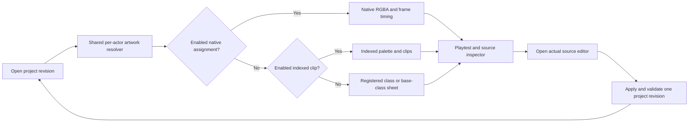

# Artwork consistency and editable sources

[Documentation](README.md) / [Asset library](ASSET_LIBRARY.md) / [Generated content audit](CONTENT_SYNC_REPORT.json)

Studio playtests, per-actor inspection and sprite-edit routing now share one artwork resolver. A renderer cache correction prevents dedicated class textures from being stored under a different base-class key. This matters when custom classes and their base classes appear together: each texture must match its own frame geometry and artwork.

## Repair an older project

Open **Assets & ability feedback**. **Current cast artwork** shows the real actor names, class names, thumbnail and active source for every placed actor. A 16 by 24 indexed override is identified as low-resolution. A native override using another class's sheet is identified as a different skin. Such overrides can be intentional; the source is retained.

Choose **Use class art for current cast** to disable active native and indexed overrides for the current roster. Or choose **Use class art for actor** on one row. This is one applied project transaction: Undo restores the previous appearance, and every original pixel and frame duration remains stored. Unplaced assignments remain available. Disabled sources are still editable and may be re-enabled deliberately.

Warnings in **Project validation** now link directly to the affected artwork row. Native overrides suppress indexed clips for the same actor in both the renderer and inspector. Importing another project remounts editor drafts so pending content from the previous project cannot remain in a source-less sprite editor.

## Edit what is actually rendered

| Active source | Edit action | Preserved source |
| --- | --- | --- |
| Native assignment | Edit sprite for actor opens that stored assignment | Embedded original image, full RGBA patches and 32 frame timings |
| Indexed clip | Edit sprite for actor opens Small indexed sprite | Palette, layers, cels, clips, pivot and timings |
| Automatic class sheet | Edit sprite for actor preselects the correct sheet and current actor; Load game sheet starts a draft | Original shipped artwork remains unchanged until an actor override is applied |

Both sprite editors use the current roster names and IDs, including named custom enemies. An assignment for an actor absent from the current mission remains labelled unplaced. The indexed format still represents one active actor clip; the native library supports up to 24 actor assignments.

## One revision across editors

The inspector's **Editable project sources** disclosure opens the current map, actors/dialogue, gameplay catalogs, terrain textures, original score, sound cues and music pattern. Counts come from the actual source, and playtests compile that same revision. Exports carry authored fields and embedded native artwork. These editors do not write directly into an existing main-campaign save.

| Current domain | Visual editing support |
| --- | --- |
| Maps and encounters | Terrain, elevation, collision, rectangular dimensions and placements |
| Characters and monsters | Names, classes, resources, learned skills, loadouts and reusable enemy snapshots |
| Gameplay content | Existing-mechanic ability definitions, class definitions, gear and proficiencies |
| Native sprites | Fourteen registered class sheets, all eight states, source pixels, alpha and timing |
| Indexed sprites | Palette, layers, four clip states and timing; current custom enemy bindings supported |
| Level appearance | Terrain palettes and top-face PNG textures |
| Story and progression | Linear briefings, contract gates, rewards and first-clear relic definitions |
| Music and sound | Procedural game-score parameters, music patterns and layered shared sound cues |
| Ability presentation | Existing VFX-family choice and sound-cue pairing |
| Scenery geometry, new VFX bitmaps, sampled audio and complete campaign packaging | Require repository/source work; complete visual editors remain future work |

## Audit and regression evidence

`npm run content:audit` regenerates [CONTENT_SYNC_REPORT.json](CONTENT_SYNC_REPORT.json). Documentation verification checks the report against all ten canonical mission factories, their published JSON, compiled rosters and registered editable artwork. It verifies fourteen class sheets and 448 frames; image integrity and decoded frame metadata are checked by the existing art verifier.

Ten new regressions cover texture ownership in both load orders, all four dedicated/base-class pairs, native/indexed precedence, non-destructive repair and Undo, current custom enemy bindings, all ten canonical sources, linked artwork warnings and cross-editor export/compile ownership. The full suite has 263 tests. No new generated sprites replace the user's artwork silently.
