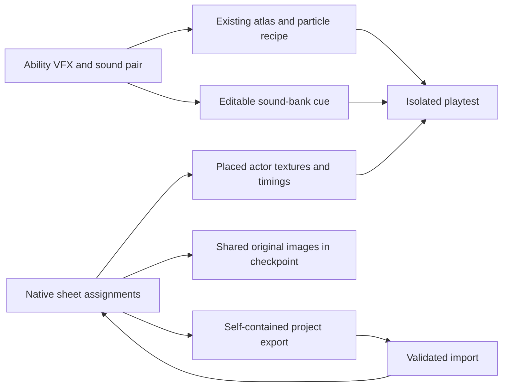

# Asset library and ability feedback

[Documentation](README.md) / [Native pixel editor](NATIVE_SPRITE_STUDIO.md) / [Sound effects](SOUND_EFFECTS_STUDIO.md) / [ADR-0021](adr/0021-multiple-native-assets-and-cosmetic-cues.md)

Open **Assets & ability feedback** in the studio. Native sheets are assigned independently to actors; ability feedback pairs existing VFX and editable sound-bank cues. These are project sources used by isolated playtests, history, checkpoints and export/import.

## Character sheet library

Use **Add character sheet** to open Pixels / native mode on a new assignment. Choose the actor and one of the eight shipped game sheets, load it, edit pixels or timings, then Apply. Applying preserves other assignments and replaces only a matching target actor. To copy an existing edit to another actor, select that actor in Preview actor and apply; the old assignment remains.

**Stored native sprite** chooses an existing assignment for editing. The asset library lists each actor, source class, dimensions, enabled state and 32-frame count. Edit, disable/enable or remove an assignment through its buttons. Removal is an undoable project edit and falls back to normal class artwork or an applicable indexed override. Unplaced assignments remain stored when switching missions; the renderer only binds placed actors.

| Contract | Bound |
| --- | --- |
| Native assignments | Up to 24, exactly one per actor |
| Actor identities | Shipped identities or validated enemy-prefixed instance IDs |
| Artwork sources | Eight shipped native sheets; all 32 frames and RGBA precision retained |
| Source geometry | Original width/height and registration; independent timing and sparse pixel overrides |
| Legacy source | Optional nativeSprite object remains readable; 8 MiB export/import limit |
| Library source | Optional nativeSprites array, exclusive with legacy object; 32 MiB export/import limit |
| Local checkpoint | One original-image entry per digest, with independent compact assignment metadata |

Adding through the new UI converts the legacy assignment to the array without discarding it. JSON exports embed each original, so they remain self-contained; repeated originals are deduplicated only in local checkpoint storage. Browser storage quotas may be smaller than the portable export budget. Failed saves report the error; export JSON to retain work. There is no automatic image eviction, compression migration or unlimited storage claim.

## Per-ability paired feedback

Choose **Feedback ability**, **Visual effect family** and **Ability sound cue**, then **Apply ability feedback**. Scoped custom abilities appear alongside shipped ones. **Use automatic feedback** removes the explicit binding; apply the draft to restore inherited behavior.

| Part | Behavior |
| --- | --- |
| VFX family | One of thirteen existing ability recipes and its atlas/particles |
| Sound cue | Hit, Miss, Heal or Buff from the applied editable bank; default bank when absent |
| Miss outcome | Keeps Miss regardless of the chosen successful-outcome cue |
| Terrain-only cast | Explicit binding can play its cue even with no unit outcomes |
| Gameplay | Costs, range, area tiles, damage, statuses, RNG and effect seed remain unchanged |
| Deduplication | A resolved action plays each selected event once; repeated action identity does not replay |

Edit sound layers in **Sound effects**. A cue is shared: changing Heal changes every ability bound to Heal. This iteration does not create independent per-ability clips, edit VFX bitmap pixels, expose particle graphs, import WAV/OGG samples or expand the music sequencer. It binds existing editable sources and presentation families.

An explicit binding can use sound-bank playback even when the original game score is enabled. The score's ordinary command feedback can still play alongside it. Audio requires the preview sound toggle and browser activation; source tests do not prove device audibility.

## Compatibility and validation

Existing version-one projects remain readable. Older builds reject the new optional fields. Duplicate actor assignments, unknown actor syntax, conflicting image digests, unknown ability IDs and invalid VFX/cue names reject atomically. Removing an ability requires clearing its feedback binding first. Balanced mission presets retain assignments and matching feedback IDs, pruning bindings whose custom abilities disappear from the replaced catalog. Native sources may remain unplaced intentionally.

Ten tests in [studio-assets.test.ts](../src/studio-assets.test.ts) cover independent edits, native library bounds, shared-image storage, missing/quota recovery, large portable exports, history, custom identities, cue rejection, cosmetic/gameplay isolation and mission switching. The full suite has 222 tests.
