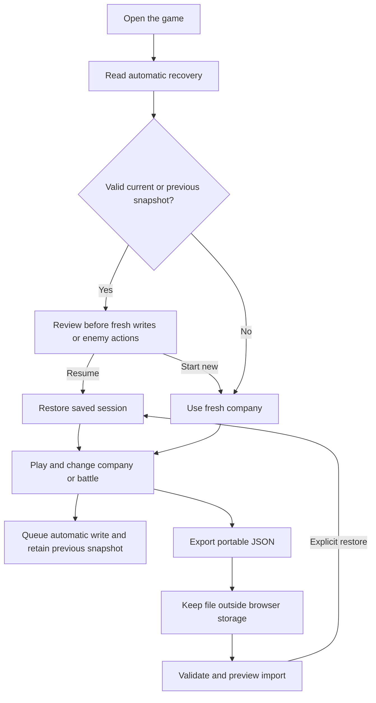

# Backups and automatic recovery

[Documentation index](README.md) · [Save data](DATA_AND_SAVES.md) · [Player guide](PLAYER_GUIDE.md)

Version 0.6 adds two ways to keep a company beyond its current tab: automatic browser recovery and portable JSON files. Both include the persistent company and active battle, including jobs, JP, learned skills/supports, equipment, inventory, resources, statuses, turn order and RNG state. Neither is cloud synchronization.

## Reopening after a closed tab

When a valid automatic snapshot exists, the game opens a **Resume your company?** review. It shows companions, treasury, cleared contracts, camp or battle position, turn and backup time. Choose **Resume recovery** to continue that snapshot, or **Start a new company** to continue with the fresh company. You can export the recovery to a file before deciding.

The startup check finishes before any fresh company is automatically saved. The previous recovery is not overwritten while the review is waiting, even if you close the review's tab and reopen again. Enemy turns and gameplay input pause until the choice is made. A recovered enemy turn continues normally after Resume.

Automatic writes follow company/battle changes and are queued in order within a page. Each transaction retains the previous decodable recovery, then writes the latest snapshot. If the primary is damaged, loading tries the previous snapshot. **Backups** displays whether automatic recovery is checking, saving, saved, or unavailable.

Abrupt closure can lose an IndexedDB write still in progress. Browser data clearing, private-mode restrictions and storage failures can remove recovery entirely. There is no unload-time guarantee, cloud copy or multi-tab conflict resolution. Keep an exported file for important progress. Versions before 0.6 did not create automatic recovery; an older manual save remains available through **Load save**.

## Export and restore a file

1. Open **Backups** from camp or the battle save controls.
2. Choose **Export current company**, then keep the downloaded JSON file. In the startup review, **Export recovery backup** exports the recovery candidate instead of the fresh company behind it.
3. To restore a file, choose **Import a backup** and select the JSON file.
4. Inspect the displayed company, gold, position, turn and timestamp. Selection alone does not change the game.
5. Choose **Restore reviewed backup**, or cancel the preview and return to the current company.

Restoring replaces the current in-memory session and updates automatic recovery. It does **not** overwrite the manual save. Use Save company/Save battle afterward if you want the restored session in the manual slot. Invalid files leave the current company unchanged. Files are read locally; importing does not upload game data to a service.

## Four browser slots

| Slot              | Purpose                               | Written by                   |
| ----------------- | ------------------------------------- | ---------------------------- |
| `manual`          | Explicit player checkpoint            | Save company / Save battle   |
| `backup`          | Previous decodable manual checkpoint  | The next explicit save       |
| `recovery`        | Latest automatic session snapshot     | Company/battle state changes |
| `recovery-backup` | Previous decodable automatic snapshot | The next automatic write     |

The IndexedDB database remains `echoes-crown`, schema version 1, store `saves`. These slots are shared by tabs on the same origin. Use one active game tab when preserving a single expedition; another tab can write a different recovery. Export/import can transfer a company between devices, browsers and origins without changing the game rules.

## Portable format and validation

| Field        | Meaning                              |
| ------------ | ------------------------------------ |
| `format`     | `echoes-crown-save`                  |
| `version`    | Portable envelope version `1`        |
| `exportedAt` | ISO timestamp; display-only metadata |
| `game`       | Valid expedition format version `2`  |

The file limit is **1 MiB of UTF-8 data**, checked before JSON parsing and on export. The parser accepts the portable envelope, native `{ game: ... }` records and supported legacy `{ battle: ... }` records through the existing migration path. Unknown envelopes, incompatible versions and invalid company data are rejected. Optional fields with `undefined` values disappear in JSON; their absence keeps the same meaning.

No checksum, encryption, account, password, runtime code execution or cross-tab merge is added. These are compatibility and shape checks, not proof that a save was earned without editing. Older application versions may reject newer skill IDs or discard support data, so do not downgrade a progressed company.
