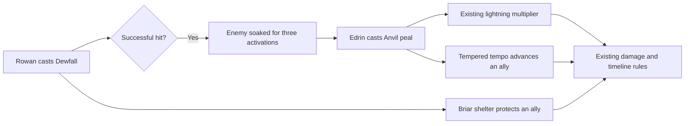

# The Briar Resonance

[Documentation](README.md) / [Mission library](MISSION_LIBRARY.md) / [Artwork editing](ARTWORK_SYNC.md)

Open **Enemy templates / Playable mission presets / The Briar Resonance**, then choose **Load mission preset** and **Playtest revision**. This standalone 24 by 20 encounter introduces two classes, two playable profiles, two named rivals, six abilities, five gear pieces and two original 32-frame sheets. Defeat all six foundry defenders. Pools and the bell are scenery and tactical terrain, not interactable objectives.

## Cast and class roles

| Character | Current source slot / team | Class | Role and identity |
| --- | --- | --- | --- |
| Rowan Briar | `sera` / playable | Thorn Warden | A road keeper who protects allies, restores health and prepares soaked targets |
| Edrin Bellforge | `ilya` / playable | Resonant Smith | A displaced forge apprentice who follows soaking with lightning and controls timing |
| Joren Ashbrook | `corin` / playable | Dawn Duelist | Returning mobile physical attacker |
| Nera Coldmere | `mae` / playable | Frost Sentinel | Returning guard, recovery and frozen-crossing specialist |
| Warden Senna Moss | `enemy-ember-scholar-ashen-weir` / enemy | Thorn Warden | Rowan's former colleague; protects the foundry watch |
| Foreman Garron Rusk | `enemy-cinder-clock-ashen-weir` / enemy | Resonant Smith | Claims Edrin's teacher's bell and threatens the same lightning combination |

Captain Ysra, Darian Sunscar, an Ash Sentry and a Lantern Mender complete the opposing formation. Every placed defender has a matching reusable enemy template. Rivals share their class sheet with the corresponding playable profile; this pack supplies two unique sheets, not four. Stable inherited enemy IDs keep template references compatible.

These profiles occupy existing company slots in this source project. They do not add reserve-roster slots or recruits to the main campaign. The original missions, Lantern Parley and Frostglass Vigil retain their own casts. All previous project classes remain available in this pack's editable catalog.

| New class / stable ID | Gameplay base | Move / speed | Attack / armor / magic | Main skills |
| --- | --- | --- | --- | --- |
| Thorn Warden / `custom-thorn-warden` | Lifebinder | 4 / 11 | 4 / 6 / 8 | Briar shelter, Dewfall, Green mending |
| Resonant Smith / `custom-resonant-smith` | Stormherald | 4 / 10 | 6 / 5 / 9 | Anvil peal, Dissonant strike, Tempered tempo |

These are base numbers before equipment. Rowan starts with Vanguard secondary access and learned Cleave. Edrin has Arcanist secondary access and learned Frost. Both classes are available without extra unlock requirements within this project.

## Abilities and combinations

| Ability / stable ID | Existing base | Energy / reach / power | Supported behavior |
| --- | --- | --- | --- |
| Briar shelter / `custom-briar-shelter` | Aegis | 6 / 2 / 0 | Guard one living ally; 45 percent damage reduction until their next activation, burn cleansed |
| Dewfall / `custom-dewfall` | Raincall | 7 / 3 / 10 | Spirit cross, radius 1; successful hits soak enemies for three activations |
| Green mending / `custom-green-mending` | Mend | 7 / 3 / 26 | Heal and cleanse burn, or revive at the existing fixed 24 HP |
| Anvil peal / `custom-anvil-peal` | Surge | 8 / 3 / 25 | Single-target lightning; water or soaking enables the existing 1.5 damage multiplier |
| Dissonant strike / `custom-dissonant-strike` | Delay | 7 / 2 / 13 | Spirit hit; surviving enemy loses 30 timeline ticks on a successful hit |
| Tempered tempo / `custom-tempered-tempo` | Haste | 7 / 2 / 0 | Advance an ally by 35 timeline ticks immediately |

Guard affects the final damage; soaking is not consumed by lightning. Hit rolls and existing critical-hit rules still apply. No new root, retaliation, stun, regeneration, crafting or persistent haste mechanic is implied by the class names. The default free weapon strike retains one-tile reach. All six abilities have explicit editable VFX-family and shared sound-cue bindings.

## Gear and encounter

| Item / stable ID | Slot | Bonuses | Price / proficiency |
| --- | --- | --- | --- |
| Thornwood staff-spear / `custom-thornwood-staff` | Weapon | Attack +2, magic +3 | 90 / Thorn Warden |
| Resonant forgehammer / `custom-resonant-hammer` | Weapon | Attack +3, magic +4 | 105 / Resonant Smith |
| Briarcoat / `custom-briarcoat` | Armor | Armor +3, HP +12 | 85 / unrestricted |
| Forge apron / `custom-forge-apron` | Armor | Armor +3, HP +8 | 80 / unrestricted |
| Resonance seal / `custom-resonance-seal` | Relic | Magic +2, HP +8 | Reward only / unrestricted |

The 480-tile board has a clear central stone road, two pools and a one-step eastern foundry terrace. All ten starting placements are legal and connected. Six defenders have lower base HP than the preceding Vigil to introduce the support-heavy party. Their new values are stored in both the reusable templates and placed actors. A seven-line briefing introduces Rowan, Edrin and their rivals.

Bounty is 175, victory JP is 85 and the first-clear seal settles once through the existing progression system. Studio previews remain isolated and award no main-company rewards. Like the preceding showcase, this source uses the `redoubt` contract slot and its own catalog gates; it is not an added linked campaign chapter.

## Artwork and editing

| New source | Dimensions | States / cells |
| --- | --- | --- |
| [Thorn Warden PNG](../public/art/characters/custom-thorn-warden.png) / [WebP](../public/art/animations/custom-thorn-warden.webp) | 887 by 1774 | Eight / 32 |
| [Resonant Smith PNG](../public/art/characters/custom-resonant-smith.png) / [WebP](../public/art/animations/custom-resonant-smith.webp) | 887 by 1774 | Eight / 32 |

Each transparent sheet has four columns and eight rows: idle, walk, attack, cast, hurt, guard, victory and downed. The built-in image generation tool used the Frost Sentinel source only as a style/layout reference. [Exact generation prompts](../public/art/characters/briar-prompts.json) are committed. These are single-view sheets with existing enemy mirroring; unique decoded cells and alpha bounds are verified, rather than claiming directional motion capture or manually authored animation.

Open **Assets & ability feedback / Current cast artwork / Edit sprite for actor** to select the actual source. **Load game sheet** starts an editable native draft for automatic class art. Full-resolution RGBA pixels, alpha, frame timings, actor assignment, PNG export and embedded project JSON follow the same pipeline as existing sheets. Fourteen registered class sheets now provide 448 cells in the editor and animation workbench. The artwork loader versions its manifest URL with the built manifest digest and each sheet URL with its own image digest, so a browser holding the preceding release does not hide newly added sheets. Local and live Pages checks verify the compiled cache revision against the release manifest.

Loading a preset preserves existing artwork and audio overrides. An old override can therefore mask a new class sheet: the inspector shows the active source, and **Use class art for actor** restores automatic art reversibly while retaining authored pixels. Import the clean [mission JSON](../public/missions/briar-resonance.json) for the default cast appearance. Source editing still covers maps, catalogs, templates, dialogue, progression, music and sound; new mechanics, sampled audio and campaign packaging retain the limits in the [artwork guide](ARTWORK_SYNC.md).

## Verification

Nine new regressions cover connected roster/template parity, both editable native sheets, a real soaking/lightning command sequence, guard and revival, exact timeline changes, Undo/Redo and export preservation, first-clear settlement, fixture equality and deterministic simulations. The complete suite has 271 tests. All ten canonical sources pass the content audit without validation errors or warnings.

| Seed | AI-for-both-teams result | Activations | Surviving allies |
| --- | --- | --- | --- |
| 74319 | Defeat | 85 | 0 |
| 9001 | Victory | 43 | 3 |
| 42 | Victory | 65 | 3 |

Each intermediate save validates and simulations leave the source unchanged. These are regression and difficulty signals; complete human balance certification remains follow-up work.

The six Briar ability bindings now include editable appearance presets. Green protection/rain/recovery and cool lightning with amber particles retain their existing gameplay bases. See the [readiness guide](CONTENT_READINESS.md) for the current optimized-AI outcomes and settings.

The [current playability audit](CONTENT_READINESS.md) uses the improved custom-class AI. Older acceptance descriptions above may refer to the original policy; the generated report is authoritative for current outcomes.
