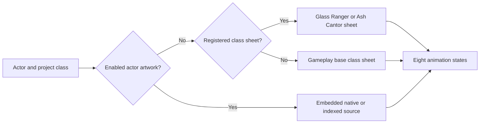

# Glass and ash character pack

[Documentation](README.md) / [Mission library](MISSION_LIBRARY.md) / [Native sprite editor](NATIVE_SPRITE_STUDIO.md)

Open **Enemy templates / Playable mission presets / The Lantern Parley**, then **Load mission preset** and **Playtest revision**. This standalone 20 by 16 mission introduces two named playable profiles, two named rivals, two project-scoped classes, six abilities and two weapons. Its six-line briefing names the participants. The four other defenders and two original companions remain available.

The playable profiles occupy the existing `sera` and `ilya` company slots. They are character presets for isolated source projects, not additional recruits or reserve-party members. The main campaign's four identities and eight built-in jobs remain intact. The mission retains the Emberwarden catalog as well as its two new classes. Formula scripting, summons, sustained chants and recruit settlement are not implemented by this pack.

## Characters

| Character | Role / stable actor slot | Class / artwork | Identity |
| --- | --- | --- | --- |
| Tamsin Valehart | Playable / `sera` | Glass Ranger | A road scout following names missing from the flood records; teal half-cloak and glass bow |
| Orris Fen | Playable / `ilya` | Ash Cantor | A lantern keeper who believes remembrance should guide the living; charcoal robes and bronze lantern staff |
| Vessa Flintglass | Enemy / `enemy-ember-scholar-ashen-weir` | Glass Ranger | Tamsin's former teacher, guarding the wardens' road |
| Brother Caldrin | Enemy / `enemy-cinder-clock-ashen-weir` | Ash Cantor | Orris's rival, keeping the archive's names behind the line |

Corin Ash and Maelis Reed fill the other two playable slots. Rivals share their class sheet with the playable character; there are two original artwork sets, not four unique appearances. Retained actor and template IDs preserve source compatibility with the parent mission. Actor names, roles, equipment, dialogue and placements remain editable.

## Classes and abilities

| Class | Gameplay base | Move / speed | Attack / armor / magic | Primary abilities |
| --- | --- | --- | --- | --- |
| `custom-glass-ranger` / Glass Ranger | Shadowrunner | 5 / 13 | 7 / 3 / 3 | Glass shot, Shard volley, Facet mark |
| `custom-ash-cantor` / Ash Cantor | Lifebinder | 4 / 10 | 2 / 4 / 9 | Cinder hymn, Ashen shelter, Mourning bell |

Both classes are available within the mission project without new unlock requirements. Their gameplay base provides the supported engine lineage. Artwork selection independently prefers their registered dedicated sheet, so future custom classes still fall back to their original base artwork.

| Ability / stable ID | Base | Energy / range / power | Existing behavior |
| --- | --- | --- | --- |
| Glass shot / `custom-glass-shot` | Strike | 4 / 4 / 19 | Single-target physical bow attack; ordinary LOS and height/flank rules |
| Shard volley / `custom-shard-volley` | Cleave | 8 / 4 / 17 | Cross radius 1 physical attack; allies spared |
| Facet mark / `custom-facet-mark` | Veil | 6 / 4 / 14 | Spirit damage; a successful hit exposes for two activations |
| Cinder hymn / `custom-cinder-hymn` | Ember | 8 / 4 / 22 | Cross radius 1 fire; burn and grass ignition |
| Ashen shelter / `custom-ashen-shelter` | Aegis | 8 / 3 / 0 | Guard one living ally, cleanse burn; immediate, not sustained |
| Mourning bell / `custom-mourning-bell` | Delay | 9 / 4 / 15 | Spirit damage and 30-tick delay on a surviving hit |

Tamsin starts with learned Gloam pursuit from her Shadowrunner secondary, giving exposure a follow-up. Orris starts with learned Thread of life from Lifebinder. Their weapons are Wayfarer's glass bow (`custom-glass-bow`, attack +5) and Ashwood lantern staff (`custom-cantor-lantern`, magic +4), priced at 90 and restricted to the matching class. They use existing gear slots; no new weapon-type system is implied.

## Sprite sources and editing

| Source | Sheet | Frames | Contents |
| --- | --- | --- | --- |
| [Glass Ranger PNG master](../public/art/characters/custom-glass-ranger.png) / [compiled WebP](../public/art/animations/custom-glass-ranger.webp) | 887 by 1774 | 32 | Teal cloak, leather armor and glass bow |
| [Ash Cantor PNG master](../public/art/characters/custom-ash-cantor.png) / [compiled WebP](../public/art/animations/custom-ash-cantor.webp) | 887 by 1774 | 32 | Charcoal robe, prayer book and bronze lantern staff |

Each has four columns and eight rows: idle, walk, attack, cast, hurt, guard, victory and downed. These are one-facing sheets; enemies are mirrored by the existing renderer, not a new directional animation set. All 32 cell hashes per sheet are distinct. The manifest records original/compiled hashes, per-frame opacity/bounds and foot registration. Generation produced subtle idle/guard changes and larger action changes; frame uniqueness does not certify hand-authored animation quality.

Choose **Pixels / Game sprites / Add character sheet**, or use **Assets & ability feedback / Add character sheet**. Select **Glass Ranger / Tamsin** or **Ash Cantor / Orris** in Game character sheet, select the current actor, then Load game sheet. All existing RGBA tools, 32-frame timing, PNG export, actor assignment and project JSON recovery apply. The animation workbench also lists both sheets.

Existing embedded native or indexed actor overrides retain precedence. If a previous project has Sera's or Ilya's artwork, disable that override to see the new class sheet. Loading a mission deliberately preserves user artwork and audio. New clean mission JSON has no such overrides.

Run `npm run characters:build` to rebuild only the two new WebPs and merge metadata into the manifest. The PNG masters are committed alongside them. `npm run art:build` continues to rebuild all sheets when the original external masters are available. Local and Pages verifiers check all ten compiled sheets and the two new source PNG hashes.

The built-in image generation tool created both masters. Exact prompts and provenance are recorded in [character generation prompts](../public/art/characters/prompts.json). Original images are retained; WebP compilation preserves alpha and source hashes.

## Acceptance and current limits

Ten new tests cover profile/roster validity, actual ranged and exposure commands, secondary healing availability, art selection and fallback, native-source editing compatibility, published fixture equality, source preservation and seeded terminal play. Complete suite: 232 tests. The mission compiles with zero errors/warnings. All eight mission fixtures are generated by the same registry used by the editor.

| Seed | AI-for-both-teams result | Activations |
| --- | --- | --- |
| 74319 | Defeat | 28 |
| 9001 | Defeat | 30 |
| 42 | Defeat | 27 |

The existing AI is a short-horizon policy and does not coordinate a ranger's exposure with another unit. These losses are recorded for follow-up human difficulty tuning, not presented as a certified difficulty curve. Opening the inherited wall removes a repeatable passive corner stalemate. No change was made to the original Ashen Weir or its AI.
