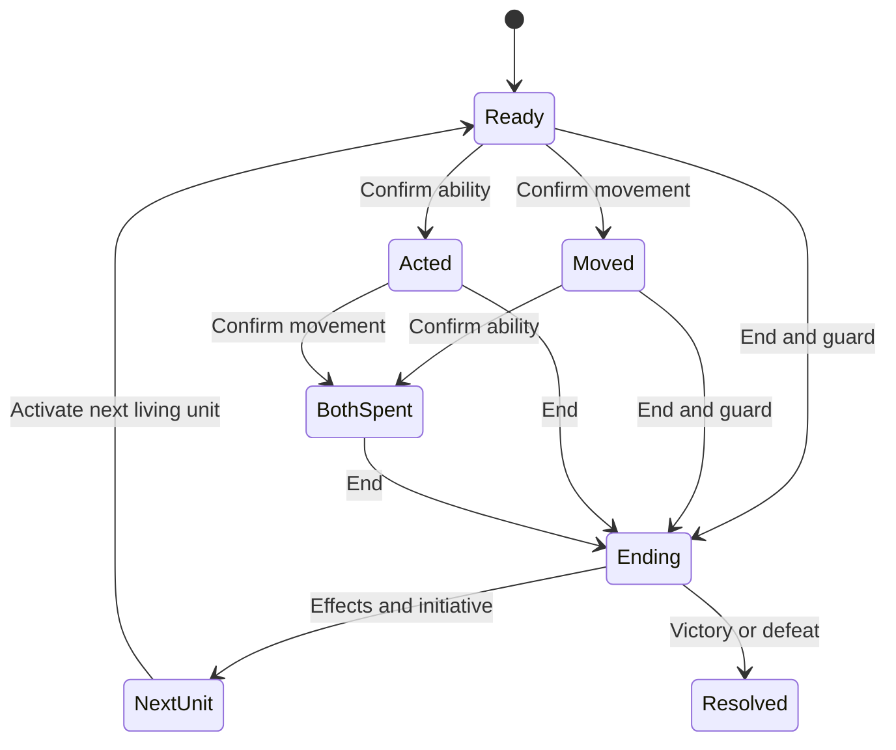

# Combat rules

[Documentation index](README.md) · [Jobs and abilities](JOBS_AND_ABILITIES.md) · [Engine source](../src/engine.ts)

This is the implementation reference for the Veyr battle, not the rules of every system proposed in the original brief.

## Coordinates and movement

| Property   | Rule                                                     |
| ---------- | -------------------------------------------------------- |
| Board      | 9×9; `x` and `z` each range from 0 to 8                  |
| Display    | Columns A–I and rows 1–9; D6 corresponds to `(3, 5)`     |
| Distance   | Manhattan: `abs(dx) + abs(dz)`                           |
| Neighbors  | Four cardinal cells, no diagonal movement                |
| Heights    | Encounter uses elevations 0, 1 and 2                     |
| Step limit | Absolute elevation difference at most 1                  |
| Cost       | 1 per step; climbing adds 1, descending adds none        |
| Blockers   | Obstacles, water and other units, including fallen units |
| Ice        | Walkable using normal movement rules                     |
| Budget     | Current primary job's `move` stat                        |

`reachable()` performs a priority-ordered cost search and returns a map from `"x,z"` to cumulative cost. It includes the starting tile at cost 0; moving to the current tile is rejected. Rendering interpolates to a confirmed destination; the simulation commits the entire move atomically. There are no opportunity attacks or path-entry hazard triggers.

## Commands and turn state

```ts
type Command =
  | { type: "move"; x: number; z: number }
  | { type: "skill"; skill: SkillId; x: number; z: number }
  | { type: "end" };
```

`command(state, request)` returns the original state object for an illegal command or a terminal battle. A legal transition returns a cloned state. This function is typed application code, not a general parser for arbitrary network input.



A turn can end with either resource unused. Movement updates facing along the dominant movement axis; ties prefer x. An ability also turns toward its center. There is no manual final-facing selection.

## Initiative

At encounter creation Sera is active. Readiness values begin at Sera 0, Corin 4, Ilya 8, Maelis 12, Oathless captain 16, Cinder acolyte 20, Hollow outrider 24 and Ash cantor 28.

On ending an activation:

1. Set guard if the actor did not use an ability.
2. Apply burn and standing terrain damage.
3. Decrease the actor's burn, slow, exposed and soaked counters toward zero.
4. Add `round(1000 / primaryJob.speed)` to the actor's existing `next` value, plus 30 if slow remains after decrement.
5. Resolve victory or defeat.
6. If still playing, choose the living unit with the smallest `next`; ties use `id.localeCompare()`.
7. Clear that unit's moved, acted and guard flags; restore 3 energy up to its maximum; increment `battle.turn`.
8. When the new counter is divisible by 8, decrease every tile's burn counter by 1.

The counter measures activations, not rounds. Readiness is not a real-time clock; presentation delays and camera motion cannot change it. Self-targeted Borrowed dawn changes readiness without granting a second action in the current activation.

## Target legality and line of sight

A legal center must exist, be unobstructed, fit the skill's Manhattan range, pass the sampled line-of-sight check, and satisfy action/energy availability. Lantern concord also needs 3 company momentum. Healing requires a same-team occupant, including a fallen one; timeline support requires a living same-team occupant. Damage centers can be empty.

Line of sight samples rounded intermediate grid positions between the caster and center. Obstacles and terrain above the interpolated eye-height line block the cast. Eye height is tile elevation plus 1. Units are not LOS blockers. This is a discrete grid approximation, separate from decorative 3D meshes.

Area radius 1 means the center and its four cardinal neighbors, clipped to the map. Range and LOS are validated for the center, not separately for each affected neighbor. Damaging effects select living enemies in that footprint and spare allies.

## Damage and accuracy

Let `H = attacker elevation - defender elevation` and `B` be the base amount:

```text
B = skill.power
  + (physical ? attackerJob.attack : attackerJob.magic)
  - defenderJob.armor
  - formationDefense
  + max(-6, min(8, 4 * H))
  + (flanking ? 6 : 0)
  + (defender exposed ? 7 : 0)

guarded amount = B * 0.55              # only if defender guards
lightning amount = amount * 1.5        # only if target is soaked/on water
preview damage = max(1, round(amount))
hit chance = min(100, 94 + (flanking ? 6 : 0) + 2 * H)
critical damage = round(preview damage * 1.5)
```

| Modifier              | Exact condition                                                                                                                 |
| --------------------- | ------------------------------------------------------------------------------------------------------------------------------- |
| Flank                 | Offset from defender to attacker dotted with defender facing is negative                                                        |
| Formation defense     | A different living same-team unit with primary job `vanguard` is within Manhattan distance 1; subtract 4 once, without stacking |
| Exposure              | Counter above zero; +7 applies to damaging magic as well as physical attacks                                                    |
| Lightning combination | Lightning ability and target tile water or target's soaked counter above zero                                                   |
| Critical              | 10% chance after a successful accuracy check; damage abilities only                                                             |
| Armor                 | Applies to all damaging elements in the current formula                                                                         |

The UI shows non-critical damage. Healing bypasses this formula: restore up to skill power, capped by missing HP; revival restores 24. Heal and buff hit chance is 100. No elemental resistance table is implemented.

Randomness uses a state-owned unsigned 32-bit linear congruential generator:

```text
seed = (imul(seed, 1664525) + 1013904223) >>> 0
roll = seed / 4294967296
```

An accuracy roll is consumed for each damaging target. A critical roll is consumed only after a hit. Target iteration order and command sequence therefore matter to exact replays.

## Status and terrain timing

| Effect        | Applied by              |               Value | Resolution                                                                               |
| ------------- | ----------------------- | ------------------: | ---------------------------------------------------------------------------------------- |
| Burn          | Successful fire hit     |                   2 | 6 damage before decrement at each affected unit's turn ending                            |
| Slow          | Successful ice hit      |                   2 | Decrement at turn ending, then +30 readiness if still positive                           |
| Soaked        | Successful ice hit      |                   2 | Enables lightning multiplier until decremented to zero                                   |
| Exposed       | Successful Dusk needle  |                   2 | +7 incoming damage while positive                                                        |
| Guard         | End without an ability  |             Boolean | Multiply incoming attack damage by .55 until next activation                             |
| Burning grass | Fire footprint on grass |         Tile burn 3 | 4 damage when a unit ends there; tile counter decays at global activation multiples of 8 |
| Ice           | Ice footprint on water  | Terrain replacement | Remains ice for the rest of the battle                                                   |

Status counters belong to the affected unit; terrain counters use the global activation counter. Since slow is decremented before the readiness penalty, a freshly applied value of 2 produces a penalty on the next affected ending, then none once it reaches 0. Reapplication sets the counter to 2; it does not add to the previous value.

Fire and ice terrain changes occur across the footprint regardless of whether an enemy hit or missed. Terrain burn and status burn can both damage the same unit. Thread of life clears status burn, including on revival; it does not extinguish terrain, remove slow or remove exposure.

## Riposte, incapacitation and outcomes

A surviving primary Blade Dancer hit by an adjacent Weapon strike immediately ripostes for a fixed 9 damage. This reaction has no energy cost or separate accuracy roll. If it incapacitates the attacker, the engine advances the turn automatically rather than leaving a dead actor active.

Units at 0 HP retain their tile, leave the timeline and can be revived by Thread of life. Revival preserves their recorded readiness. There is no permanent-death option. If all enemies fall, victory is checked before all-allies defeat; once terminal, normal commands are rejected. Victory's `rewarded` flag prevents duplicate rewards: each companion gets 60 primary-job JP once.

## Momentum and JP

Successful allied damaging hits add 1 momentum per target, capped at 5. Terrain changes, misses, healing and enemy hits do not generate allied momentum. Lantern concord spends 3 before resolving; its successful hits can generate new momentum normally.

Every legal skill use grants 10 JP to the actor's primary job, even if it misses, heals zero HP or targets empty terrain. Movement and ending a turn grant none. This is a prototype progression economy, not a final anti-farming balance.

## Enemy planner

| Stage          | Current scoring                                                                                                                             |
| -------------- | ------------------------------------------------------------------------------------------------------------------------------------------- |
| Position       | Prefer distance 3 for Arcanist/Lifebinder, 1 otherwise; punish distance error ×5; add height ×1.5; subtract move cost ×.25 and tile burn ×4 |
| Damage action  | Sum effective damage capped by target HP; add 22 for a predicted kill                                                                       |
| Healing action | Score actual restored health, with revival weighted ×1.8                                                                                    |
| Cost           | Subtract energy cost ×.2; choose the best positive score                                                                                    |
| Finish         | Use the chosen ability, then end if battle is still playing                                                                                 |

The planner moves before acting, shares the same validation functions as players, and excludes Lantern concord. It does not yet score haste benefits, plan multiple turns, coordinate objectives, evaluate a full resistance table, or expose difficulty personalities. Animation delays do not alter the scored decision.
