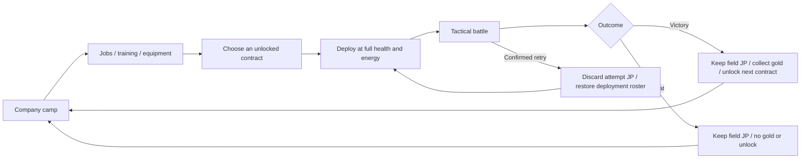

# Company and progression

[Documentation index](README.md) · [Jobs](JOBS_AND_ABILITIES.md) · [Saves](DATA_AND_SAVES.md)

Version 0.4 extends an expedition loop around the tactical engine. The company camp is a functional management screen, not a 3D town or the full campaign promised in the original brief.

## Contracts

| Contract             | Unlock              | Gold per victory | Tactical change                                                                       |
| -------------------- | ------------------- | ---------------: | ------------------------------------------------------------------------------------- |
| The shrine of Veyr   | Initially available |               60 | Original two-tile stone crossing and foundational enemy roles                         |
| The drowned causeway | Clear shrine        |               85 | Flooded former crossing, a northern bridge and two mobile outriders                   |
| The Oathless redoubt | Clear causeway      |              110 | Southern approach; Runewarden, Storm Herald, Shadowrunner and Chronoweaver opposition |
| The silent belfry    | Clear redoubt       |              140 | Raised courtyard, Orren’s half-health awakening; first clear awards Bellkeeper’s seal |

These are four variants within the Veyr region, each 9×9 with four allies and four enemies. They share the region's stone/forest art, not four different biomes. Map geometry, spawn positions and enemy roles differ. Cleared contracts can be replayed for JP and another bounty. All current objectives require defeating the enemy force; branching quests and exploration remain future work.

Return to camp from the result screen to settle the contract. The engine has already granted victory JP; settlement copies field progress to the persistent roster, pays the bounty, increments victories and records a unique completed-contract ID. The Bellkeeper’s seal is granted only when the belfry is first added to completed contracts. It cannot be purchased; replaying the belfry still pays gold and JP. See [the boss guide](THE_SILENT_BELFRY.md). Calling settlement again on the resulting camp state does nothing, preventing duplicate reward collection.

Defeat settlement retains the JP earned in that attempt, but grants no bounty or completion. A confirmed retry restores the company's **pre-deployment** profile instead: attempt JP is discarded, loadouts are restored, and a new deterministic deployment seed is selected. A new company resets everything in memory after confirmation, while the manual save stays untouched.

## JP and permanent learning

| Record         | Meaning                                                            |
| -------------- | ------------------------------------------------------------------ |
| `jp[job]`      | Lifetime JP earned in that job; determines job level and unlocks   |
| `jpSpent[job]` | Lifetime JP already spent learning from that job                   |
| Spendable JP   | `jp[job] - jpSpent[job]`                                           |
| `learned`      | Permanent collection of known skill IDs, shared across job changes |

Learning costs **60 spendable JP** from the selected job. Job levels still use `1 + floor(lifetimeJP / 60)`, so buying a skill cannot lower a level or relock another job. Training requires camp, an unlocked teaching job, a skill belonging to that job and sufficient unspent JP. A known skill cannot be bought twice, including a skill shared by two jobs.

Primary jobs grant all their native skills immediately. A secondary job grants only its skills that the member has permanently learned. This preserves useful primary experimentation while making cross-class capability something to develop. Starter secondary skills are already learned so the initial company remains functional. Ilya retains the starter Storm Herald assignment exception.

For example, Sera can earn Vanguard JP, learn Sundering arc, become an Arcanist and choose Vanguard as her secondary. She then has elemental primary skills plus her permanently learned cleave. Native primary skills do not automatically become permanently learned simply by changing jobs.

Each valid ability use earns 10 lifetime primary-job JP; a victory grants 60 to every companion. Empty casts and misses still earn use JP. This is an early progression economy, not a final anti-farming balance. Version 0.4 adds [job mastery and eight support lessons](MASTERY_AND_SUPPORTS.md), with passive, reaction and movement slots. A separate character-level system remains planned.

## Equipment and shared inventory

Every member has weapon, armor and relic slots. The inventory counts **all owned copies**, including equipped ones. Reserving a copy for one companion makes it unavailable to others until unequipped or another copy is purchased. The belfry awards a named first-clear relic; random loot, selling, crafting, upgrades and rarity rolls remain future work.

| Item                | Slot   |       Price | Bonuses                           | Proficiency                                                  |
| ------------------- | ------ | ----------: | --------------------------------- | ------------------------------------------------------------ |
| Oathsteel blade     | Weapon |          60 | Attack +4                         | Vanguard, Blade Dancer, Shadowrunner, Runewarden             |
| Ashen twinblades    | Weapon |          75 | Attack +3, speed +1               | Same blade jobs                                              |
| Glass-tipped rod    | Weapon |          65 | Magic +4                          | Arcanist, Lifebinder, Storm Herald, Chronoweaver, Runewarden |
| Living willow staff | Weapon |          65 | Magic +2, maximum HP +8           | Same caster jobs                                             |
| Company leathers    | Armor  |          35 | Armor +1, maximum HP +4           | Any                                                          |
| Bronze lamellar     | Armor  |          95 | Armor +4, maximum HP +15, move −1 | Vanguard, Runewarden                                         |
| Wayfarer's boots    | Relic  |          80 | Move +1                           | Any                                                          |
| Copper focus        | Relic  |          80 | Magic +3                          | Any                                                          |
| Dawnwatch charm     | Relic  |          90 | Speed +2                          | Any                                                          |
| Bellkeeper’s seal   | Relic  | Reward only | Armor +2, magic +3                | Any                                                          |

The company begins with 140 gold, one of each weapon, four leathers, one pair of boots and one copper focus. Each companion starts with a suitable weapon and leathers; the two relics begin unequipped. Purchases are capped at 99 owned copies per item and cannot overdraw gold. Equipment/job changes happen at camp, with the existing first-activation job adjustment still available inside a battle.

Derived stats are primary job stats plus equipped gear and support bonuses. Move and speed have a minimum of 1; attack, armor and magic have a minimum of 0. Maximum HP is the member's base HP plus gear HP. Secondary jobs do not add stats. Bonuses affect actual pathfinding, damage, defensive calculations and initiative, not only the dossier display. Healing remains the skill's fixed amount, so magic bonuses do not increase Thread of life's healing.

A job change automatically unequips incompatible weapon/armor copies; ownership is preserved. The portrait shows the job costume, not individual equipment models. At the next deployment all members recover to derived maximum HP and full energy, and combat-only statuses/turn flags reset.

## Persistent and temporary state

The `Expedition` owns a `Company` profile and a battle snapshot. Camp edits the profile. Deployment projects it into combat units, retaining the pre-deployment profile for retries. Terminal settlement copies the final units' progression and loadouts back to the profile. This avoids awarding the same battle JP again during camp settlement.

Progress carries between contracts **within the expedition**. Automatic recovery follows company and battle changes; Save company/Save battle keeps a separate explicit checkpoint. Portable JSON export/import is available through Backups. There is no cloud account. Manual save includes the current stage, treasury, inventory, learned skills, spending, completed contracts and active battle. See [data and saves](DATA_AND_SAVES.md) for migration and recovery.
