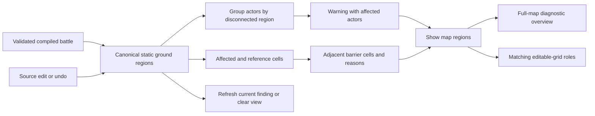

# Connectivity overlays and grouped findings

[Documentation](README.md) · [Project validation](PROJECT_VALIDATION.md) · [Large maps](LARGE_MAP_STUDIO.md) · [Open studio](https://cptnope.github.io/Echoes-of-the-Shattered-Crown/studio.html)

Disconnected enemies in the same ground region now share one warning. Show map regions opens a diagnostic overview, highlights the same cells in the editable grid and lists affected actors. Four enemies behind the same river can therefore appear as one region finding instead of four repeated warnings.

## Review a connectivity finding

1. Open Project validation → Show findings.
2. Choose Show map regions on a map finding. This switches to Battlefield / Inspect, selects the representative coordinate and focuses the overlay. It does not paint or change the project revision.
3. Compare the full-map overview with the editable grid. Solid amber ground marks the affected region, dashed green ground marks reference regions, and crosses mark adjacent barrier cells. Filled circles mark affected actors; triangles mark reference spawns. The legend prints actual tile counts.
4. Review Affected actors. Inspect actor on map reveals that actor's tile. Focus affected ground returns to the representative coordinate. Inspect barrier cycles through the marked cells in row/column order.
5. Inspect each tile's terrain, elevation and collision, then choose an editing tool if a repair is appropriate. Warnings remain advisory: bridges, ranged attacks and terrain-changing abilities need playtesting.
6. Source edits recompute the geometry. If the selected finding still exists, the overlay uses its current geometry and counts. If it disappears, the overlay clears. Undo can restore the warning; select it again to display an overlay.
7. Clear overlay removes only the view. It does not edit source, remove the warning, change history or save a repair.

## Grouping and geometry

| Case | Finding and overlay |
| --- | --- |
| Enemy region without any allied spawn | One finding for all enemies in that region; reference ground is the union of allied spawn regions |
| Single-tile actor region | One trapped-spawn finding; actual neighboring barrier tiles are marked |
| Region with one ally while other allies are elsewhere | One split-deployment finding; other allied regions provide reference ground |
| Regions without actors | Existing aggregate finding includes every empty region; occupied regions provide reference ground |
| Ability, learning or reward warning | Existing actor/catalog navigation; no connectivity overlay |

Region groups use the same static graph as validation: nonblocked grass/stone/ice, edge adjacency, elevation difference at most one. Component traversal and actor lists use canonical row/column order, so tile or placement storage order cannot change group IDs or geometry. Enemy-group IDs use the component's northwest-most cell; changing topology can change an ID. Different disconnected regions stay separate even if they might share a distant obstacle.

Barrier cells are actual in-bounds neighboring tiles with water, collision, an elevation gap over one step, or multiple reasons. A cell is listed once with all its reasons. A barrier may also be reference ground, especially across a height gap; accessible text preserves both roles while the cross takes visual precedence. Wider obstacles only expose the adjacent edge, not every tile in the obstacle.

## Source and report ownership

The report's optional mapOverlay field contains affectedCells, referenceCells, barriers with reasons, affectedActors and referenceActors. It extends diagnostic report version 1; reports remain separate from editable level-project source. Source JSON, checkpoints and battle saves receive no overlay selection or geometry fields. Existing level files need no migration.

Overlay selection stores a finding ID, then resolves it against the current report. A presentation index maps coordinates to roles once per overlay for grid and overview rendering. Clear, focus, actor and barrier inspection are view operations. Pending-draft guards also apply to overlay navigation.

## Verification and limits

Ten new cases in [studio-connectivity.test.ts](../src/studio-connectivity.test.ts) cover one-river/four-enemy grouping, exact region partitions, independent groups, combined barrier reasons, trapped exits, aggregate empty islands, fresh geometry and repair removal, undo/source/report ownership, order independence and 32×32 bounds/index isolation. The full suite has 222 tests.

This is a 2D authoring diagnostic overlay. It does not add overlays to the 3D playtest, provide a free camera or certify a unique causal obstacle, minimal repair, combat reachability or victory. It does not make automatic terrain changes. Multiple warnings may still describe different region problems; grouping by region is deliberately narrower than inferring a shared root cause.
