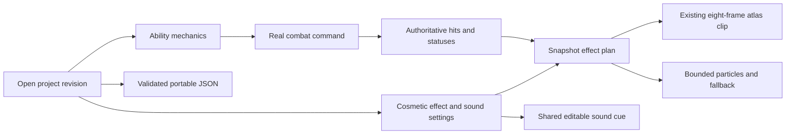

# Content playability and editor audit

[Documentation](README.md) / [Source inventory](CONTENT_SYNC_REPORT.json) / [Executable results](PLAYABILITY_REPORT.json) / [Artwork sources](ARTWORK_SYNC.md)

All ten canonical Studio missions compile, validate, roundtrip and reach a terminal result under three deterministic AI-for-both-teams runs. All 190 ability/mission combinations execute through the real command path on isolated legal training fields, produce valid battle saves, resolve an eight-frame effect clip and generate sound events. These are executable compatibility checks, not a claim that every mission has been cleared manually or that every encounter is balanced.

## What is editable now

| Existing content | Studio location | Applied source and playback |
| --- | --- | --- |
| All ten encounter boards | Enemy templates / Playable mission presets, then Battlefield | Dimensions, terrain, elevation, collision and actor placement |
| Characters and monsters | NPCs, dialogue & progression; Enemy templates | Current roster names, resources, classes, learning and loadouts; reusable hostile snapshots |
| Classes, abilities, gear and consumables | Gear, abilities & jobs | Project catalogs retain stable IDs and supported mechanic bindings; item stock and resale values are editable |
| Fourteen character sheets / 448 cells | Assets & ability feedback / Current cast artwork / Edit sprite | Native RGBA pixels, alpha, actor assignment and all eight states' frame timings |
| Indexed character source | Pixels / Small indexed sprite | Palette, layers, cels, timing and current actor bindings |
| Level surface appearance | Terrain textures | Terrain palettes and top-face textures |
| Linear briefings and progression | NPCs, dialogue & progression | Dialogue, contract gates, bounty, victory JP and first-clear relics |
| Procedural score and command feedback | Game audio | Existing notes, instruments, envelope and feedback parameters |
| Combat sound effects | Sound effects | Shared hit, miss, heal and buff cue layers and WAV export |
| Authored music pattern | Music | Notes, timing and instrument settings |
| Every current ability's presentation | Assets & ability feedback / Ability visuals and sound | Effect family, tint, particle color/motion/density, size, frame/travel timing, opacity and sound pairing |

Editors apply to the open project revision. Playtests compile that revision; portable JSON retains authored fields and embedded native sources. They do not change an existing main-campaign save. An old per-actor override can deliberately mask a newer class sheet: the inspector identifies the active source and supports reversible class-art restoration.

Scenery geometry, direct VFX bitmap painting, sampled-audio import and complete linked-campaign packaging remain source-code workflows. Branching quests and arbitrary new combat mechanics are also outside the current visual editors. An appearance override does not add a new mechanic.

## Ability effects without duplicate sheets

The three existing effect atlases provide 96 decoded, distinct transparent frames. Every current ability maps to a supported eight-frame clip. The class's attack/cast pose comes from its existing character sheet; the impact/travel effect and particles are separate. A new ability using an existing mechanic can reuse the appropriate clip and customize its presentation without downloading another large sheet.

Select **Feedback ability** to work on any current catalog entry. Preview its eight atlas cells, adjust settings, then choose **Apply ability feedback**. **Reset effect appearance** keeps the chosen effect/sound pair; **Use automatic feedback** removes the whole override. Undo/Redo and project export preserve these choices. A different effect family or sound cue retains the appearance settings until explicitly reset. Invalid numeric settings block Apply and the preview uses safe family defaults.

| Setting | Accepted values | Rendering behavior |
| --- | --- | --- |
| Effect tint / particle color | Six-digit hex colors | Multiply the atlas tint; independently color motes and fallback rings |
| Effect size | 0.5–4 tiles | Cosmetic sprite size; gameplay radius is unchanged |
| Frame duration | 30–250 whole ms | Eight cells at the chosen rate |
| Travel duration | 0–1,500 whole ms | Zero disables travel; self-targets and reduced motion still suppress travel |
| Particle motion | Sparks, embers, ice, electric, rain, motes, shadow or time | Existing bounded particle behavior |
| Particle density | 0–2 | Zero disables motes; density remains subject to the existing pool cap |
| Opacity | 0–1 | Atlas/fallback-ring opacity; particle density controls motes separately |

Reduced-motion battle playback holds a contact frame and suppresses particles/travel. The atlas preview starts paused. Sound cues remain shared: editing Heal's layers changes every ability paired with Heal. Existing older projects without appearance settings retain their original defaults; older application builds cannot read the new optional style field.

## Playability and optimization evidence

`npm run content:playtest` regenerates the [executable report](PLAYABILITY_REPORT.json); `npm run docs:verify` checks it against current sources. Thirty runs validate every intermediate save, detect stalls at 400 activations, verify unchanged source exports and separately check idempotent reward settlement. Ability training fixtures verify commands and presentation mappings, rather than pretending to be full encounter clears.

| Mission | Seed 74319 | Seed 9001 | Seed 42 | Initial aim-tile reduction |
| --- | --- | --- | --- | --- |
| Shrine | Defeat / 12 | Defeat / 14 | Victory / 11 | 89% |
| Causeway | Victory / 19 | Victory / 19 | Victory / 17 | 89% |
| Redoubt | Defeat / 17 | Defeat / 17 | Defeat / 17 | 90.2% |
| Belfry | Victory / 38 | Defeat / 20 | Victory / 24 | 89.1% |
| Greybank | Victory / 41 | Victory / 25 | Victory / 35 | 96.2% |
| Ashen Weir | Defeat / 46 | Defeat / 35 | Defeat / 37 | 96.3% |
| Cinder Archive | Defeat / 34 | Defeat / 36 | Defeat / 29 | 97.3% |
| Lantern Parley | Defeat / 27 | Defeat / 23 | Defeat / 22 | 97% |
| Frostglass Vigil | Defeat / 39 | Defeat / 41 | Defeat / 46 | 97.7% |
| Briar Resonance | Defeat / 85 | Victory / 43 | Victory / 65 | 98.1% |

Result cells show outcome / activations. The controlled policy is intentionally recorded honestly: repeated defeats identify encounters needing human balance review, not proof of an unwinnable mission. Improved custom-class AI changes some earlier pack acceptance results. This table and the generated report are the current results; changelog entries describe their original acceptance runs.

AI now resolves custom caster bases and ranged primary abilities before choosing movement distance. Soaking setup recognizes affordable custom lightning skills with their own reach and line of sight. Target pruning preserves source tile order and all useful legal aims, including empty centers for area attacks and fallen allies for healing. The last column counts candidate aim tiles on each initial roster; it is not a measured FPS improvement. Particle buffers no longer upload every idle frame, and empty point clouds are hidden; sprite/particle pool limits remain unchanged. Character and effect manifests/images use content digests to avoid stale artwork after deployment.

Eight additional regressions protect candidate completeness/order, area and revival edges, custom-class range, custom lightning support, strict appearance validation, legacy defaults, export/history and presentation/gameplay isolation. All 292 tests pass. Human full-clear balance review, sampled audio and complete campaign packaging remain follow-up work.

The [shop and supplies guide](SHOP_AND_ITEMS.md) adds quantity commerce and six consumable definitions. The same audit now executes sixty item commands alongside the 190 ability cases. All ten canonical sources carry explicit editable starter quantities.
