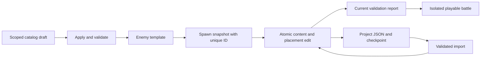

# Custom content authoring

[Documentation](README.md) · [Catalog guide](RULE_CATALOG_STUDIO.md) · [ADR-0019](adr/0019-bounded-custom-records-and-enemy-templates.md)

The studio can create classes, abilities and gear, then use reusable enemy templates to populate an editable encounter. These records belong to the project and use the same applied history, validation, checkpoint, import/export and playtest paths as existing game data.

## Create and use records

1. Open **Gear, abilities & jobs** and choose the catalog section. Enter a stable `custom-` ID, then use **Create new record** or **Duplicate selected record**.
2. Edit the display name and values. Custom classes select a shipped class archetype and sprite; custom abilities select a shipped mechanics and VFX base. Apply catalog overrides before changing editors.
3. Assign native skills and prerequisites, gear proficiencies, actor equipment and learned abilities through the existing forms. IDs stay immutable after creation. Display names can change.
4. Delete custom records only after removing every listed reference. Shipped records cannot be deleted. References include native skills, prerequisites, gear proficiencies, actor/template loadouts and contract relic rewards.

| Source | Bound | Identity and runtime contract |
| --- | --- | --- |
| Classes | 48 total, including eight shipped | Custom ID; required shipped baseJob; existing class passives and sprite states |
| Abilities | 128 total, including thirteen shipped | Custom ID; required shipped baseSkill; existing formula, special conventions and VFX |
| Gear | 128 total, including ten shipped | Custom ID, existing slots and bonuses; scoped prices and proficiencies |
| Enemy templates | 32 | Unique enemy-prefixed ID, hostile team and scoped loadout |
| Active actors | 4–24 | Four required company heroes and up to twenty hostile actors |
| Board | 9–32 tiles per side | Exactly one placement per active actor, on unique open in-bounds tiles |

Custom catalog IDs match `custom-[a-z][a-z0-9-]{0,39}`. New enemy/template IDs match `enemy-[a-z][a-z0-9-]{0,55}`. Template and active-actor IDs must be distinct. Class prerequisites remain acyclic. Every applied change validates the full combined source.

## Enemy templates and instances

Open **Enemy templates**, copy an existing actor or template, and supply a new template ID. Edit its class, resources, equipment and learned abilities, then apply the template draft. Choose an instance ID and an open column/row to spawn it. Creation updates content and placements atomically; rejected coordinates do not partially add an actor.

Spawning takes a snapshot. Later template edits affect future spawns; explicit field updates can revise selected existing instances. Edit an existing instance in **NPCs, dialogue & progression**. Remove instances through the enemy panel; dialogue speaker references must be removed first. The four heroes cannot be removed. Undo/redo includes roster edits and templates; unsaved drafts must be applied or discarded before a playtest.

## Compare and update placed enemies

In **Enemy templates**, choose an applied template, then open **Compare and update placed enemies**. Select one or more hostile actors and the fields to copy. Base health and energy are checked initially; names, classes, learned abilities, JP and equipment require explicit selection.

The comparison table shows every difference, its placed and template values, and **Copy** or **Keep** for the chosen field set. Stable IDs, teams, dialogue and placements are never transferred. Matching values do not create a revision. Learned ability order, JP key order/zero entries and omitted empty equipment do not count as differences.

The complete candidate content is validated before Apply is available. For example, copying a Tidewarden primary job onto an Arcanist carrying a Glass-tipped rod rejects until the selected loadout is compatible. Choose equipment together with the class, adjust the instance, or keep its original class. Any invalid actor blocks the entire batch; no partial application occurs.

**Apply selected template fields** records one content edit. Undo restores every affected actor together. Other editor drafts must be applied or discarded first. The comparison always uses the applied template, never an unsaved draft. This is an explicit one-time transfer with no stored parent link, automatic propagation or three-way merge. Individual overrides on checked fields are intentionally replaced; review each Copy row first. Template selection and checkboxes are view state, excluded from JSON/checkpoints.

## Guided Saltglass Crossing

**Build Saltglass Crossing** creates an editable example through the same catalog and template helpers. It occupies the existing causeway contract slot, creates a 16×12 river crossing and deploys four heroes against three enemies. Prior artwork, audio and shipped catalog overrides are retained. Conflicting expansion IDs reject the operation; undo restores the prior source.

| Content | Added records |
| --- | --- |
| Tidewarden | Runewarden archetype, four native abilities |
| Abilities | Brine Lance (Raincall), Glacial Chain (Frost), Tidal Ward (Aegis), Ebb Hour (Delay) |
| Gear | Tidal trident, Saltglass coat, Pearl focus, Breakwater spear, Rune mantle, Waystone |
| Enemies | Brineguard, Rimeweaver, Tide Cantor; separate templates and active snapshots |
| Encounter | Seven active actors, crossing at rows five and six, two briefing lines |

Sera starts as Tidewarden with Lifebinder secondary, Mend learned and the new trident/coat/focus. The class inherits the Runewarden sheet; copied abilities inherit their existing animation and particle families while using authored costs, power, range and effects. No new generated artwork is implied.

## Compatibility and limits

Original level-project v1 files and shipped catalogs remain valid. New optional fields and custom IDs require this runtime; older builds reject them. Project limits remain 128 KiB for legacy maps, 512 KiB with explicit dimensions, or 8 MiB with native sprite source. Applied catalog and roster validation also protects scoped battle saves. No general migration framework is added.

This is project authoring and isolated playtesting. Arbitrary contract IDs, variable company/neutral NPC identities, live template links, scripting new formulas/effect programs, per-instance native art bindings and complete playable-game packaging remain future work. The preview expedition owns the ally equipment and one deployment so victory settlement remains valid; it does not change the player's persistent economy.

## Verification

Twenty cases in [studio-authoring.test.ts](../src/studio-authoring.test.ts) cover bounds, stable bindings, references, snapshots, rejected placement isolation, roster limits, custom combat/AI, presentation, large-map effect bounds, shop/equip/progression, checkpoint/JSON/history and complete battle settlement. The full suite has 186 tests. A deterministic policy clears a fresh default Saltglass fixture in twenty activations with a valid save after every command. This controlled fixture is regression evidence; inherited overrides and human choices can change balance and outcomes.
