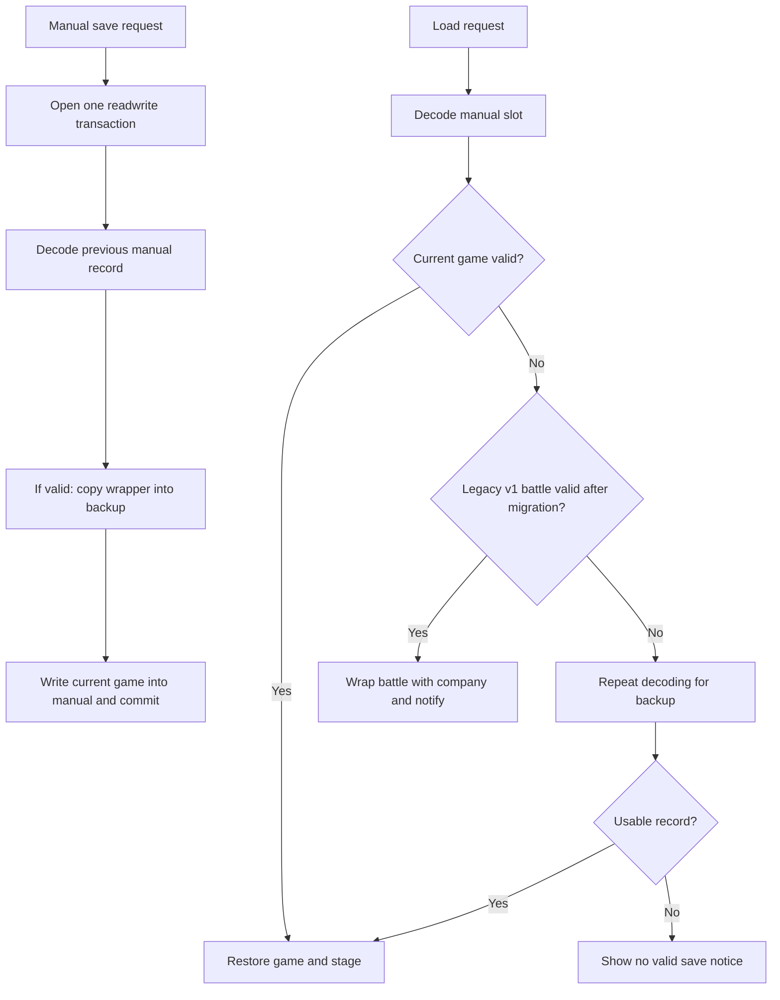

# Data and saves

[Documentation index](README.md) · [Company progression](COMPANY_AND_PROGRESSION.md) · [Storage source](../src/storage.ts)

## Current records

| Record       | Important fields                                                                              | Responsibility                                       |
| ------------ | --------------------------------------------------------------------------------------------- | ---------------------------------------------------- |
| `Expedition` | `version: 2`, `stage`, `company`, `battle`                                                    | Whole saved game; stage is camp or battle            |
| `Company`    | `members`, `gold`, `inventory`, `completed`, `victories`, `deployments`                       | Persistent roster, shared economy and route progress |
| `Member`     | Identity, job/secondary, `baseHp`, `maxMp`, `jp`, `jpSpent`, `learned`, `equipment`           | Profile projected into each new encounter            |
| `Battle`     | `version: 2`, `encounter`, seed, tiles, units, active, turn, momentum, result, log, rewarded  | Deterministic active/resolved combat                 |
| `Unit`       | Member fields plus position, HP/MP, readiness, facing, guard, moved/acted and status counters | Encounter-specific combat state                      |
| `Tile`       | x, z, height, terrain, blocked, burn                                                          | Board rules and terrain state                        |

Current battles still have 81 tiles and eight units. The persistent company has exactly the four known companion IDs. Unit order matters to random-roll consumption. The combat log retains up to 40 recent entries.

## IndexedDB contract

| Setting                      | Value                                                |
| ---------------------------- | ---------------------------------------------------- |
| Database / schema version    | `echoes-crown` / `1`                                 |
| Object store                 | `saves`                                              |
| Slots                        | `manual`, `backup`                                   |
| Current wrapper              | `{ game: Expedition, savedAt: ISODateString }`       |
| Current game / battle format | Both version `2`                                     |
| Legacy wrapper supported     | `{ battle: Version1Battle, savedAt: ISODateString }` |

Database schema version remains 1 because the store layout did not change. It is separate from the serialized game's format version. Presentation settings, selected camp tab, camera and audio context are not serialized.

## Save, load and migration

`saveGame()` copies a decodable previous manual record to backup and writes the new wrapper within a single IndexedDB readwrite transaction. It awaits transaction completion before reporting success and closes the connection in `finally`. It does not overwrite a valid backup with a malformed previous manual record.

`loadGame()` tries manual first, then backup, using the same pure `decodeSave()` routine. It returns the game and flags indicating backup recovery and/or legacy migration. It restores the active battle or camp exactly as saved; it does not automatically settle a stored victory until the player returns to camp.

### Legacy v1 migration

Migration clones the old battle, adds the shrine encounter ID, sets battle version 2, records each unit's old maximum HP as base HP, adds empty equipment and JP spending, and marks the previous secondary job's skills learned. It then validates the resulting battle and expedition.

Positions, HP/MP, turn flags, statuses, readiness, JP, RNG seed and outcome are preserved. Empty equipment prevents new bonuses from silently changing a battle already in progress. The migrated company receives the new starting treasury/inventory, with its roster taken from the old battle; equipment can be assigned at camp later. Since the old format had no pre-deployment profile, its migrated current roster becomes the retry baseline. Old malformed or incompatible records are rejected rather than guessed into a playable state.

Loading a legacy record does not rewrite it immediately. A subsequent manual save stores the current v2 wrapper and retains the old decodable record as backup. There is still no portable save export/import or general migration chain beyond this one supported transition.

## Profile versus field state

During a battle, the company profile is the pre-deployment baseline; the battle's allied units hold new JP and any first-turn job adjustments. Save includes both. Terminal settlement copies field progression back, then adds contract gold and unique completion. Retry uses the profile instead, discarding that attempt's gains. Camp settlement is gated by stage and outcome to prevent duplicate rewards.

## Validation and limitations

The engine validates known jobs, skills, gear slots/proficiencies, JP spending, status counters, coordinates, resources and fixed board/roster counts. Expedition validation additionally checks companion identities, gold/count bounds, completion IDs, and that profile/field equipment allocations do not exceed owned quantities. Malformed shapes are caught and rejected. These are application compatibility checks, not a public upload-security schema.

## Storage limitations

| Scenario                                   | Behavior                                                          |
| ------------------------------------------ | ----------------------------------------------------------------- |
| Refresh or reopen                          | Fresh company appears; use Load save to restore the manual slot   |
| New company                                | In-memory progress resets after confirmation; manual save remains |
| Retry contract                             | Pre-deployment roster restored; attempt gains discarded           |
| Return after defeat                        | Attempt JP kept; no bounty or contract unlock                     |
| Another profile/device/origin              | Separate storage; no synchronization                              |
| Private Site versus Pages                  | Different origins and different saves                             |
| Multiple tabs on one origin                | Shared slots; later saves can overwrite earlier ones              |
| Site-data clearing/private-browsing policy | Persistence may be removed or restricted                          |

Repository paths on the same `cptnope.github.io` host share an origin, though this project uses its own database name. A custom domain is another origin and does not automatically transfer existing snapshots. No autosave, cloud sync, encryption, checksums, portable recovery file or conflict resolution is implemented.

## Version 0.3 compatibility

The expedition format remains version 2. The new `bellkeeper` encounter and `crownseal` equipment ID are accepted by the current validators. Battle snapshots may carry an optional boolean `bossAwakened`; absence means the phase has not triggered, so prior 0.2 saves require no migration. Once triggered, the phase flag, enemy speed relic and changed readiness/resources serialize with the active battle. A malformed phase flag is rejected.

The unique relic is awarded during the first successful belfry settlement, using completed contract IDs as the deduplication record. Retry does not settle rewards. Old application versions cannot read the new encounter/item IDs; do not downgrade a browser save after playing the belfry.
