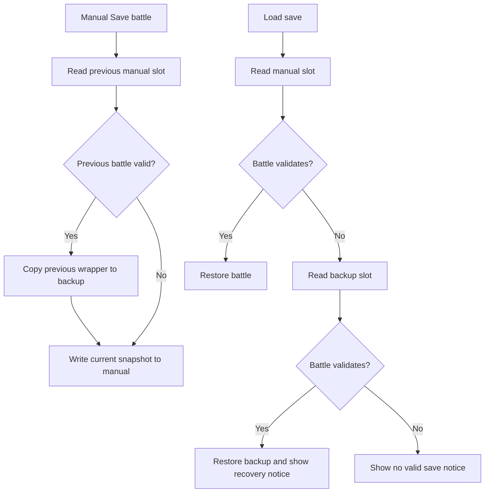

# Data and saves

[Documentation index](README.md) · [Engine types](../src/engine.ts) · [Storage implementation](../src/storage.ts)

## Runtime records

| Record                    | Fields                                                                                         | Notes                                                |
| ------------------------- | ---------------------------------------------------------------------------------------------- | ---------------------------------------------------- |
| `Battle`                  | `version`, `seed`, `tiles`, `units`, `active`, `turn`, `momentum`, `result`, `log`, `rewarded` | Authoritative simulation snapshot                    |
| `Tile`                    | `x`, `z`, `h`, `terrain`, `blocked`, `burn`                                                    | Terrain is grass, stone, water or ice                |
| `Unit` identity           | `id`, `name`, `job`, `secondary`, `team`                                                       | Team is ally or enemy                                |
| `Unit` position/resources | `x`, `z`, `hp`, `maxHp`, `mp`, `maxMp`, `next`, `facing`                                       | Energy appears as EN in the HUD; readiness is `next` |
| `Unit` turn state         | `guard`, `moved`, `acted`                                                                      | Reset selectively on activation                      |
| `Unit` progression        | `jp`                                                                                           | Partial map from `JobId` to nonnegative JP           |
| `Unit` status             | `burn`, `slow`, `exposed`, `soaked` inside `status`                                            | Counters decrement on that unit's turn ending        |

There are 81 tiles and eight units in a current valid save. The unit array is also significant for deterministic target iteration; changing its order can change which target consumes which random roll. The log keeps at most 40 recent entries.

## IndexedDB contract

| Setting                 | Value                                        |
| ----------------------- | -------------------------------------------- |
| Database                | `echoes-crown`                               |
| Database schema version | `1`                                          |
| Store                   | `saves`                                      |
| Primary key             | String `manual`                              |
| Backup key              | String `backup`                              |
| Stored wrapper          | `{ battle: Battle, savedAt: ISODateString }` |
| Battle format version   | `battle.version === 1`                       |

Database version and battle format version are distinct even though both currently equal 1. IndexedDB's upgrade callback creates the store; it does not migrate older battle formats.

Illustrative wrapper, **not a complete loadable save**:

```json
{
  "savedAt": "2026-11-18T03:43:00.000Z",
  "battle": {
    "version": 1,
    "seed": 74319,
    "active": "sera",
    "turn": 1,
    "momentum": 0,
    "result": "playing",
    "rewarded": false,
    "tiles": [],
    "units": [],
    "log": []
  }
}
```

The empty arrays above are shorthand for documentation. Loading that example would be rejected.

## Save and recovery flow



Saving reads the old manual record and copies it to backup only if its battle validates, then writes the new manual record. These are separate database operations; do not describe the pair as an atomic transaction. A successful UI notice means the awaited save operation completed, not that a portable backup was exported.

Loading tries both slots in order and closes the database in a `finally` block. It returns the restored battle plus a `recovered` flag. Load restores RNG, readiness, resources, class JP, terrain changes and terminal outcomes along with positions. It clears targeting state in the interface. It does not restore camera, sound, text size or other presentation settings.

## Validation boundaries

`validateSave()` catches malformed-record errors and returns false. It checks the format version, board/unit counts, coordinate ranges, unique tile and unit identities, known jobs and terrain, finite resource values, status counters, and presence of a suitable active unit. The engine's exact checks are authoritative; this is not a full schema validator for every possible invariant or a security boundary for untrusted uploaded files.

There is no migration, save import, checksum, encryption, campaign schema or automatic repair. The previous valid slot is the only recovery mechanism. Before changing `JobId`, status counters, dimensions or required record fields, decide how existing snapshots will remain readable or be explicitly rejected.

## Storage limitations

| Scenario                             | Expected behavior                                                                                  |
| ------------------------------------ | -------------------------------------------------------------------------------------------------- |
| Refresh or reopen                    | New in-memory battle; use Load save to restore the manual snapshot                                 |
| Restart battle                       | Reset roster and JP; existing manual save stays unchanged                                          |
| Clear browser/site data              | Both stored slots may be removed                                                                   |
| Another browser/profile/device       | Separate storage; no cloud synchronization                                                         |
| Private Site versus GitHub Pages     | Different origins and separate saves                                                               |
| Private browsing or disabled storage | Browser-dependent persistence; errors are shown as notices                                         |
| Multiple game tabs                   | Shared origin slots; later saves can overwrite earlier ones without conflict detection             |
| Package version changes              | Does not automatically migrate or invalidate saves; `battle.version` and validation govern loading |

All projects on the same `cptnope.github.io` origin share browser-origin storage space. The database name is project-specific, but the repository path is not a separate storage origin. A custom domain introduces another origin and does not automatically transfer existing saves.
