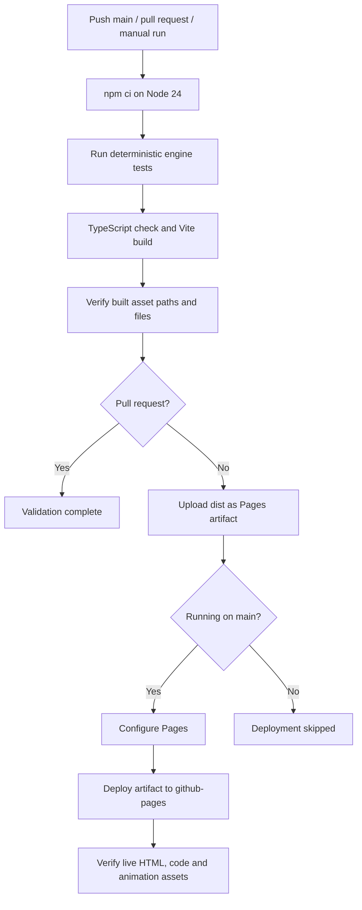

# Deployment

[Documentation index](README.md) · [Pages workflow](../.github/workflows/pages.yml) · [Asset verifier](../scripts/verify-pages.mjs)

## Production target

| Setting                | Value                                                                                                        |
| ---------------------- | ------------------------------------------------------------------------------------------------------------ |
| Repository             | `CptNope/Echoes-of-the-Shattered-Crown`                                                                      |
| Branch                 | `main`                                                                                                       |
| Live game              | [cptnope.github.io/Echoes-of-the-Shattered-Crown/](https://cptnope.github.io/Echoes-of-the-Shattered-Crown/) |
| Pages source           | GitHub Actions                                                                                               |
| Output                 | `dist/`                                                                                                      |
| Build base             | `/Echoes-of-the-Shattered-Crown/`                                                                            |
| Runner / Node          | `ubuntu-latest` / Node 24                                                                                    |
| Deployment environment | `github-pages`                                                                                               |

Only the built static game is deployed. The source tree, original brief and Markdown guides remain in the repository. No server process, database service or application secret is required on Pages.

## Pipeline



Pull requests targeting `main` validate without deployment. Pushes and manual runs on `main` publish after the build job succeeds. A manual run on another branch can build/upload but skips deployment. Concurrency is grouped by ref and cancels an in-progress run for that same ref when a new run starts.

## Permissions and configuration

| Job                            | Permission        | Purpose                                  |
| ------------------------------ | ----------------- | ---------------------------------------- |
| Default build and verification | `contents: read`  | Check out source and verification script |
| Deploy                         | `pages: write`    | Create the Pages deployment              |
| Deploy                         | `id-token: write` | Supply OIDC deployment identity          |

Repository **Settings → Pages → Build and deployment → Source** must be **GitHub Actions**. Configure this once; the workflow does not grant itself repository administration. No personal access token or custom secret is required. Environment protection rules can still require an approval if a maintainer configures them later.

## Base path

Vite defaults to `/` unless `BASE_PATH` is set. The workflow sets the repository subpath so generated HTML points to `/Echoes-of-the-Shattered-Crown/assets/...`. Without that prefix the page can load HTML while its game JavaScript returns 404.

Reproduce the Pages build in PowerShell:

```powershell
$env:BASE_PATH = '/Echoes-of-the-Shattered-Crown/'
npm run build
node scripts/verify-pages.mjs
Remove-Item Env:BASE_PATH
```

Or in a POSIX shell:

```sh
BASE_PATH=/Echoes-of-the-Shattered-Crown/ npm run build
BASE_PATH=/Echoes-of-the-Shattered-Crown/ node scripts/verify-pages.mjs
```

For a local Pages preview, start Vite preview after that build and open its printed origin followed by `/Echoes-of-the-Shattered-Crown/`. For another static host at its domain root, rebuild without `BASE_PATH`. A custom domain on Pages normally needs `/`; update the workflow base and use the actual Pages deployment output URL. Renaming the repository also requires a base-path update.

## What the checks prove

The local verifier checks the game title, React mount point, JavaScript/CSS references, expected base prefix and nonempty built asset files. The final job fetches the deployment's actual `page_url`, checks the URL path, and requests its HTML and each referenced asset. It rejects missing or empty assets and HTML fallbacks returned in place of JavaScript/CSS. It retries up to six times with five-second pauses for CDN readiness.

These checks do **not** execute WebGL, verify sprites visually, exercise IndexedDB or assert a complete player battle. Browser smoke testing complements them. The [initial Pages run](https://github.com/CptNope/Echoes-of-the-Shattered-Crown/actions/runs/44233777082) passed all three jobs; movement and turn advancement were also checked in the live game. That is historical evidence, not a promise that every future deployment passes.

## Recovery

| Failure                 | Inspect first                                    | Response                                                                                      |
| ----------------------- | ------------------------------------------------ | --------------------------------------------------------------------------------------------- |
| Dependency installation | `npm ci` log and lockfile                        | Resolve the actual lock/runtime issue; do not silently switch to unlocked installation        |
| Tests or build          | First failed step                                | Fix source or types before deploying                                                          |
| Configure Pages         | Pages source and repository/environment settings | Confirm Actions source and allowed environment branch                                         |
| Deployment permissions  | `Deploy Pages` log                               | Restore required Pages/OIDC permissions; keep build read-only                                 |
| Live verifier           | Reported URL/status/path                         | Check base, artifact and CDN readiness; do not treat deployment alone as browser verification |
| Blank game but HTTP 200 | Browser console, asset URLs and WebGL            | Separate asset-path failures from GPU/runtime issues                                          |

Prefer fixing or reverting the source commit through normal history. Do not force-push or hand-edit `dist/` as a parallel production source. A subsequent successful push to `main` rebuilds and publishes its artifact.

Saves on the private Site and Pages use different origins. A successful deployment does not migrate browser saves. See [storage boundaries](DATA_AND_SAVES.md#storage-limitations).

## Character atlas

The production artifact includes `public/art/company-atlas.png` at `art/company-atlas.png` beneath the Pages base path. The verifier checks both local and published PNG signatures, 1536×1024 dimensions and RGBA format. A passing asset check establishes delivery, not visual quality or WebGL behavior.

## Animation assets

The build includes animation-review.html and all eight WebP sheets. The Pages verifier imports verify-animation-art.mjs: local builds decode frames with Sharp; the live job uses Node built-ins to check the published manifest, file sizes, WebP signatures and SHA-256 checksums. The verification job does not require npm install.

Version 0.8 also verifies three combat-effect WebP atlases and their manifest. Local checks decode all 96 cells; live checks validate deployed sizes and SHA-256 hashes with Node built-ins.
