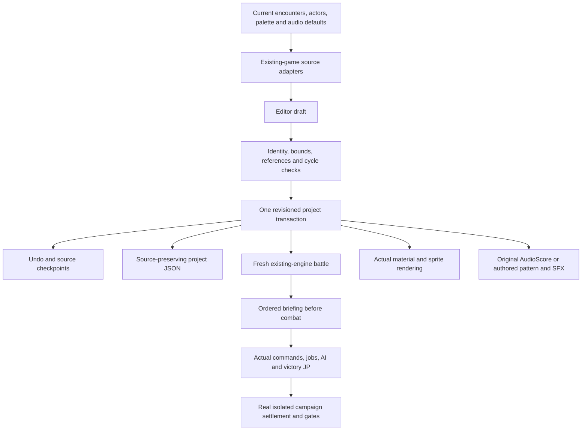

# Existing game data: editor coverage and source contracts

[Studio](LEVEL_STUDIO.md) · [Native sprites](NATIVE_SPRITE_STUDIO.md) · [Full toolkit plan](studio/README.md)

The working studio loads current game sources and applies validated project overrides in isolated playtests. It does not yet edit every system or publish a complete replacement campaign. This table is the implementation audit; a blueprint or schema example is not a working editor.

## Current coverage

| Area | Working source/editor | Runtime proof | Remaining boundary |
| --- | --- | --- | --- |
| Levels | Battlefield loads shrine, causeway, redoubt and bellkeeper from createBattle | Tiles, elevations, collision, actor names/jobs/resources and boss encounter identity compile into the real engine | Resizable 9–32-side rectangular maps; four heroes plus up to twenty enemies; one level source open at a time |
| Terrain materials | Terrain textures loads the shared renderer palette for grass, stone, water and ice | Procedural color variants and optional painted 16 × 16 top images feed the 3D tile materials, including terrain changes | Prop models, walls, lighting, scenery, import of external textures and variable texture sizes remain future work |
| Existing character art | Pixels native mode loads all eight actual 887 × 1774 sheets and 32 frames | Edited registered actor texture and state timing in the scene | Up to 24 independent native assignments, including custom enemies; flattened runtime source, no original master layers |
| Indexed pixel sketches | Separate small layered sprite workspace | Actor override in playtest | Starter source is a review asset, not a converted native sheet |
| Characters / enemy NPCs | Game content loads shipped actors; enemy templates create additional hostile identities | Name, primary/secondary job, health, energy, starting JP, learned secondary skills and optional equipment compile into battle units | New enemy IDs and snapshot templates; neutral NPC interaction, new allies, social schedules and spawn waves remain future work |
| Dialogue | Ordered lines seeded from each existing contract description and Sera's shipped opening quote | Project dialogue appears before combat; combat/AI waits for Begin battle or Skip | Linear encounter briefing; branching choices, flags, quest states, shops and localization remain planned |
| Contract progression | All four current names, descriptions, objective labels, rewards, prerequisites and first-clear items | Actual contractOpen and returnToCamp functions evaluate source gates/rewards; combat uses authored victory JP | Objective text does not change defeat-all victory; no job-curve, learning-cost or complete campaign editor |
| Original game music / feedback | Game audio loads the exact original sixteen frequencies, 650 ms spacing, lead/bass and 440/280 Hz command tones | Main AudioScore and project preview use the same source and player | Project JSON source; score recording/multitrack/WAV export remain planned |
| New music patterns | Existing sixteen-step sketch editor | Source-rendered one-bar WAV and project preview loop | Separate composition; enabled original-game score takes precedence |
| Layered outcome SFX | Existing hit/miss/heal/buff authoring bank | Authored PCM/WAV and resolved-event preview bindings | Additional project source; the original game has two command feedback tones rather than a shipped four-outcome bank |
| Ability presentation | [Asset library](ASSET_LIBRARY.md) binds existing VFX families and editable bank cues | Cosmetic preview feedback retains gameplay geometry and formulas | Shared four-cue bank; no new VFX bitmap editor, arbitrary graphs or per-ability sampled clips |
| Gear, abilities and jobs | [Catalog editor](RULE_CATALOG_STUDIO.md) copies all current definitions and actor loadouts | Actual stats, commands, AI, movement, prices, equip, deployment, learning, unlock and mastery use scoped source | Bounded custom IDs, enemy templates and hostile spawns; mechanics inherit shipped bases; new formulas remain planned |
| Support definitions and AI programs | Source implementations remain in code | Current support behavior and AI scoring remain active, consuming authored job/ability data | No support/AI-program authoring controls yet |
| Full game distribution | Project JSON and native/terrain PNG/audio derivatives | Reopen and edit compatible sources in the current studio | No complete playable-plus-editable bundle or automatic production-asset replacement |

## Load the actual level

In Battlefield choose **Existing game encounter → Load existing encounter**. This is one undoable project transaction. It loads the selected map's exact cells, placements, roster and encounter ID. Bellkeeper therefore uses Orren, the belfry scenery and the existing awakening rule rather than reskinning a shrine battle.

Loading replaces the currently open level geometry and actor source. Art, audio, terrain appearance and already edited contract/dialogue catalog remain in the project. Undo restores the previous level. Save/export before loading if both variants need to be retained as separate files. This is a single-level project, not a four-map workspace.

## Paint terrain appearance

The game originally uses procedural mesh colors and details; there are no shipped tile texture images to import. Renderer colors now come from the same shared source used by Terrain textures. Editing a palette entry changes existing material variants without altering collision or movement.

Choose **Painted 16 × 16 top texture** to apply pixel art to the upper tile face. Select a palette color and click/drag or use arrows/Space. Draft undo groups a stroke; project Apply is one transaction. PNG export is the texture derivative; JSON preserves all four palettes, source pixels and the procedural/painted choice. Original side walls, vegetation and stone seams remain geometry.

## Characters, dialogue and progression

**NPCs, dialogue & progression** has three sections. The roster comes from the currently loaded encounter, including its actual enemy roles and resources. Primary and secondary job IDs still reference current game catalogs; changing the primary job changes the actual battle stats/art unless an explicit sprite override is enabled. Learned skills are filtered by the existing secondary-job availability rule.

Dialogue is an ordered list of stable line IDs with existing actor/narrator speakers. Add, edit, remove or reorder lines for any of the four contracts. Apply and playtest that contract to see the same source. Empty conversations start combat directly. Text is rendered as text, not HTML. Main company saves are not modified.

Progression edits preserve four stable encounter IDs. Unknown prerequisites and cycles reject. A completed-contract checklist evaluates the real gate function on an isolated fixture. After an actual playtest victory, **Settle preview victory** uses the real campaign settlement function on a fresh scratch company: edited gold, first-clear item and unlock results are visible, and the button cannot pay twice. Combat victory JP is awarded once through the existing rewarded flag. The new optional battle value is bounded and validated; old player saves without it remain compatible.

## Source ownership

| Source field | Meaning |
| --- | --- |
| encounter | Optional current level identity; omitted legacy projects mean shrine |
| content | Four contract records, dialogue per contract, active actor source, optional enemy templates and victory JP |
| materials | Shared procedural colors and optional 16 × 16 painted top images |
| rules | Optional existing job, skill and gear catalog; used by compiled battles and gear validation |
| gameAudio | Original score/command-tone parameters, including all sixteen precise frequencies |
| sounds / music | Additional outcome bank and one-bar pattern source |
| pixels / nativeSprite | Indexed/native source overrides; native wins when both target one actor |

The adapters copy existing source; they do not mutate imported module globals. Project export keeps the 128 KiB bound for legacy maps, 512 KiB for maps with explicit dimensions and 8 MiB with an embedded native sheet. Unsupported fields reject. Player progress, main-game defaults and production asset files remain separate from project overrides.

## Verification

Ten integration/model tests cover exact four-map imports, reversible encounter loading, actor-to-runtime compilation, invalid references/cycles, actual JP/gold/relic/gate behavior, exact terrain colors/RGBA, rejection, cross-editor JSON round trips, original audio frequencies and real AudioScore timing/cancellation with mocked Web Audio. The suite has 254 tests. UI acceptance additionally checks actual loading, editing, source reopening, terrain appearance, briefing gating and audio controls in the published studio.

The [catalog extension](RULE_CATALOG_STUDIO.md) adds ten runtime parity tests and optional actor loadouts. The complete suite now has 254 tests.

The [large-map extension](LARGE_MAP_STUDIO.md) adds bounded rectangular maps, brushes and camera/navigation tools with ten additional runtime and persistence tests.

The [project validation panel](PROJECT_VALIDATION.md) adds source/runtime/export error gates, static-ground and catalog/content warnings, typed record/tile navigation and separate rejected-import reports. It does not certify mission completion.

[Grouped connectivity overlays](CONNECTIVITY_OVERLAYS.md) now show affected/reference ground, adjacent barrier edges and affected actor lists. Shared enemy regions produce one warning; distinct regions remain separate. These views do not alter gameplay or source.
