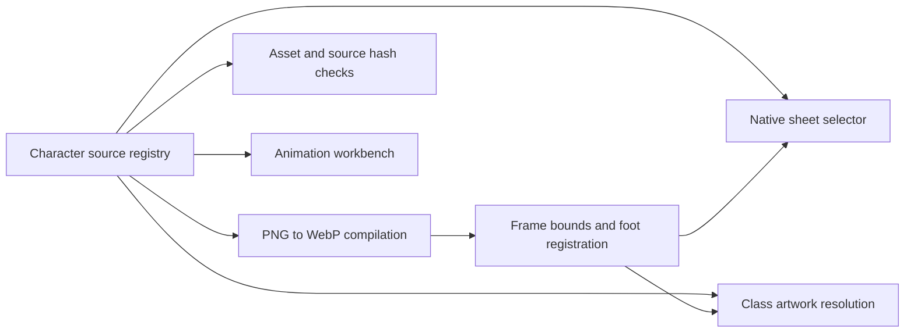

# The Frostglass Vigil

[Documentation](README.md) / [Mission library](MISSION_LIBRARY.md) / [Glass and ash characters](CHARACTER_CLASS_PACK.md)

Open **Enemy templates / Playable mission presets / The Frostglass Vigil**, choose **Load mission preset**, then **Playtest revision**. This 22 by 18 standalone mission brings Tamsin, Orris, Joren and Nera together against six outpost defenders. The six-line briefing introduces the new rivals. Defeat every enemy; the pools are tactical terrain rather than extraction zones or interactable objectives.

This pack adds two project classes, two playable profiles, two named rivals, six abilities, two weapons, an armor piece, a first-clear relic and two original 32-frame sheets. Existing artwork/audio overrides are retained when loading; disable an older actor override to see dedicated class art. A clean downloaded mission has no artwork overrides.

## Cast and roles

| Character | Team / current source slot | Class | Identity and role |
| --- | --- | --- | --- |
| Tamsin Valehart | Playable / `sera` | Glass Ranger | Ranged physical pressure and exposure setup |
| Orris Fen | Playable / `ilya` | Ash Cantor | Fire, guard, timeline pressure and secondary healing |
| Joren Ashbrook | Playable / `corin` | Dawn Duelist | A former dawnwatch escort who turns exposed guards into openings |
| Nera Coldmere | Playable / `mae` | Frost Sentinel | A winter-road keeper who protects the company and opens frozen crossings |
| Captain Ysra | Enemy / `enemy-kiln-warden-ashen-weir` | Frost Sentinel | Nera's former captain; guards the outpost approach |
| Darian Sunscar | Enemy / `enemy-coal-runner-ashen-weir` | Dawn Duelist | Joren's rival; presses the southern flank |

Vessa Flintglass and Brother Caldrin return alongside an Ash Sentry and Lantern Mender. Enemy templates remain independent reusable snapshots. Named rivals share their class sheet with the playable profile; two new unique sheets are supplied, not four. The inherited stable template/instance IDs keep source compatibility with the earlier showcase.

All four playable profiles use the existing company slots. These are source-project character presets, not four additional recruits or a reserve roster. The main campaign and original mission sources retain their existing characters. The source catalog contains the earlier Emberwarden, Glass Ranger and Ash Cantor definitions plus the two new classes.

## Classes

| Stable ID / class | Existing gameplay base | Move / speed | Attack / armor / magic | Tactical role |
| --- | --- | --- | --- | --- |
| `custom-frost-sentinel` / Frost Sentinel | Runewarden | 4 / 10 | 6 / 9 / 6 | Close protection, ice crossings and recovery |
| `custom-dawn-duelist` / Dawn Duelist | Blade Dancer | 5 / 14 | 9 / 4 / 2 | Mobile exposure and physical pursuit |

Both are available inside this project without additional unlocks. Equipment modifies these base numbers. Nera starts with Rimeplate, which subtracts one movement, and a Dawnwatch charm, which adds two speed. Joren's boots add one movement and saber adds one speed. Their named artwork is registered independently from their gameplay base classes.

| Ability / stable ID | Base | Energy / reach / power | Behavior |
| --- | --- | --- | --- |
| Rimeward / `custom-rimeward` | Aegis | 7 / 2 / 0 | Guard one living ally and cleanse burn; no cold immunity |
| Frostline / `custom-frostline` | Frost | 7 / 3 / 18 | Cross radius 1; freeze water and slow enemies for two activations |
| Winter's mercy / `custom-winters-mercy` | Mend | 7 / 2 / 28 | Heal and cleanse burn, or revive at the existing fixed 24 HP |
| Sunlit pursuit / `custom-sunlit-pursuit` | Gloam | 8 / 2 / 28 | Physical hit; adds the existing pursuit bonus against exposure and consumes it |
| Dawn cut / `custom-dawn-cut` | Cleave | 7 / 1 / 26 | Close physical cross, allies spared |
| Daybreak feint / `custom-daybreak-feint` | Veil | 5 / 3 / 12 | Spirit damage; expose for two activations on a successful hit |

Tamsin or Joren can expose a defender before Joren pursues. Exposure is consumed only on a successful pursuit hit. Nera can guard the lead fighter, recover an ally at close reach, or freeze a pool to open a route. Orris's longer-range healing complements Nera's short reach. These actions reuse existing mechanics: no new freeze duration, stealth, taunt, forced movement or sustained channel is introduced.

## Equipment and mission

| Stable ID / item | Slot | Bonuses | Price / use |
| --- | --- | --- | --- |
| `custom-rime-spear` / Rimeglass spear | Weapon | Attack +4, magic +2 | 95; Frost Sentinel only; equipped by Nera |
| `custom-dawn-saber` / Dawnsteel saber | Weapon | Attack +5, speed +1 | 100; Dawn Duelist only; equipped by Joren |
| `custom-rimeplate` / Rimeplate | Armor | Armor +4, HP +16, move -1 | 105; Frost Sentinel only; equipped by Nera |
| `custom-vigil-compass` / Vigil compass | Relic | Armor +1, move +1 | Reward only; first clear |

The mission has 396 tiles, a clear central road, pools on both flanks and an eastern terrace one step higher. All ten actors have connected legal starting positions. Four enemy specialists have reduced base health compared with the Parley, making this a mixed-party introduction rather than a strict increase in enemy durability. All six placed enemies have matching reusable template sources.

Bounty is 165 and victory JP is 80. The Vigil compass uses existing once-only first-clear settlement. Isolated studio previews grant no company rewards. The source occupies `redoubt` in its own project and requires Causeway in that catalog; it is not a linked new campaign chapter.

## Original artwork and editor support

| Sheet source | Dimensions | Animation states / frames |
| --- | --- | --- |
| [Frost Sentinel PNG](../public/art/characters/custom-frost-sentinel.png) / [WebP](../public/art/animations/custom-frost-sentinel.webp) | 887 by 1774 | Eight states / 32 distinct cells |
| [Dawn Duelist PNG](../public/art/characters/custom-dawn-duelist.png) / [WebP](../public/art/animations/custom-dawn-duelist.webp) | 887 by 1774 | Eight states / 32 distinct cells |

Four columns and eight rows contain idle, walk, attack, cast, hurt, guard, victory and downed sequences. Original RGBA transparency is retained. Native editing provides painting, alpha, per-frame timing, source assignment, PNG export and self-contained project JSON. Single-view sprites use existing enemy mirroring. Subtle pose variation and unique cell hashes are verified; they do not imply manually authored directional animation.

Choose **Assets & ability feedback / Add character sheet**, then select Frost Sentinel / Nera or Dawn Duelist / Joren, choose a current actor and **Load game sheet**. All twelve registered artwork sources appear in the animation workbench as well. The workbench derives its sheet count, showcase height and recorder readiness from the registry, rather than requiring another fixed-count edit.

`src/character-sources.json` is the shared registry for the four original custom character sources. The renderer/editor combine it with the eight built-in class labels; build and verification scripts use the same IDs. `npm run characters:build` compiles the four custom PNG masters without needing the external originals for the eight built-in sheets. All twelve sheets total 384 cells. Built-in image generation produced the two new masters; [exact prompts](../public/art/characters/frostglass-prompts.json) are committed.

## Acceptance and balance evidence

Ten new regressions cover the complete roster, both new native sources, ice crossing and movement, guard and revival, pursuit consumption, reversible source ownership, first-clear settlement, fixture equality and seeded outcomes. All 244 tests pass. Source fixtures are generated for nine missions. Both original character projects remain separate and reproducible.

| Seed | AI-for-both-teams outcome | Activations | Surviving allies |
| --- | --- | --- | --- |
| 74319 | Defeat | 39 | 0 |
| 9001 | Defeat | 41 | 0 |
| 42 | Defeat | 46 | 0 |

All intermediate saves validate and each run leaves the source unchanged. The policy is a regression/difficulty signal, not a full human balance certification. It does not coordinate multi-unit exposure setups. Human full-clear playtesting and additional difficulty tuning remain follow-up work.

Two additional cache regressions protect source ownership while reclaiming orphaned derived native images. Published editing exposed accumulated browser cache pressure; the save path now preserves incoming/current/backup sources while reclaiming only unreferenced image entries. Portable JSON remains the reliable path when the active library itself exceeds browser storage.

The [current playability audit](CONTENT_READINESS.md) uses the improved custom-class AI. Older acceptance descriptions above may refer to the original policy; the generated report is authoritative for current outcomes.
