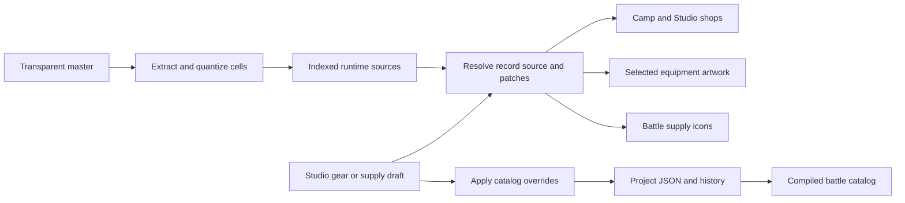

# Gear and supply artwork

The 22 equipment records and six supplies now have distinct inventory artwork. The same 64 × 64 pixel sources appear in the camp shop, selected company loadouts, Studio shop trials and battle supply commands. Names, quantities and prices remain ordinary accessible text. Icons are decorative beside those labels.

## Edit real artwork

1. Open **Gear, abilities & jobs** in Studio and select **Gear** or **Items & supplies**.
2. Choose the record, then expand **Artwork · item name**.
3. Choose a shipped artwork source, select a color and click pixels. Arrow keys select a pixel; Space paints it. **Restore source pixel** removes that pixel override.
4. **Undo artwork** and **Redo artwork** navigate the local artwork draft. **Reset item artwork** returns to that record's default art.
5. Use **Export icon PNG** to work externally. **Import 64 × 64 PNG** accepts an actual PNG under 256 KB, preserves alpha and stores its pixels in the catalog draft. Other sizes are rejected rather than silently resampled.
6. Choose **Apply catalog overrides**. Project Undo/Redo, exported JSON, re-import and isolated playtests carry the icon definition. A shop trial uses current drafts; it does not write your company save.

Changing a source replaces the current pixel patches. Export artwork you want to retain first. Gear artwork does not alter combat statistics, costs or ownership. These are inventory illustrations; animated battle character outfits and weapons still come from their existing class/actor sheets.

## Source and storage

| File | Purpose |
| --- | --- |
| `public/art/gear/gear-master-v1.png` | Original transparent 7 × 4 generated master, retained unchanged |
| `public/art/gear/gear-master-v1.prompt.txt` | Exact built-in image_gen prompt and provenance |
| `public/art/gear/gear-icons-v1.png` | Padded, indexed runtime icon sheet, 448 × 256 |
| `public/art/gear/manifest.json` | Stable row-major IDs and SHA-256 fingerprints |
| `src/gear-art-source.json` | Per-icon palette and 4096 indexed pixels consumed by the game/editor |
| `scripts/build-gear-art.ts` | Deterministic cell extraction, 64-color quantization and runtime source builder |

Run `npm run gear:build` after replacing a master intentionally. It requires seven columns and four rows of equal square cells with alpha. The master uses muted bronze, steel, sage cloth, leather and colored glass to match the game. Its built-in image_gen output was generated on 2026-11-23; it is not an external commercial asset pack.

An optional `icon` field in a gear or item definition contains a shipped `source` ID and unique `[pixelIndex, "#rrggbbaa"]` patches. There are at most 4096 patches, indices 0–4095. Unknown sources, extra fields, duplicate pixels and malformed colors are rejected. No image URL or executable payload is accepted. Custom records receive a slot/effect fallback until artwork is assigned. Old records without `icon` keep their source JSON and resolve current defaults at render time.

Projects with explicit artwork can use the existing 8 MiB source budget; ordinary legacy sources retain their previous limits. This permits complete imported icons without an unrelated character sprite assignment. Campaign backup size limits are unchanged.

Seven artwork regressions cover shipped source coverage, atlas digests, immutable RGBA patches, hostile/malformed overrides, legacy/custom fallback behavior, full-PNG-equivalent project roundtrip and commerce invariants. The complete suite has 292 tests. Browser checks verify the authoring/export/playtest workflow and responsive controls separately; this is not a claim of animated equipment replacement.
