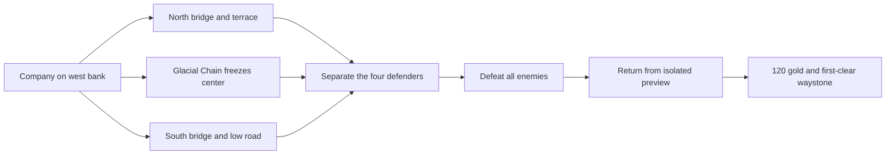

# The Sluice at Greybank

[Documentation](README.md) / [Custom content authoring](CUSTOM_CONTENT_AUTHORING.md) / [Editable mission JSON](../public/missions/greybank.json)

Greybank is a complete Tidewarden encounter for the current studio. Open **Enemy templates**, expand **Playable mission presets**, select **The Sluice at Greybank**, then choose **Load mission preset**. Alternatively download and import the linked JSON. Playtest, read the four-line briefing, and defeat all four enemies.

Loading the preset replaces map, combat catalogs, roster/templates, contract metadata and dialogue with balanced defaults. It preserves existing art/audio sources. This explicit reset prevents experimental damage/range overrides from deciding the encounter before it begins. Undo restores the prior project. Export unsaved work before switching sources.

## The battlefield

The 18 by 14 map has two permanent one-row bridges at rows 3 and 10 across river columns 8 and 9. The center begins as water. Eastern terraces provide elevation advantage; sluice masonry breaks straight approaches. All deployment tiles have ground routes to the other bank, so freezing is optional.

| Approach | Opportunity | Pressure |
| --- | --- | --- |
| North bridge, row 3 | Approach the Rimeweaver and disrupt the northern fire line | Elevated defenders and a longer route from the company start |
| Central river, row 6 | Glacial Chain at column 8 freezes both river columns; Sera can then move to column 9 in her opening activation | A narrow foothold near Venn; protect the first unit across |
| South bridge, row 10 | Corin can threaten the cantor's support position | The mobile outrider can meet an isolated advance |

Glacial Chain freezes a cardinal cross. Target column 8, row 6 from Sera's starting tile (5,6), then Move to (9,6). An action and movement can occur in either order. The river shortcut is a terrain interaction through an existing spell; there is no scripted bridge switch or sluice-control objective.

Brine Lance applies soak on successful hits. Ilya has Glasslight Bolt through her Storm Herald secondary skills; lightning gains its existing wet-target bonus. Tidal Ward protects a living ally until their next activation. Ebb Hour delays a defender. Keep Maelis close enough to heal rather than sending every unit across together.

## Defenders and rewards

| Defender | Role | Base health / energy |
| --- | --- | --- |
| Sluicekeeper Venn | Tidewarden / Vanguard; central control and protection | 115 / 32 |
| North-bank Rimeweaver | Arcanist / Tidewarden; elevated elemental pressure | 78 / 40 |
| Reed Cantor | Chronoweaver / Tidewarden; healing, ward and timeline support | 82 / 40 |
| South-bank Outrider | Blade Dancer / Vanguard; mobile physical pressure | 82 / 24 |

Four templates and their placed snapshots remain editable. Defenders use existing class animations, spell atlases, particles and AI. Venn is a named leader with ordinary Tidewarden behavior; no new boss phase or unique art is implied.

The causeway contract slot pays 120 gold on victory and grants Sluicekeeper's waystone once on first clear. The relic grants one movement and one speed and is excluded from the shop. Victory JP is 70 through the existing reward path. Preview settlement remains isolated from player saves. The shipped main campaign retains its four original contracts; this mission is an editable studio preset, not a new linked campaign chapter.

## Evidence and remaining work

Six cases in [greybank.test.ts](../src/greybank.test.ts) verify source/geometry, actual freezing and movement, soak/lightning synergy, reset/isolation/history, full deterministic outcomes and once-only settlement, plus the published fixture matching the preset. Run `npm run mission:build` after intentionally changing the preset. The full suite has 202 tests.

A controlled AI policy for both sides wins in 39 activations at seed 74319 and 28 at seed 9001; at seed 42 it loses in 46. Every command produces a valid save. These outcomes establish reproducibility and exercise victory/defeat; they do not certify human difficulty. Manual review checks the opening freeze route and the rendered terrain. Further balance passes should record casualties, resource pressure and route choices with human play.

Next content work is a second encounter that tests different Tidewarden choices. Campaign linking and full-game exports remain separate editor milestones.
