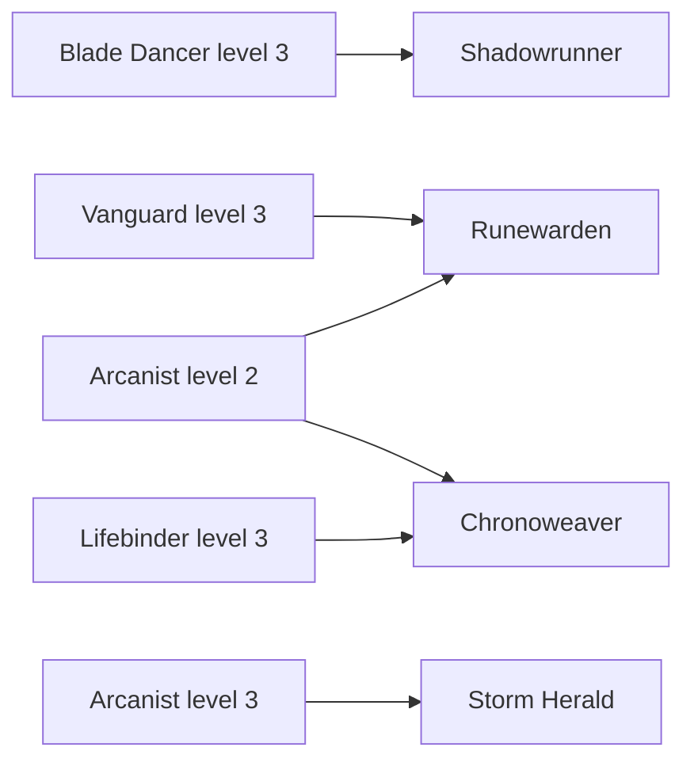

# Jobs and abilities

[Documentation index](README.md) · [Content source](../src/data.ts) · [Combat rules](COMBAT.md)

## Loadout contract

A unit has a primary job, a secondary set, permanent learned skill IDs, lifetime JP, per-job spending and three equipment slots. Available skills are Weapon strike, all native primary skills, the secondary job's **learned** skills, and Lantern concord. Primary stats plus gear and equipped support bonuses determine combat; the secondary supplies skills only.

Camp training costs 60 spendable JP from the selected unlocked teaching job. Lifetime JP determines levels and prerequisites and is never reduced by spending. Starter secondary skills are already learned. A shared skill needs to be learned only once. Base maximum HP remains character-specific; equipped HP bonuses and proficiency changes can change derived maximum HP.

Mastery lessons and passive/reaction/movement slots are available for all eight jobs. A separate overall character level remains planned. See [mastery and supports](MASTERY_AND_SUPPORTS.md) and [company progression](COMPANY_AND_PROGRESSION.md).

## Job statistics

These are **base job stats**. Actual battle stats include equipped bonuses; the camp dossier shows the derived values.

| ID             | Name         | Move | Speed | Attack | Armor | Magic | Granted skills                |
| -------------- | ------------ | ---: | ----: | -----: | ----: | ----: | ----------------------------- |
| `vanguard`     | Vanguard     |    3 |    10 |      9 |     9 |     0 | Sundering arc                 |
| `dancer`       | Blade Dancer |    5 |    14 |      7 |     3 |     0 | Dusk needle                   |
| `arcanist`     | Arcanist     |    3 |    10 |      1 |     2 |    10 | Cinder bloom, Stillwater      |
| `lifebinder`   | Lifebinder   |    4 |    11 |      0 |     4 |     8 | Thread of life                |
| `shadowrunner` | Shadowrunner |    5 |    15 |      8 |     2 |     0 | Dusk needle                   |
| `runewarden`   | Runewarden   |    3 |     9 |      5 |    11 |     6 | Stillwater                    |
| `stormherald`  | Storm Herald |    4 |    12 |      2 |     3 |    11 | Glasslight bolt, Stillwater   |
| `chronoweaver` | Chronoweaver |    4 |    13 |      0 |     3 |     9 | Borrowed dawn, Thread of life |

Only primary Vanguards grant adjacent protection; only primary Blade Dancers riposte. These are fixed engine behaviors, not equipable reaction slots. Four advanced definitions reuse current skills and remain progression foundations rather than fully separate skill boards.

## Progress and prerequisites

```text
jobLevel(JP) = 1 + floor(JP / 60)
```

| Job level | Total JP required |
| --------: | ----------------: |
|         1 |                 0 |
|         2 |                60 |
|         3 |               120 |
|         4 |               180 |

A missing JP record counts as level 1. Level computation currently has no cap. Prerequisite checks require every listed job level.



| Job                                             | Unlock requirement          | Initial availability       |
| ----------------------------------------------- | --------------------------- | -------------------------- |
| Vanguard / Blade Dancer / Arcanist / Lifebinder | None                        | All four selectable        |
| Shadowrunner                                    | Blade Dancer 3              | Locked                     |
| Runewarden                                      | Vanguard 3 and Arcanist 2   | Locked                     |
| Storm Herald                                    | Arcanist 3                  | Locked for new assignments |
| Chronoweaver                                    | Arcanist 2 and Lifebinder 3 | Locked                     |

Ilya starts with a Storm Herald secondary despite the general prerequisite. `changeJob()` permits retaining an existing secondary, but a new selection must be unlocked. Replacing that starter set can therefore make it unavailable to reselect. The UI gate for all swaps is `battle.turn === 1`; JP persists when swapping and carries between contracts after settlement at camp. A new company resets progress; retrying restores the pre-deployment profile. Primary/secondary selection is unrestricted by turn count while at camp, with the old initial-turn exception still available in combat.

## Ability definitions

Power is an input to the damage formula, not guaranteed final damage. Range uses Manhattan distance to the center. A cross is center plus four cardinal neighbors.

| ID       | Name            | Energy | Range | Power | Area   | Kind / element     |
| -------- | --------------- | -----: | ----: | ----: | ------ | ------------------ |
| `strike` | Weapon strike   |      0 |     1 |    24 | Single | Damage / physical  |
| `cleave` | Sundering arc   |      7 |     1 |    29 | Cross  | Damage / physical  |
| `ember`  | Cinder bloom    |      9 |     4 |    31 | Cross  | Damage / fire      |
| `mend`   | Thread of life  |      8 |     4 |    36 | Single | Heal / spirit      |
| `surge`  | Glasslight bolt |     10 |     5 |    32 | Single | Damage / lightning |
| `frost`  | Stillwater      |      6 |     4 |    20 | Cross  | Damage / ice       |
| `veil`   | Dusk needle     |      6 |     3 |    28 | Single | Damage / physical  |
| `haste`  | Borrowed dawn   |      8 |     3 |     0 | Single | Buff / spirit      |
| `rally`  | Lantern concord |      0 |     4 |    42 | Cross  | Damage / spirit    |

| Ability         | Additional behavior                                                  |
| --------------- | -------------------------------------------------------------------- |
| Weapon strike   | Can trigger a surviving adjacent enemy Blade Dancer's riposte        |
| Sundering arc   | Hits enemies in its cross; no friendly damage                        |
| Cinder bloom    | Burns hit enemies; ignites grass throughout the footprint            |
| Thread of life  | Heals up to 36 or revives at 24 HP; clears burn                      |
| Glasslight bolt | ×1.5 damage to soaked targets or targets on water                    |
| Stillwater      | Slows and soaks hit enemies; freezes water throughout the footprint  |
| Dusk needle     | Exposes a hit target to +7 incoming damage                           |
| Borrowed dawn   | Reduces an ally's readiness by 35, with a floor of 0                 |
| Lantern concord | Requires and spends 3 shared momentum; successful hits can refill it |

## Starter build experiments

| Primary + secondary     | What changes                                     | Tradeoff                                                  |
| ----------------------- | ------------------------------------------------ | --------------------------------------------------------- |
| Vanguard + Lifebinder   | Armor, adjacency protection and a revival option | Low speed and movement; modest magical damage             |
| Blade Dancer + Arcanist | High mobility with fire and ice skills           | Uses Dancer magic 0 and armor 3; not a full-strength mage |
| Arcanist + Lifebinder   | Area magic plus restoration                      | Low armor and move 3                                      |
| Lifebinder + Vanguard   | Restoration with Sundering arc                   | Uses Lifebinder attack 0; no secondary-job Vanguard aura  |

These combinations illustrate skill access and stat tradeoffs; they are not claims of balance certification. Future jobs and the 20-job plan are in [the roadmap](ROADMAP.md).

## Mastery lessons

Every current job has one support lesson. Mastery requires an unlocked job, 240 lifetime JP and all its native skills permanently learned; the lesson costs 120 spendable JP. See [mastery and supports](MASTERY_AND_SUPPORTS.md) for the eight effects, three equipment-independent slots and reaction timing.
