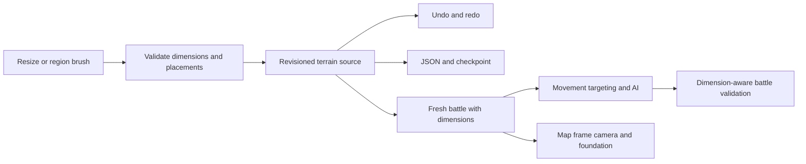

# Large-map studio

[Documentation](README.md) · [Level studio](LEVEL_STUDIO.md) · [Coverage audit](EXISTING_GAME_EDITORS.md) · [Open studio](https://cptnope.github.io/Echoes-of-the-Shattered-Crown/studio.html)

The battlefield editor supports rectangular maps from 9 to 32 tiles per side: up to 1,024 tiles instead of 81. It expands the current encounter source and uses the existing deterministic battle engine. The four default campaign encounters remain their original 9×9 size.

## Build a larger battlefield

1. In Battlefield, enter Map width and Map height and choose New tile terrain.
2. Choose Resize map. Existing cells retain coordinates and data at the northwest corner; new cells start elevation 0, open. Shrinking removes outer cells and rejects if any actor would be outside. Undo restores removed terrain.
3. Select a terrain, elevation or collision tool and a 1×1, 3×3 or 5×5 Brush size. A click changes the clipped square as one undo step. Collision uses the inverse of the clicked cell for the whole region. Brushes reject the entire edit if they would leave an actor blocked or on water.
4. Choose Small/Medium/Large tile size (24/36/48 pixels). Scroll inside the map frame. Enter Go to column/row and Find tile to focus and reveal a coordinate without painting it. Arrow keys clamp independently at each map edge; Enter/Space activates a focused cell with the selected tool.
5. Move heroes and monsters into the expanded area using Place actor. Map expansion does not automatically spread the current roster.
6. Playtest the revision. Fit map returns to the full view; Focus active actor centers the current unit at approximately the original encounter scale. Rotate and zoom controls work with mouse, keyboard activation and touch. The tactical tile controls remain available below the scene.
7. Save locally or export the source JSON. Reimport opens a validated, staged project. Loading a shipped encounter restores its 9×9 terrain and actors; Undo restores the expanded source.

## Shared contract

| Concern | Current contract |
| --- | --- |
| Source | Optional dimensions object with whole-number width/height in 9–32; absent means 9×9 |
| Terrain | Exactly one unique cell for every coordinate; existing four terrain kinds and elevation 0–2 |
| Actors | Four required heroes and up to twenty enemies; valid distinct placements inside boundaries |
| Transactions | Up to 1,024 edits, validated atomically; 50 source history entries |
| JSON limits | 128 KiB legacy maps; 512 KiB explicit dimensions; 8 MiB embedded native art |
| Runtime | Dimensions copied to Battle; movement, targeting, AI and action-save validation use the same geometry |
| Rendering | World tile coordinates remain x−4/z−4 to preserve existing sprite/VFX alignment; camera target and foundation center derive from dimensions |
| Performance | Tile coordinate lookup cached per tile-array identity; grass decoration drops from four tufts to one above 256 tiles; no frame-rate guarantee |

## Verification and limits

Ten tests in [studio-large-maps.test.ts](../src/studio-large-maps.test.ts) cover legacy defaults, maximum and rectangular maps, invalid dimensions/missing cells, shrinking and undo, atomic clipped brushes, real movement/attacks past coordinate 8, deterministic monster AI, catalog/content/checkpoint/JSON preservation, encounter reload and navigation/frame/lookup behavior. The complete suite has 202 tests.

A larger map may have unreachable routes or a slow battle; validation guarantees structural correctness, not mission balance. Actors, objectives and decoration programs retain existing identities/mechanics. No arbitrary rosters, chunks/streaming, runtime minimap, drag painting, free camera panning, procedural campaign generator or complete campaign export is claimed. Older builds reject the new optional dimensions field. Source remains version 1; this is additive compatibility for the current runtime, not a general migration system.
