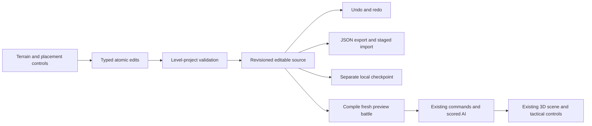

# Level studio pilot

[Documentation index](README.md) · [Full studio plan](studio/README.md) · [Play the studio](https://cptnope.github.io/Echoes-of-the-Shattered-Crown/studio.html)

The level studio is implemented at `studio.html`, available from camp and battle navigation. It loads any of the four existing encounter battlefields, edits and resizes them up to 32×32 tiles, and playtests the result with the existing engine, actor sprites and combat effects. It also edits [layered combat SFX](SOUND_EFFECTS_STUDIO.md). It implements parts of STSL-01/02/03/04; neither prototype slice nor the full authoring toolkit is complete.

## Edit and play

1. Open **Level studio**. It restores a valid local checkpoint when available; otherwise it opens the shrine template.
2. Select **Paint terrain**, **Set elevation**, **Toggle collision** or **Place actor**, then select a tile. Each click is one validated, undoable edit.
3. Open **Project details** to change the name or unsigned 32-bit battle seed.
4. Choose **Playtest revision**. Move, use abilities and end activations; enemies use the existing scored AI. The tactical tile controls provide a keyboard alternative to the 3D view.
5. **Restart preview** retries the captured source revision. **Return to editor** retains the editable project.
6. **Save locally** stores a checkpoint in this browser. **Export project** downloads the editable JSON for another browser or device.
7. **Import project**, or paste JSON and validate it. Review the project before choosing **Open project**. Cancel leaves the open source and history intact.

Keyboard: Tab reaches tools and tile buttons; arrow keys move focus within the board; Enter/Space activates the focused tile. A blocked tile displays ×, actor labels carry ally/enemy underlines, and each tile exposes its coordinates, terrain and elevation to assistive technology.

On phones, use **Show battlefield tools** to open the palette. The board scrolls horizontally inside its own frame to preserve selectable tile sizes (24, 36 or 48 pixels; choose Large for larger touch targets). Preview entry/exit returns to the top of the workspace.

## Implemented boundaries

| Area | Current behavior |
| --- | --- |
| Board | 9–32 tiles per side; exactly width × height unique cells; grass/stone/water/ice; elevation 0–2 |
| Actors | Four company heroes plus up to twenty enemies; editable instances and reusable templates |
| Placement | Reject overlapping actors and blocked/water deployment tiles |
| Rules/objective | Existing combat formulas, skills, initiative, AI and defeat-all objective |
| Edits | Typed atomic batches, expected revision checks, 50 retained undo steps and redo |
| Preview | Fresh isolated Battle for the selected revision and seed; isolated company and settlement; no player-save mutation |
| Local save | Explicit save; separate studio keys; previous-valid checkpoint fallback |
| Files | Strict level-project v1 JSON; 128 KiB legacy maps / 512 KiB maps with explicit dimensions / 8 MiB with embedded native sheet; unknown fields rejected |
| Distribution | Studio is a built static entry on GitHub Pages |
| Not yet implemented | New ally/neutral NPC identities, new objective/formula programs, advanced pixel/multitrack music editing, sampling/recording and full audio graphs, complete playable-game export, full project migrations or collaboration |

Undo and redo restore document data while increasing the revision. A new edit after undo discards the redo branch. Invalid batches leave the entire previous document intact. Undo history is session-only; files/checkpoints retain the current source, not the history.

## Source and runtime flow

## Implemented file contract

`src/studio-project.ts` owns the implemented format. The discriminator is `echoes-level-project`, version 1. Root fields are format, version, id, revision, name, seed, tiles, placements and optional sounds/music/pixels/nativeSprite/encounter/content/materials/gameAudio/rules/dimensions. Tile records contain x/z/h/terrain/blocked; placement records contain id/x/z. Optional content carries initial actor resources and contract reward definitions; ongoing health/status/turn snapshots remain separate.

This format is separate from player backups and the proposal examples under docs/studio/specs. Import rejects those formats and future fields rather than silently discarding editable data. A level JSON needs this compatible runtime/studio; it is not a standalone playable game or the planned Complete game artifact.

## Persistence and recovery

The browser keys are `echoes.level-studio.v1` and `echoes.level-studio.v1.backup`. Saving validates the source, preserves a valid previous primary as backup and then writes the new primary. A corrupt primary never replaces a valid backup. Storage failure reports an error; file export remains available.

A save compares the current stored value against the value last opened/saved by this tab. A stale tab must export its work and reload. This catches ordinary sequential multi-tab overwrites; localStorage provides no compare-and-swap primitive, so simultaneous writers are not a transactional collaboration system.

Campaign IndexedDB/manual/recovery slots are untouched. Playtest outcomes remain in memory, and playtest progress is not saved by a level-project export.

## Verification

Eight project tests join the existing 62 tests: exact source round trip, import rejection, atomic/stale/occupancy checks, undo/redo, edited runtime compilation, isolated terminal/retry/replay cases, corrupt-checkpoint recovery/stale writes and storage failure. The terminal cases use controlled battle fixtures; they do not certify the balance or reachability of every authored map.

Pages verification checks the studio HTML and its emitted asset paths alongside the game and animation workbench. Structural validation permits isolated routes; authors must playtest whether a map can be completed.

Applied sound banks use the same project history, checkpoint and source export/import. Level-project v1 files without sounds remain valid; older studio builds reject the new optional field. See the [SFX pilot guide](SOUND_EFFECTS_STUDIO.md) for source and playback contracts.

The [music-pattern pilot](MUSIC_PATTERN_STUDIO.md) adds one editable sixteen-step bar with loop audition, WAV export and preview playback alongside SFX. Applied notes use the same history/checkpoint/JSON path.

The [pixel-animation pilot](PIXEL_ANIMATION_STUDIO.md) adds a two-layer 16x24 clip with frame editing, source timing/pivot, PNG export and one-actor playback. Project JSON retains its optional pixels source alongside music and SFX.

The [action-clip extension](ACTION_CLIP_STUDIO.md) adds explicit Idle/Walk/Attack/Cast ownership and state-driven playback. Existing shared-loop files remain valid; rich projects may export as compact JSON to stay within the same 128 KiB limit.

[Native game-sprite editing](NATIVE_SPRITE_STUDIO.md) adds full-resolution imported character sheets as a separate optional nativeSprite source. Native mode takes precedence when both sprite sources target the same actor. Existing sources and original art files remain intact.

See [existing-game editing](EXISTING_GAME_EDITORS.md) for real encounter imports, editable terrain appearance, actor/dialogue/contract controls and original audio source. Objective labels remain text over the existing defeat-all rule; branching NPC/quest and full rule/campaign tools remain planned.

[Catalog overrides](RULE_CATALOG_STUDIO.md) add editable existing gear, abilities and jobs, with optional actor equipment and actual shared runtime consumption. Source rules can be removed to return to defaults when actor loadouts remain compatible.

[Large-map editing](LARGE_MAP_STUDIO.md) documents resizing, clipped brushes, map navigation, camera fitting and compatible source/save validation.

[Project validation](PROJECT_VALIDATION.md) recomputes for applied revisions. Errors block playtesting; ground connectivity and content warnings are advisory. Rejected imports have separate findings and never replace the current project.

[Connectivity overlays](CONNECTIVITY_OVERLAYS.md) explain selected ground-region warnings in a full-map overview and the editable grid. Clear/focus/inspection are view operations; repairs remain explicit author edits.

[Asset library](ASSET_LIBRARY.md) adds optional nativeSprites and abilityCues source fields. Array libraries export up to 32 MiB; legacy nativeSprite files keep their existing limit.
