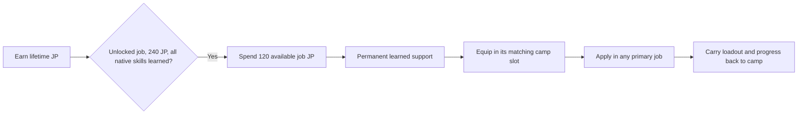

# Job mastery and support abilities

[Documentation index](README.md) · [Jobs](JOBS_AND_ABILITIES.md) · [Company](COMPANY_AND_PROGRESSION.md)

Version 0.4 gives each of the eight jobs a permanent support lesson. In camp, select a companion, open Training, and choose a job. Mastery requires that job to be unlocked, **240 lifetime JP**, and every native skill in its permanent learned collection. Native primary skills must still be learned for JP before they count; starter secondary skills already in the collection count normally.

Mastery is derived from progress, not a separate purchase or saved badge. Spend **120 unspent JP from the mastered job** to learn its support. This uses the same `jpSpent` account as ordinary skills, preserves lifetime levels and cannot buy the same lesson twice. Supports do not equip automatically.

## Lessons

| Job          | Support          | Slot     | Effect                                                                     |
| ------------ | ---------------- | -------- | -------------------------------------------------------------------------- |
| Vanguard     | Steadfast        | Passive  | Armor +2                                                                   |
| Blade Dancer | Lightfoot        | Movement | Move +1                                                                    |
| Arcanist     | Deep channel     | Passive  | Magic +3; fixed healing unchanged                                          |
| Lifebinder   | Second wind      | Reaction | After surviving an enemy ability hit, spend 2 energy to recover up to 4 HP |
| Shadowrunner | Close reprisal   | Reaction | After surviving an adjacent enemy Weapon strike, deal 5 damage back        |
| Runewarden   | Runic discipline | Passive  | Armor +1, magic +2                                                         |
| Storm Herald | Storm pulse      | Passive  | Magic +2, speed +1                                                         |
| Chronoweaver | Unhurried step   | Movement | Speed +2                                                                   |

Equip one passive, one reaction and one movement support using the controls below the selected job's lesson. **None** clears a slot. A learned support works with every primary job and remains equipped through job changes, deployment, result settlement and manual saves. Camp is required to learn or change these slots. Equipment and support bonuses stack in the shared derived-stat calculation; secondary jobs still provide skills rather than stats.

For example, Sera can earn 300 Vanguard JP, learn Sundering arc for 60, then learn Steadfast for 120. She retains 300 lifetime JP and has 120 spendable JP left. Equipping Steadfast adds two armor even after changing her primary job to Arcanist. Learning the support alone gives no stat bonus.

## Reaction timing

Reactions resolve immediately after a successful damaging ability hit, before checking the battle outcome. Second wind requires the defender to survive and have at least two energy; it cannot revive a fallen unit. It applies once per affected defender per successful ability hit. It does not react to misses, burn/terrain hazards or counter damage. It can trigger on multiple separate hits while energy remains.

Close reprisal requires an adjacent Weapon strike and a surviving defender. Its fixed damage stacks with the native Blade Dancer riposte when the attacker remains alive. Counter damage does not trigger another support reaction. If a reaction defeats the active attacker, the normal lethal-riposte path resolves the outcome or advances the turn. Damage previews show the incoming hit before reaction recovery or retaliation; they do not forecast the full exchange.

## Saves and limits

The expedition remains version 2. Optional `learnedSupport` and `supportSlots` fields are carried by member profiles and combat units. Saves without either field represent no learned/equipped supports. Once present, the learned IDs must be unique and known, all three slots must exist, and each equipped ID must be owned and match its slot. Extra slot keys are rejected. The existing v1 migration still applies.

Do not downgrade after learning supports: older builds do not apply the bonuses and can discard the new fields during result settlement. This milestone supplies one support lesson per existing job, not the full twenty-job roadmap, respecialization/refunds, extra active skill boards, or a separate character-level system. The enemy planner uses the existing hit preview and does not model full reaction exchanges.
