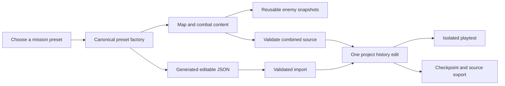

# Mission preset library

[Documentation](README.md) / [Greybank](GREYBANK_MISSION.md) / [ADR-0020](adr/0020-shared-balanced-mission-presets.md)

The four original missions, Greybank and the two [Emberwarden missions](EMBER_MISSIONS.md) share a reproducible authoring path. Open **Enemy templates / Playable mission presets**, choose a mission, then **Load mission preset**. Apply or discard other editor drafts first. The download link provides that preset's editable JSON without replacing the open project.

## Presets

| Mission | Board | Focus | Bounty / first-clear item |
| --- | --- | --- | --- |
| [The Shrine of Veyr](../public/missions/shrine.json) | 9 by 9 | Introductory crossing, elevation and elemental terrain | 60 / none |
| [The Drowned Causeway](../public/missions/causeway.json) | 9 by 9 | Flooded approach, mobile outriders and caster support | 85 / none |
| [The Oathless Redoubt](../public/missions/redoubt.json) | 9 by 9 | Advanced classes and an armored formation | 110 / none |
| [The Silent Belfry](../public/missions/bellkeeper.json) | 9 by 9 | Raised courtyard and Orren's half-health awakening | 140 / Bellkeeper's seal |
| [The Sluice at Greybank](../public/missions/greybank.json) | 18 by 14 | Tidewarden, two bridges and a frozen shortcut | 120 / Sluicekeeper's waystone |
| [The Ashen Weir](../public/missions/ashen-weir.json) | 20 by 16 | Emberwarden, split approaches and six defenders | 150 / Weirkeeper's token |
| [The Cinder Archive](../public/missions/cinder-archive.json) | 24 by 18 | Three terraces and six archive defenders | 180 / Archive lantern |

The original four and Greybank each have four heroes, four enemies, four reusable enemy templates and a four-line briefing. Each Emberwarden mission has four heroes, six enemies, six reusable templates and a five-line briefing. Original encounter stats, actor placements, learned skills, prerequisites and rewards are preserved. In Shrine, Causeway and Redoubt, the unused corner tile (8,8), isolated by two collision tiles, is now blocked scenery. No combat route or deployment moved. Belfry geometry is unchanged. The shipped main campaign remains unchanged; these are studio sources.

## Loading and ownership

Loading is one applied project transaction. It replaces the map, dimensions, combat catalogs, actor roster, templates, all four contract records and dialogue with canonical preset values. It retains the project ID, chosen seed, artwork, terrain appearance and audio sources. Earlier experimental stat overrides are intentionally reset. Preserved artwork overrides can still change appearance. The UI describes this replacement before the button; Undo restores the previous source.

The older Battlefield **Load existing encounter** action remains a source adapter that retains project catalogs and authored metadata. It can reject when retained dialogue or other references conflict with a different roster. Use the preset library for a complete balanced reset. Old project JSON remains valid; no automatic migration rewrites files or saves.

Original enemy instance IDs stay `sentinel`, `cinder`, `wraith` and `cantor`. Their template IDs are `enemy-<encounter>-<actor>-template`. They are independent snapshots; selective template updates are explicit. Keeping `sentinel` in Belfry preserves the engine's existing Orren phase trigger. Templates never replace the required runtime identities automatically.

## Reproduction and optimization

`npm run mission:build` regenerates all eight JSON sources from the same factory used by the UI. Generated IDs and seed 74319 are stable; fixture tests detect drift. The older Greybank-only generator remains compatible. Original preset construction reuses the already-created battle's unit data when adapting content, avoiding a second baseline battle generation. The legacy encounter adapter also creates its content snapshot once. No frame-rate or memory improvement is claimed without a benchmark.

## Verification and balance review

Ten tests cover the migrated sources, shipped stat/roster/progression parity, documented corner changes, generated fixtures, history/JSON recovery, all original battle outcomes, Orren's awakening, first-clear rewards and atomic rejection. The complete suite has 232 tests. All eight reports have zero errors and warnings.

| Preset | Controlled policy result at seed 74319 | Activations | Surviving allies |
| --- | --- | --- | --- |
| Shrine | Defeat | 12 | 0 |
| Causeway | Victory | 19 | 4 |
| Redoubt | Defeat | 17 | 0 |
| Belfry | Victory | 38 | 1 |
| Greybank | Victory | 39 | 4 |

The policy uses existing AI for both teams and does not reproduce a skilled player's tactics or carried company progression. Every intermediate save validates. Losses are recorded honestly; this migration establishes compatibility, not difficulty certification. Shrine and Redoubt deserve a focused human balance review before wider content expansion. Do not weaken their defenders merely to make one policy pass.

The next campaign milestone is a multi-mission project with distinct mission IDs and authored links. Greybank still occupies causeway in its own studio preset; it is not inserted into the shipped campaign automatically.

The two Emberwarden presets use `redoubt` in their own standalone sources; neither invokes Orren's sentinel phase. See the [mission pack](EMBER_MISSIONS.md) for authored catalogs, seeded wins/losses and current limits.

[The Lantern Parley](../public/missions/lantern-parley.json) is a 20 by 16 character showcase with two playable profiles, two named rivals, six enemies and a six-line briefing. See the [character pack](CHARACTER_CLASS_PACK.md) for party-slot and artwork details.
