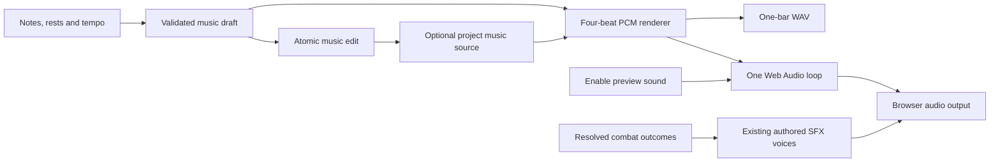

# Music-pattern studio pilot

[Level studio](LEVEL_STUDIO.md) · [Sound effects](SOUND_EFFECTS_STUDIO.md) · [Full audio plan](studio/AUDIO_STUDIO.md)

The implemented **Music** editor composes one monophonic, four-beat bar. It complements the layered SFX editor; multitrack arrangements, recording, sampling, adaptive music and full DSP graphs remain planned.

## Compose and use a loop

1. Select **Music** in the level studio. The starter sketch is not part of the project until applied.
2. Choose notes or rests for sixteen sixteenth-note steps. The four-step groups correspond to the bar's four beats.
3. Edit tempo, instrument, gain and note gate. Gate is the fraction of each step occupied by its note.
4. Choose **Loop music draft**, then **Stop music**. Switching editors stops audition. **Export music WAV** downloads one complete bar.
5. **Apply music edits** commits the pattern as one undoable source edit. Save locally or export the project JSON to preserve its editable notes/settings.
6. Playtest the revision and choose **Enable preview sound**. Included music loops alongside resolved combat SFX. Mute, restart and exit stop/restart or dispose playback.

**Preview music** can keep the source while omitting the loop from preview. Audition and WAV export remain available. Draft changes must be applied/discarded before project save/export, import or playtest. Unchanged starter sketches do not block these actions.

## Implemented contract

| Field | Contract |
| --- | --- |
| Pattern | version 1; one bar; exactly sixteen steps |
| Notes | MIDI 48–84 (C3–C6), or null for rest |
| Tempo | 60–180 BPM; four quarter-note beats per bar |
| Instrument | sine, triangle or square |
| Gain | 0–1; renderer applies a 0.3 output scale |
| Gate | 0.2–0.95 of each step |
| Envelope | Fixed 5 ms attack and decay to zero within the note |
| Preview binding | enabled boolean; omitted patterns remain editable |
| Rendering | 22,050 Hz mono; bar length round(240 / BPM × sample rate) |
| Playback | One loop, replaced on new audition; existing cap of four SFX voices remains separate |
| WAV | PCM16 mono, one bar from the same PCM used for playback |

Rests contain zero samples. Each note ends before the next step, and the bar begins/ends at zero. Counts and loop duration derive from source values. This pilot has no sustain across the bar boundary, per-note velocity, chords, tracks, arrangement or recording.

## Source and playback

Level-project v1 accepts optional music alongside optional sounds. Old files without music remain valid and have no preview music. Older studio builds reject unfamiliar source fields; use the current studio to reopen enhanced files. WAV export is a rendered derivative; JSON retains notes and settings. These are not standalone game artifacts.

Music does not use combat RNG, mutate battle state or settle company rewards. The normal company game still uses its original audio sketch; authored patterns play in the studio preview.

## Verification

Six music tests cover tempo/step timing and silence, sound-control changes, strict bounds/source validation, atomic project/history/import preservation, exact WAV samples and one-loop replacement/stop/disposal with a test AudioContext. The full suite now has 84 cases.

Device audibility and resampling are browser/device concerns; a mocked context does not certify them. Browser review should compose a note, audition/stop, export both WAV and editable project, reopen it, then enable/mute/restart preview with music and SFX together.
