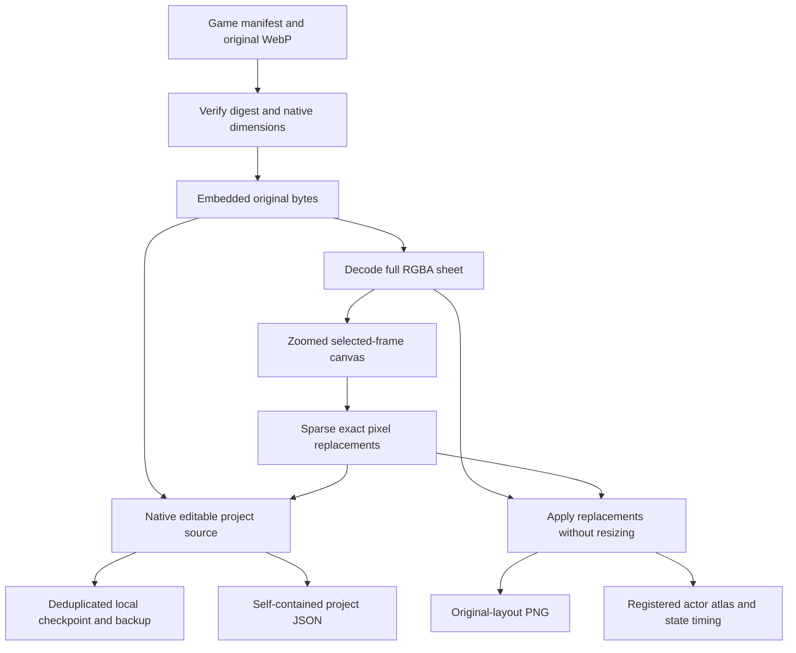

# Native game-sprite editor

[Studio](LEVEL_STUDIO.md) · [Small indexed editor](PIXEL_ANIMATION_STUDIO.md) · [Animation pipeline](ANIMATION_PIPELINE.md) · [ADR-0013](adr/0013-native-sprite-sources-and-overrides.md)

The **Pixels → Game sprites · native resolution** mode edits artwork already shipped in the game. It loads all eight job sheets at 887 × 1774, with 32 frames across idle, walk, attack, cast, hurt, guard, victory and downed. Frames are 221 or 222 pixels wide/high because the original sheet dimensions do not divide evenly. No resizing, palette reduction or alpha threshold is applied.

[The asset library](ASSET_LIBRARY.md) now keeps up to 24 native actor assignments. Pixels / Stored native sprite selects an assignment; New sheet assignment creates another. Applying preserves every other actor. Legacy single-sheet projects remain readable and migrate to the array when the library is used.

## Load and edit

1. Choose a game character sheet and preview actor, then **Load game sheet**. The loader verifies the asset against its manifest SHA-256 and checks decoded dimensions. This creates an unapplied draft.
2. Choose a state and one of its four frames. Zoom 1×/2×/4×/8× scrolls inside the canvas. It never changes image resolution.
3. Paint with 1×1, 3×3 or 5×5 brushes, erase, flood fill or sample exact RGBA with the eyedropper. Paint color and alpha are independent; eraser writes transparent black. Fill compares all four channels and stays within the selected frame.
4. Keyboard users can focus the canvas and move the source cursor with arrows, then Space/Enter. Pixel x/y fields and **Use native tool at cursor** provide an explicit alternative. The cursor is reported below the canvas.
5. A dragged stroke is one undo step; cancelled strokes restore their starting source. Timing and applied edits are undoable. Native draft history retains thirty snapshots. Apply/discard before project save/export/playtest or loading another sheet.
6. **Play native clip** auditions selected-state source timing. Set each frame to 40–1,000 whole milliseconds. State/column identities remain fixed to the original 4 × 8 atlas.
7. **Apply native sprite edits**, then save/export the project and playtest. The selected actor uses this artwork with original display scale and per-frame foot registration. Physical/magical actions and all other animation states use their actual battle presentation signals.
8. **Export native PNG sheet** writes a lossless 887 × 1774 PNG in the original layout. Export project JSON as well to retain the embedded original, editable pixel overrides and timing.

## Source and runtime contract

| Value | Contract |
| --- | --- |
| Original | Embedded WebP bytes; immutable SHA-256, dimensions and job identity |
| Pixel values | Exact eight-digit RGBA; no indexed palette conversion |
| Editable source | Sparse replacements keyed by full-sheet pixel index; transparency replaces underlying art |
| Geometry | Four columns and eight rows; crop boundaries use rounded proportional source coordinates |
| States | Four fixed frames per state; independent source durations |
| Registration | Original idle height and 32 foot offsets; not inferred again from edited pixels |
| Actor binding | One assignment per actor, including custom enemy IDs; does not change jobs or stats |
| Composition | Original decoded pixels plus sparse RGBA replacements |
| Playtest | Existing atlas UVs, display scale, team tint and all eight state priorities |
| Coexistence | Native source wins when enabled and targeting the same actor as the small indexed source |
| Source limits | 8 MiB legacy native source; 32 MiB native library; 128 KiB legacy or 512 KiB expanded maps without native sources |
| Local checkpoint | Shared original image keyed by digest plus compact primary/backup sources |
| Portable export | Original image embedded in every exported JSON; no local checkpoint references |

Import validates structure, bounds and size. Image decoding separately verifies digest and natural dimensions before editing or compiling a native texture. A broken embedded image remains an error rather than being painted over as if it loaded successfully. Original repository art is not overwritten; apply creates a project override. Normal company gameplay continues to use repository artwork.

## Limits and recovery

Native mode edits the flattened runtime image; original AI/source-master layers cannot be reconstructed from a WebP. The separate indexed mode retains its two source layers, transformations and cel-copy tools. Native mode does not yet provide layers, region selections/transforms, frame insertion/reordering, direction sets, arbitrary image upload or exporting replacements directly into a published main-game build.

The native source allowance is bounded. A heavily repainted sheet can exceed the JSON limit because sparse replacement addresses cost space; export errors report that limit. Browser storage quota is independent and can be lower. Original sheets are cached by digest for checkpoints, so repeated saves of the same sheet do not duplicate the embedded image. Loading many distinct sheets can still exhaust quota; a failed save keeps the prior checkpoint, and a project JSON or PNG can be downloaded. Automatic cache deletion is not performed.

Eight new automated cases verify original bytes, all sheet rectangles, exact decoded RGBA extraction, alpha/erase/atomicity, connected fill, rejection, state timing, portable history and checkpoint failure/recovery. See [testing](TESTING.md) for the complete current suite and integration boundary.

Two dedicated artwork sources are now available alongside the eight original job sheets: [Glass Ranger and Ash Cantor](CHARACTER_CLASS_PACK.md). They work with the same native pixel and timing tools and can be assigned to current actors, including named custom enemies.
