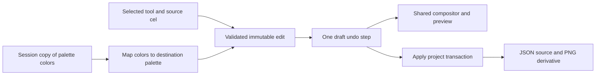
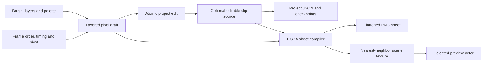

# Pixel and animation studio pilot

[Level studio](LEVEL_STUDIO.md) · [Full pixel blueprint](studio/blueprints/PIXEL_ANIMATION_EDITOR.md) · [Current animation pipeline](ANIMATION_PIPELINE.md)

The implemented **Pixels** editor paints a small, layered source clip and applies it to one actor in the studio playtest. It implements part of STSL-03, not the full character-production toolchain. The original game art remains available when the custom clip is omitted.

[Independent action clips](ACTION_CLIP_STUDIO.md) extend this pilot with explicit Idle/Walk/Attack/Cast conversion and 1–4 owned frames per action. Unconverted projects retain the original shared-loop behavior.

For the actual higher-resolution game characters, choose **Game sprites · native resolution**; see the [native sheet editor](NATIVE_SPRITE_STUDIO.md). This guide describes the separate small indexed editor. Native mode supports all eight shipped states and partial alpha without a palette reduction.

## Edit, animate and play

1. Open the studio and select **Pixels**. The starter lantern sprite is editable source, not an imported production character.
2. Select a palette entry or **Erase**, then click/drag on the source canvas. Each stroke is one local draft undo step. Keyboard users can Tab to the canvas, move with arrows and paint with Space/Enter.
3. Expand **Layers, onion skin and motion** to choose base/detail, toggle visibility or swap layer order. Hidden source pixels remain editable after showing that layer.
4. Select a frame, duplicate/delete/reorder it, and set its duration. Edit palette colors or the shared pivot.
5. Choose **Play clip** to audition source timing. Reduced motion holds frame 1. Onion skin shows the previous composited frame only where the current frame is transparent; it never changes source pixels.
6. Choose the preview actor and whether to use the clip. **Apply pixel edits** commits it as one project transaction. Save locally or export project JSON to preserve all layers, frames and registration.
7. **Export PNG sheet** packs the visible layers into a horizontal strip. The PNG does not carry editable layers, durations or pivots; keep the project JSON.
8. Playtest the revision. The selected actor uses the compiled clip with nearest-neighbor filtering. All other actors retain their original art.

Draft pixel history retains 30 snapshots, independently of the 50-step project history for applied source changes. A new draft edit discards draft redo. Switching editors pauses audition and cancels an unfinished stroke. Invalid brush batches reject atomically. Apply/discard is required before project save/export, import or playtest.

## Faster pose editing

| Tool | Behavior | Scope |
| --- | --- | --- |
| Brush | Paint or drag a palette entry; Erase writes index zero | Selected source cel |
| Flood fill | Replace the four-connected region matching the clicked source index | Selected source cel; no diagonal or row-edge wrapping |
| Eyedropper | Select the clicked source index, including transparent zero | Reads selected layer, even when hidden; ignores composited/onion colors |
| Flip horizontally / vertically | Mirror around the fixed canvas center | Selected source cel; pivot and timing stay fixed |
| Nudge left / right / up / down | Shift exactly one source pixel | Edges crop; empty cells become transparent |
| Copy / paste layer pixels | Replace all destination pixels, including transparency | One cel; can cross frames, actions and layers |

Choose Brush, Flood fill or Eyedropper above the palette. Click or use Space/Enter on a focused pixel. Only Brush drags. Expand **Transform and copy layer** beside the preview to reuse and adjust poses. Every changed fill, flip, nudge or paste is one draft undo step. An unchanged result adds no draft step. Writes require a visible layer.

The copy buffer is local to the mounted editor session and is never included in JSON, browser checkpoints or the PNG. It captures RGBA palette values rather than unstable indices, maps them to current palette entries on paste and rejects missing colors atomically. Changing a palette color after copying may therefore require copying again. Paste replaces a cel; it does not merge only opaque pixels.

## Implemented source contract

| Field | Contract |
| --- | --- |
| Document | version 1; fixed 16×24 source; one actor binding and enabled flag |
| Actors | The eight shrine roster IDs |
| Palette | 2–16 indexed entries; index 0 exactly transparent; all others opaque RGBA hex |
| Layers | Exactly base and detail, stable IDs, explicit order and visibility |
| Frames | 1–4 legacy frames, or 1–4 per action (up to sixteen); each has two 384-index cels |
| Duration | 40–1,000 whole milliseconds per frame |
| Pivot | Shared integer x 0–16, y 0–24, measured from the source top-left |
| Composition | Last visible nontransparent layer wins; no source flattening |
| Sheet | Width = 16 × frame count, height = 24; exact composited RGBA pixels |
| Source export | Optional pixels field in level-project v1 |
| PNG export | Visible-layer derivative, horizontal frame order, transparent background |

Palette edits preserve pixel indices. Layer reordering moves the corresponding cels with each stable layer ID. Duplicated frames get independent arrays and a new ID. Reordering frames preserves their IDs, timing and cels.

## Compile and runtime boundary

The same frame compositor feeds editor preview, PNG export and the scene texture. Source frame durations select the atlas column; the pivot controls sprite registration. Compilation/playback do not consume combat RNG or change battle state.

Unconverted custom sources loop across living states. Converted sources use authored action clips; see the [state-selection contract](ACTION_CLIP_STUDIO.md). Existing combat effects and authored audio remain available.

Old level projects without pixels remain valid. The current studio preserves the optional source; earlier builds reject unfamiliar fields. Disabling a clip retains its source and restores original actor art in a fresh preview.

## Limits and verification

Resizing, arbitrary image-file import, per-frame pivots, attachments, free-form layer counts, partial-alpha paint, extra state/direction clips, tile editing and standalone complete-game export remain planned.

Eight base pixel cases verify source editing and packing. Eight action-clip cases add ownership, timing, compatibility and large-export checks. Six pose-tool cases add fill, transforms, paste and rejection checks. The full suite has 202 tests.

Browser review should paint and undo a stroke, edit timing and registration, audition, export PNG plus source, import/reopen it, and inspect the selected actor in a real playtest. A flattened PNG or passing schema check alone does not prove a full animation authoring tool.
