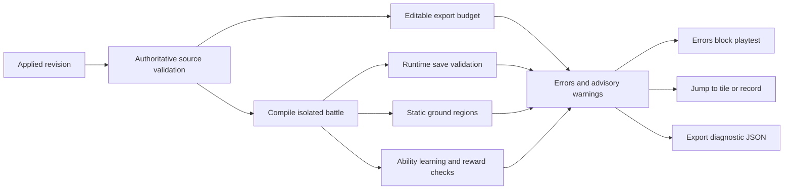

# Project validation panel

[Documentation](README.md) · [Coverage audit](EXISTING_GAME_EDITORS.md) · [Large maps](LARGE_MAP_STUDIO.md) · [Open studio](https://cptnope.github.io/Echoes-of-the-Shattered-Crown/studio.html)

The studio checks the applied project revision whenever source changes. Project validation shows errors and warnings above the editors. Choose Show findings, filter by severity and follow Show map regions or an Inspect button to the affected geometry, actor or catalog definition. Each finding explains the issue and a possible fix. Export validation report downloads a deterministic JSON report with the source revision, checks, counts, stable finding IDs, paths and targets.

## Severity and scope

| Finding | Severity | Behavior |
| --- | --- | --- |
| Invalid source schema or actor/job/gear/learned-skill/dialogue/contract/reward references | Error | Blocks playtesting that source; malformed imports are rejected before replacing the open project |
| Invalid placement, missing cells or incompatible starting equipment | Error | Existing validators reject the edit/import; diagnostics add record or tile addresses where possible |
| Export-size budget exceeded | Error | Blocks playtesting an applied revision that cannot be exported; reduce dialogue, frames or pixel edits |
| Compiled battle fails runtime save validation | Error | Blocks playtesting until source produces a reloadable battle |
| Spawn has no adjacent ground exit within one elevation step | Warning | Inspect the actor tile; open a neighbor, change elevation or move the actor |
| Enemy region has no continuous ground route from any ally spawn | Warning | One warning lists all affected enemies in that region. Show map regions highlights ground and adjacent barriers; add a route or test ranged/terrain-changing skills |
| Ally has no ground connection to another ally spawn | Warning | Check whether split deployment is intentional |
| Disconnected ground region without any actor spawn | Warning | Aggregates region/tile counts and points to a representative tile; scenery islands may be intentional |
| Available ability exceeds some users' maximum energy | Warning | Links to the ability definition and names affected actors |
| Ally lacks a positive-power damage ability within maximum energy | Warning | Links to the actor; review jobs, learning and resources; reactions/utility are not simulated |
| Learned ability is inactive with the current job pairing | Warning | Links to the actor; an intentional future job change may use the lesson |
| Damage/heal ability has zero power and no named effect | Warning | Links to the ability; stats may still contribute to the actual result |
| First-clear reward gear allows no existing job | Warning | Links to that gear's proficiency controls |

Warnings never disable playtesting. Existing pending-draft guards still apply: diagnostics describe applied source, and finding navigation/playtesting wait until drafts are applied or discarded. Findings are not dismissed as repaired; they disappear when source changes resolve them. A severity filter affects the visible list, not the total counts or blocking state.

## Following a finding

- A connectivity finding offers Show map regions, opens the [derived overlay](CONNECTIVITY_OVERLAYS.md) and selects Inspect mode. Its actor and barrier controls reveal the corresponding editable tiles without painting.
- An actor finding opens Characters and NPCs with that actor selected. A catalog finding opens the correct ability/job/gear subsection and record.
- Content targets can select the relevant contract/dialogue subsection. Rejected-import findings are displayed without navigation into the different open project's records.
- General source findings open the project JSON disclosure. Show current source is an inspection action and can show a revision even when export-size checks fail; exporting still enforces the source budget.
- Import validation is separate from Project validation. A rejected file never replaces source, clears history or disables a healthy project's playtest. Dismiss import report clears that review message. Valid imports show their own report in the staged confirmation dialog before Open project.

## Connectivity algorithm

Build connected regions from nonblocked grass/stone/ice tiles. Neighbors share an edge and differ by at most one elevation step. Water is excluded. Traverse the full static map with a queue, ignoring actor occupancy and per-turn movement allowance. Compare actor spawn regions, group disconnected enemies by component, then aggregate regions without a spawn.

## Evidence and limitations

Twelve tests in [studio-validation.test.ts](../src/studio-validation.test.ts) exercise all four shipped sources; disconnected water/collision/elevation; ice crossings; trapped spawns; empty regions; scoped costs/availability; inactive learning and reward restrictions; addressed malformed references; invalid placement/map/source; an otherwise valid source over the export budget; import limits/future fields; deterministic reports, source isolation and JSON round trips. The complete suite has 166 tests.

This is a bounded authoring check, not a solver or balance certification. It does not simulate ranged reachability, terrain changes, reaction damage, future job changes, turn-by-turn AI or mission completion. An empty report means no finding from the implemented checks. Asset byte decoding, arbitrary scripts, full campaign packaging and schema migrations remain separate work. Reports describe one source revision and are not imported as editable projects or player saves.
