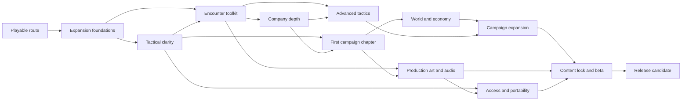
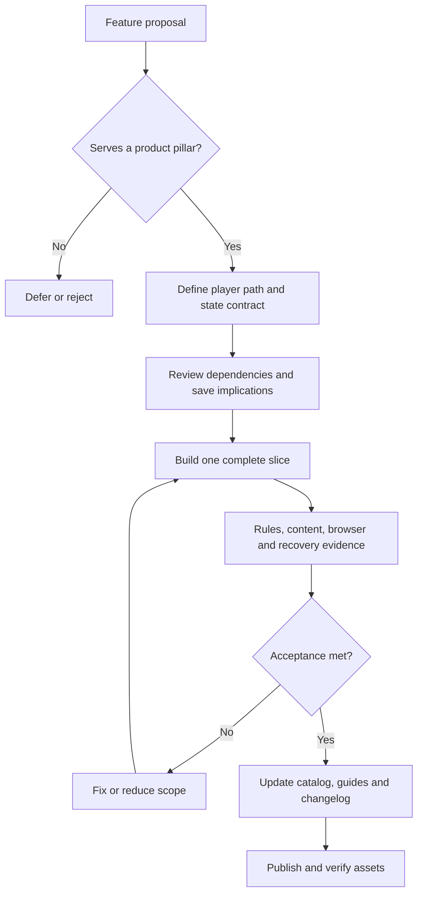

# Expansion roadmap

[Documentation index](README.md) · [How the game works](SYSTEMS_GUIDE.md) · [Roadmap library](roadmap/README.md) · [160-item backlog](roadmap/BACKLOG.md)

This plan grows the playable v0.8 contract route into a complete original tactical RPG. **Only the baseline below is implemented.** Proposed milestones are acceptance gates, not scheduled releases or delivery-date commitments. The original [project brief](../PROJECT_BRIEF.md) remains the long-term vision.

## Reading map

| Question | Reference |
| --- | --- |
| What works today? | [Systems guide](SYSTEMS_GUIDE.md), [generated catalog](REFERENCE_CATALOG.md) |
| What should be built next? | [Next three increments](#next-three-increments), [backlog](roadmap/BACKLOG.md) |
| What foundations must change? | [Engine and data expansion](roadmap/ENGINE_AND_SYSTEMS.md) |
| What will the world contain? | [Content and campaign plan](roadmap/CONTENT_PLAN.md) |
| How will assets be produced? | [Art and audio production](roadmap/ART_AUDIO_PRODUCTION.md) |
| When is a milestone complete? | [Quality and release gates](roadmap/RELEASE_AND_QUALITY.md) |

## Verified foundation

| Area | Implemented in v0.8 | Current boundary |
| --- | --- | --- |
| Company | Four companions, training, outfitter, gold, shared gear | Fixed roster; no recruitment or separate character level |
| Contracts | Shrine, causeway, redoubt, belfry; gated route and repeatable bounties | Four 9×9 boards, eight units per battle |
| Builds | Eight jobs, thirteen active skills, mastery, eight support lessons | Twenty-job target is a proposal; some skills are shared |
| Gear | Ten items, three equipment slots, proficiency and copy allocation | No consumables, crafting, selling or random loot |
| Rules | Seeded turns, height, facing, LOS, statuses, guard, reactions, momentum | No general objective engine or broad terrain system |
| AI | Movement/action scoring, healing and support choices | No multi-turn search or authored tactic graphs |
| Art | 256 character frames, 96 effect frames, bounded particles, portraits | Single character view; shared time effect; regional environment kit |
| Persistence | Expedition v2, manual/recovery backups, portable envelope v1, v1 migration | Browser-local; no cloud sync or multi-tab conflict arbitration |
| Verification | 62 automated cases and Pages asset checks | Not full device, accessibility, balance or frame-rate certification |

The [generated catalog](REFERENCE_CATALOG.md) derives current counts and tables directly from source. Implementation guides describe current behavior; this roadmap describes proposed changes.

## Product pillars

| Pillar | Expansion rule | Reject or revise when |
| --- | --- | --- |
| Readable tactics | Explain legal targets and consequences before confirmation | Effects conceal tiles or previews disagree with outcomes |
| Flexible company | Jobs create alternatives without irreversible early traps | One mandatory build or repeated grinding blocks progress |
| Original world | Mechanics and choices reinforce the cost of repairing the crown | Content depends on borrowed identities or unrelated filler |
| Reliable progress | Migrations and recovery accompany every new persistent system | A feature can discard progress or duplicate rewards |
| Deterministic rules | Simulation stays independent of rendering and input | Frame rate, particles or audio change a hit roll |
| Finite production | Finish small slices and reuse deliberate motifs | Content totals outrun asset and verification capacity |

## Milestone gates

| Gate | Scope | Dependencies | Acceptance before advancing | Status |
| --- | --- | --- | --- | --- |
| M0 | Existing contract route | None | Preserve current four-map baseline and limitations | Implemented baseline |
| M1 | Expansion foundations | M0 | Central board/roster constraints, content validation, replay fixtures, migration policy | Planned next |
| M2 | Tactical clarity and input | M1 | Explain previews, objectives, focus and persisted settings through a complete encounter | Planned |
| M3 | Encounter toolkit | M1, M2 | Two board sizes, variable deployment, objective reducers and a non-elimination mission | Planned |
| M4 | Company depth | M1, M3 | Recruit/bench model, deeper skill learning and two complete new jobs | Planned |
| M5 | First campaign chapter | M2, M3, M4 | Map → dialogue → mission → consequence → save/reload → next mission | Planned |
| M6 | World and economy | M4, M5 | Town services, faction consequence and bounded crafting without progression deadlocks | Planned |
| M7 | Advanced tactics | M3, M4 | Summons, props and selected weather rules have deterministic previews and save coverage | Planned |
| M8 | Wider campaign and roster | M5, M6, M7 | Expand proven chapter patterns; each new job meets a complete integration gate | Planned |
| M9 | Production presentation | M3, M5 | Directional/longer animations, environment kits and audio fit measured budgets | Planned |
| M10 | Accessibility and portability | M2, M5, M9 | Browser/input matrix and recovery-safe offline updates pass | Planned |
| M11 | Content lock and beta | M8, M9, M10 | Balance coverage, migration rehearsal, provenance and complete route QA | Planned |
| M12 | Release candidate | M11 | No blocking defects; restore/rollback rehearsal; explicit shipped scope and support notes | Planned |

M9 and M10 are continuing production tracks, not work deferred until all content is written. A scope cut must be marked deferred rather than described as complete.

## Next three increments

Recommended order, not a promise of a particular next release:

| Increment | Backlog IDs | Concrete result | Stop condition |
| --- | --- | --- | --- |
| A — Safe expansion seam | FND-01, FND-02, MAP-01, SAV-01, QA-01 | Checked inventory of fixed board/roster assumptions and replayable fixtures | Existing saves and all four deterministic battles remain valid |
| B — Explain the battle | CBT-01, UX-01, UX-02, OBJ-01, AI-01 | Better preview explanations and objective vocabulary using current maps | Input, preview and resolution agree |
| C — One new mission pattern | MAP-02, MAP-03, OBJ-02, QA-02 | One alternate-size mission with one new objective and explicit retry/settlement | Resume, victory, defeat and retry are demonstrated |

Do not start a world-map screen by itself: join mission gating, dialogue, rewards and recovery in one small playable route. Prove registration, facing selection and atlas budgets on one job before producing thousands of directional frames.

## Expansion tracks

All 160 entries in the [backlog](roadmap/BACKLOG.md) are planned. Each has an ID, priority/relative size, milestone, dependencies and acceptance evidence.

| Prefix | Track | Items | Critical integration |
| --- | --- | --- | --- |
| FND | Architecture and tools | 10 | Typed boundaries and reproducible transitions |
| MAP | Maps and deployment | 10 | Dimensions, occupancy, camera and saves together |
| CBT | Combat rules | 10 | Previews, RNG and reaction order |
| OBJ | Objectives and rewards | 10 | Terminal state, retry and exactly-once settlement |
| AI | Enemy behavior | 10 | Legal actions and objective scoring |
| JOB | Jobs and ability boards | 10 | Learning, loadouts, art, AI and migrations |
| CMP | Company and recruitment | 10 | Profiles, reserves and deployment |
| NAR | Narrative and campaign | 10 | Quest flags, branches and checkpoints |
| ECO | Inventory and economy | 10 | Transactions, sinks and softlock prevention |
| WRL | Towns and world systems | 10 | Travel, factions, props, summons and weather |
| ART | Characters and environments | 10 | Direction selection, registration and budgets |
| VFX | Effects and presentation events | 10 | Ordered results and bounded pools |
| AUD | Audio and music | 10 | Gesture, mixers, provenance and mute behavior |
| UX | Input and accessibility | 10 | Complete player paths across controls |
| SAV | Persistence and portability | 10 | Migration, conflicts, updates and recovery |
| QA | Verification and release | 10 | Content routes, devices and rollback |

## Scope options

These are planning envelopes, subject to production capacity. The largest option is not automatically the release requirement.

| Area | Next chapter slice | Broader campaign candidate | Stretch |
| --- | --- | --- | --- |
| Jobs | Current eight plus two complete additions | Twenty fully supported jobs | More only if roles remain distinct |
| Missions | Existing four, one new objective mission and a short chapter chain | Roughly 24–36 authored missions | Optional challenge variants |
| Companions | Four originals, one recruit and a reserve slot | Roughly 8–12 authored recruits | Extra recruit stories after route QA |
| Regions | Veyr plus one adjacent region | Six proposed regional kits | Extra biomes with a tactical purpose |
| Gear | Current ten plus a curated chapter set | Roughly 40–60 purposeful items | Cosmetic variants and postgame upgrades |
| Abilities | Deepen current identities first | Approximately 60–80 distinct skills | More only with demonstrated decision value |
| Story | One complete branch and consequence | Several tested routes and supported endings | Additional endings after route coverage |
| Platforms | Desktop baseline plus targeted touch/controller checks | Published browser/device matrix | Native wrappers after stable web delivery |

Mission counts mean authored encounters, not menu entries. Shared skills count once. A region needs an environment kit, navigation, missions, audio treatment and a save path. Twenty data rows do not satisfy the job target.

## Change control

Done means the acceptance evidence exists, player controls work, save behavior is explicit and guides describe what shipped. Preserve IDs when rescheduling; mark superseded work with a successor. The [quality plan](roadmap/RELEASE_AND_QUALITY.md) lists release risks and unresolved decisions.

