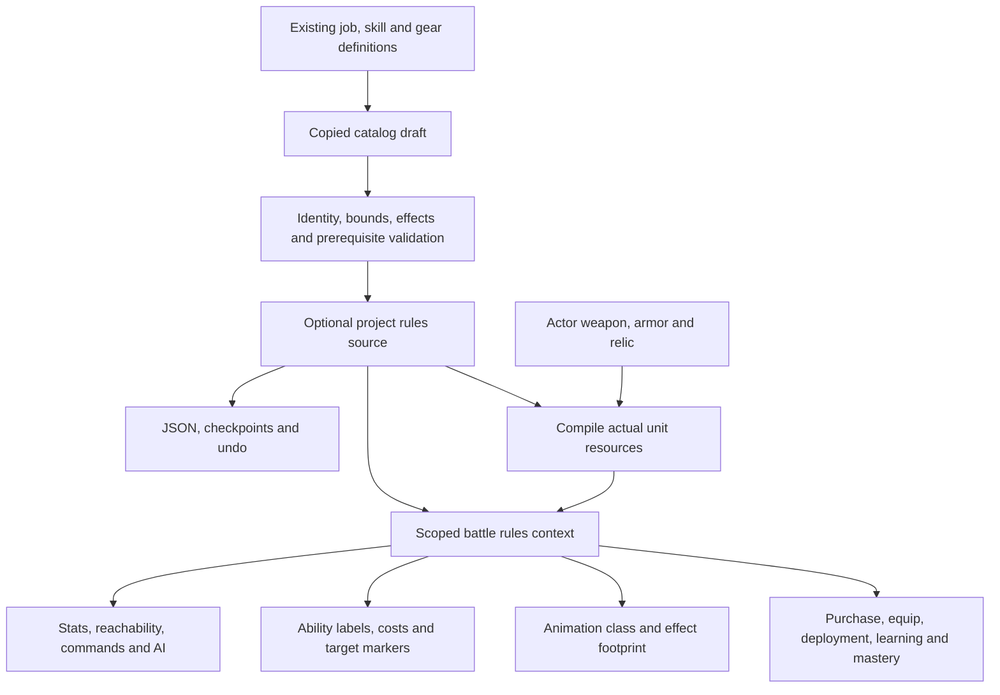

# Gear, ability and job catalog overrides

[Editor coverage](EXISTING_GAME_EDITORS.md) · [Level studio](LEVEL_STUDIO.md) · [Architecture decision](adr/0015-scoped-rule-catalogs.md)

**Gear, abilities & jobs** loads all 13 current abilities, 8 jobs and 10 equipment definitions. Applying a catalog adds a scoped rules source to the project. A compiled battle carries that context; shared engine, AI, campaign and presentation functions resolve it explicitly. Imported global catalogs are never mutated.

## Editable definitions

| Domain | Editable fields | Consumed by |
| --- | --- | --- |
| Ability | Name, description, cost, range, power, radius, kind, element, existing effect | Skill availability, energy, targeting, damage/healing/status resolution, AI scoring, animation classification and effect footprint |
| Job | Name, role, accent, movement, speed, attack, armor, magic, native abilities, prerequisite job levels | Unit stats, path reachability, initiative, AI movement/ability selection, unlock, learning and mastery checks; display labels |
| Gear | Name, description, slot, price, reward-only flag, proficiency jobs, six bonuses | Spawned actor stats, player equip rules, shop purchase, deployment and source/save validation |
| Actor loadout | Weapon, armor, relic | Current ally/enemy spawn; validated against the active gear catalog and primary job |

Shipped IDs remain mandatory. [Custom content authoring](CUSTOM_CONTENT_AUTHORING.md) supports additional stable IDs: up to 48 classes, 128 abilities and 128 gear records in total. Custom classes and abilities bind to an existing archetype for mechanics and presentation. Creation does not generate new art or effect programs.

## Author, apply and test

1. Select the catalog section and existing record. Changes remain a draft until **Apply catalog overrides**.
2. For abilities, edit values and choose among implemented effects. Effect-kind mismatches reject; power is interpreted by the existing formula, so fixed buff/revive conventions are not arbitrary numeric programs.
3. For jobs, assign native abilities and prerequisite levels. Missing/duplicate references and prerequisite cycles reject.
4. For gear, edit its bonuses, price and allowable jobs. An omitted jobs list allows every job; an empty restricted list allows none. **Try the real shop purchase function** runs an isolated company fixture with this draft and reports actual gold/stock results.
5. In **NPCs, dialogue & progression → Characters and NPCs**, select starting weapon/armor/relic. Existing identities and teams are retained; enemies use the same catalog as allies.
6. Apply and playtest. The ability list, costs and target markers use the scoped definitions, and legal commands/AI consume those same values.
7. Save/export the project and reopen it. **Use shipped catalog defaults** removes the override when current actor loadouts remain compatible. Undo can restore the prior catalog transaction.

A slot or proficiency change can invalidate a currently equipped actor item. The project transaction rejects instead of silently unequipping or discarding it. Unequip/change that actor loadout first, then apply the new catalog. A compatible removal of catalog overrides falls back to shipped definitions while preserving other project sources.

## Runtime ownership

The main battle/camp interfaces also resolve an optional battle catalog for labels and shared operations; absence keeps baseline behavior. This is not a complete project-to-main-game export pipeline. Studio map, dialogue, sprite, audio and material overrides still require the compatible project preview.

## Validation and bounds

| Source | Bounds |
| --- | --- |
| Ability cost / range / power / radius | 0–99 / 0–16 / 0–250 / 0–4, whole values |
| Job move / speed | 1–8 / 1–99 |
| Job attack, armor, magic | 0–99 |
| Job prerequisite levels | 1–99; UI zero removes the prerequisite |
| Gear price | 0–9,999 |
| Gear HP / movement bonuses | −100–500 / −8–8 |
| Other gear bonuses | −99–99 |
| Actor HP after bonuses | Clamped to at least one; maximum resources reset only for fresh compilation |
| File limits | 128 KiB legacy, 512 KiB explicit dimensions, 8 MiB native art |

Actor gear must use a matching slot and valid job proficiency. Optional rules in battle/player backups receive the same catalog validation. Old projects/battles without rules remain valid. Large descriptions or other rich sources can reach the explicit file limit; export never truncates definitions.

## Verification and remaining work

Ten new tests cover exact shipped imports and source isolation, real health/movement/initiative, command cost/range/power, animation/effect footprint, monster AI with edited native skills, real purchase/equip/deployment, learning/unlock/mastery, rejection, actor loadout constraints, JSON/undo/reset and legacy fallback. The full suite has 192 tests. Runtime tests use controlled fixtures; browser checks additionally verify forms, actual playtest actions and downloaded-source recovery.

Still planned: variable company/neutral actor identities, neutral NPC interactions, branching quests/dialogue, support-definition editing, new AI programs, formula scripting, job-level/learning-cost curves, arbitrary effect graphs, equipment artwork and complete playable-plus-editable game export. The shared catalog seam makes these follow-on tools possible; it does not mark the complete studio roadmap finished.
