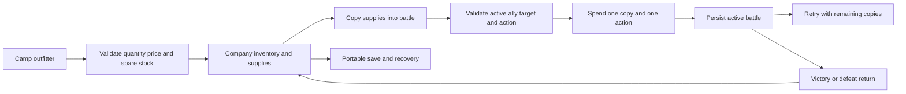

# Equipment, battle supplies and trading

[Documentation](README.md) / [Generated catalog](REFERENCE_CATALOG.md) / [Editor coverage](CONTENT_READINESS.md)

The default outfitter now carries 22 gear definitions and six consumables. Twenty-one gear records are purchasable; the Bellkeeper's seal remains a protected contract reward. Twelve new equipment choices add stat tradeoffs without changing the original starter loadouts or gold. Equipment changes combat stats; it does not replace the character's visible weapon or armor artwork.

## New equipment

| Item | Slot | Buy gold | Bonuses | Proficiency |
| --- | --- | --- | --- | --- |
| Watchman's spear | Weapon | 85 | Attack +5, armor +1 | Vanguard, Dancer, Shadowrunner, Runewarden |
| Silverleaf rapier | Weapon | 110 | Attack +4, speed +2 | Vanguard, Dancer, Shadowrunner, Runewarden |
| Runic maul | Weapon | 130 | Attack +8, speed -1 | Vanguard, Runewarden |
| Stormglass focus | Weapon | 125 | Magic +6, armor -1 | Existing caster classes and Runewarden |
| Pilgrim's crook | Weapon | 95 | Magic +3, HP +14 | Existing caster classes and Runewarden |
| Scout coat | Armor | 70 | Armor +2, speed +1 | Any |
| Channeler's robes | Armor | 100 | Armor +1, magic +2, HP +8 | Any |
| Bastion plate | Armor | 155 | Armor +6, HP +22, move -1, speed -1 | Vanguard, Runewarden |
| Trailwarden vest | Armor | 110 | Armor +2, HP +18 | Any |
| Iron signet | Relic | 90 | Armor +2 | Any |
| Ember pendant | Relic | 115 | Attack +2, magic +2 | Any |
| Heartwood token | Relic | 95 | HP +20 | Any |

A spear does not grant additional strike reach, a hammer does not stun, and a pendant does not add resistance. Weapon reach and special effects still belong to abilities. Healing abilities retain fixed power; a staff's magic bonus affects magical damage rather than increasing their healing amount. The [generated catalog](REFERENCE_CATALOG.md) contains stable IDs and exact current definitions.

## Buying and selling

Open camp's **Outfitter**. Filter by weapon, armor, relic or supplies; search by name/description; choose a whole quantity from 1 to 99. Rows show owned, equipped and spare copies, unit prices and the full transaction amount. A failed quantity, insufficient gold or insufficient spare stock rejects the entire trade.

| Rule | Behavior |
| --- | --- |
| Inventory cap | At most 99 copies of each gear or supply ID |
| Gear reservations | Equipped copies remain owned and cannot be sold; unequip in Company first |
| Reward-only gear | Cannot be bought or sold, regardless of an authored resale value |
| Default buyback | Half the buy price, rounded down |
| Authored buyback | Optional integer between zero and the buy price; zero disables selling |
| Transactions | Camp only, no partial fills, immutable input, safe integer gold |
| Price cycles | Buying then selling cannot create gold |
| Persistence | Manual saves, recovery and portable company backups include inventory and supplies |

For example, three spare leathers cost 105 gold; selling two returns 34. The four equipped starter leathers remain reserved throughout. An old camp's previous battle snapshot may still show equipment that has since been unequipped and sold: camp ownership follows the current company, while an active battle is still checked against deployed ownership.

## Consumables

| Item / ID | Buy / default sell gold | Battle effect | Reach |
| --- | --- | --- | --- |
| Field tonic / `field-tonic` | 25 / 12 | Restore up to 35 HP to a living ally | 1 |
| Vital tonic / `vital-tonic` | 55 / 27 | Restore up to 70 HP to a living ally | 1 |
| Ether draught / `ether-draught` | 40 / 20 | Restore up to 18 energy to a living ally | 1 |
| Deep ether / `deep-ether` | 75 / 37 | Restore up to 32 energy to a living ally | 1 |
| Cleansing salts / `cleansing-salts` | 30 / 15 | Remove burn, slow, exposure and soaking; no healing or guard | 1 |
| Phoenix seed / `phoenix-seed` | 110 / 55 | Revive a fallen ally at up to 30 HP | 1 |

New companies start with three Field tonics, one Ether draught and one Cleansing salts. Legacy saves without supplies receive no free inventory. Deploying copies the company's quantities into the battle; usage is recorded in the active battle and reconciled on either victory or defeat. Retrying keeps the remaining quantities, preventing a refund exploit. Existing earned-JP retry behavior remains separate.

Open **Items** in battle, choose a supply and select a highlighted allied tile. Main-game combat uses its usual confirmation button; Studio playtests use their usual direct tile action. A use spends one copy and the active ally's action, without energy, JP or RNG changes. Movement remains separate. Items cannot target enemies, exceed reach or pass blocked line of sight. Full-health healing, full-energy recovery, cleansing an unaffected ally, ordinary tonic use on a fallen ally, and revival of a living ally reject without spending anything. HP and energy clamp to their maxima. Items cannot revive after the battle has already ended.

Existing healing/protection effect families and sound outcomes provide feedback. The item cue records the actual item ID, and its effect plan stays single-target even if an author expands Mend's ability radius. No additional character or impact sheets are required for these mechanics. Enemy AI does not spend the player's shared supplies.

## Studio authoring and the isolated shop trial

Under **Gear, abilities & jobs**, use **Gear** to edit equipment price, optional buyback, slot, proficiency and bonuses. **Use automatic gear resale** restores the half-price calculation. **Add current shop stock** adds missing current stock to an older explicit catalog while retaining existing overrides; it does not add owned copies.

The **Items & supplies** tab edits each item's name, description, buy/sell price, supported effect, power, reach and starting quantity. Healing, energy and revival power is 1–250; cleansing uses zero power. Reach is 0–3, with revival requiring at least one tile. Custom item IDs use the existing bounded `custom-` convention. The six shipped identities remain present, and an in-stock custom item must be emptied before deletion. **Use automatic item resale** restores default pricing.

Apply the catalog to save definitions and quantities in one reversible project transaction. Undo/Redo and portable project JSON preserve them. Applied counts initialize every isolated playtest; restarting a Studio preview deliberately restores the project's starting stock. This is distinct from retrying a persistent campaign battle, which preserves spent supplies.

Expand **Try buying and selling in this project's shop** and choose **Start shop trial**. This uses the same Shop component and pure commerce functions as camp, with an isolated fixture company and editable trial gold. It honors the current draft's gear, item prices and starting supplies. Trade results are not saved campaign data or project changes. Editing a source field resets the trial. This lets authors test custom shop records without replacing their real company.

New gear definitions are optional for older explicit project catalogs. The original ten gear IDs remain required, and old catalogs without an item table remain readable. Missing company/project supply fields mean empty stock. The version-two company and version-one project envelopes retain their versions with validated optional fields. Older application builds cannot safely use the new item definitions/commands.

## Verification

Fourteen commerce/item regressions cover allocation protection, quantity/cap/price validation, no-profit cycles, legacy sources, all supported item effects, useful-target checks, source history and exports, retry/settlement persistence and single-target feedback. The complete suite has 285 tests. The generated playability report now executes 60 item cases across all ten missions, in addition to 190 ability cases and thirty terminal simulations. These checks do not claim a full human campaign balance review or visual equipment swapping.
