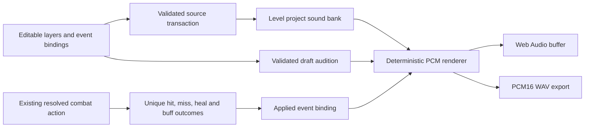

# Sound-effects studio pilot

[Level studio](LEVEL_STUDIO.md) · [Planned full audio studio](studio/AUDIO_STUDIO.md) · [Open studio](https://cptnope.github.io/Echoes-of-the-Shattered-Crown/studio.html)

The implemented **Sound effects** editor creates layered procedural combat sounds. Applied sources share the level project's revision history, local checkpoint and JSON export/import. This is partial STSL-04 work: multitrack music composition, sampling/recording, arbitrary DSP graphs and a complete game bundle remain planned.

## Create, hear and use a sound

1. Open the level studio and select **Sound effects**.
2. Choose Hit, Miss, Heal or Buff. These are fixed resolved-combat-event bindings.
3. Select a layer or add one. Edit waveform, start/end pitch, duration, delay, attack and gain; mute or remove layers as needed.

   **Master gain and seed** expands the bank volume and cue noise-seed controls.
4. Use **Audition draft** to hear the current source. **Stop sound** stops voices; changing editor/event also stops audition.
5. **Export draft WAV** renders a mono PCM16 sound from that draft. It does not replace the editable source.
6. **Apply sound edits** commits the whole bank as one undoable source edit. Discard restores the applied bank. Invalid drafts cannot be applied or rendered.
7. Save locally or export the project. Importing that project restores the applied layers and event bindings.
8. Playtest the revision and choose **Enable preview sound**. Legal resolved actions play the applied source. Mute, restart or exit stops current preview voices.

Draft edits remain available while switching between Battlefield and Sound effects. Apply/discard is required before playtesting or saving/exporting the project; importing another project is rejected while a sound draft is pending. Page navigation warns about unapplied drafts. Project undo/redo can replace an applied sound bank and reset its draft.

## Implemented source

| Field | Supported contract |
| --- | --- |
| Bank | version 1, master gain 0–1, exactly four unique event cues |
| Cue | hit/miss/heal/buff, unsigned 32-bit noise seed, 1–4 layers |
| Layer identity | Unique stable ASCII ID within its cue |
| Waveform | sine, triangle, square or seeded full-band noise |
| Pitch | Tone start/end 40–2,400 Hz, linear sweep; inactive for noise |
| Timing | Duration 20–1,200 ms; delay 0–400 ms; attack 1–100 ms and shorter than duration |
| Envelope | Linear attack, quadratic decay to zero |
| Layer gain | 0–0.8; independent enabled/muted flag |
| Output | 22,050 Hz mono; summed layers through tanh limiter, master gain and 0.6 output scale |
| Runtime voices | Up to four; oldest voice stopped at cap; stop/dispose disconnect sources |
| WAV | RIFF PCM16 mono at the same rate; quantized from the same rendered samples |

The waveform view shows peak amplitude by time bin on a fixed ±1 scale. Duration and peak are computed from the rendered buffer. Tones/noise are generated locally; no samples, microphones, external sound libraries or code extensions are imported.

## Preview event contract

An action identity uses unit, skill, turn and target. A repeated snapshot/end activation does not replay its previous cue. A cue plays once per unique outcome kind, so an area attack with two hits plays one hit cue; mixed hit/miss outcomes can play both. Legacy actions without outcomes do not invent successful hits. Movement, inspection and illegal commands do not emit these cues.

Audio never consumes combat RNG or changes battle state. Noise has a separate deterministic, layer-local seed. Preview is muted by default and creates/resumes its AudioContext through a user action. Enabling sound midway through a battle does not replay the existing action. Browser/device suspension may require muting and enabling again.

## Project compatibility and scope

Level-project v1 now accepts optional **sounds**. An absent field keeps old level JSON valid and uses the built-in sound bank for preview. The field is added only when a sound edit is applied. When present it is validated strictly; unknown sound/source fields are rejected.

Older studio builds that do not support sounds reject these enhanced project files. Use the updated studio to preserve/reopen them. Player saves and the planned full-project package are separate formats. The normal company game retains its existing audio sketch; authored SFX run in the level-studio preview.

## Verification

Eight sound tests cover finite/bounded repeatable PCM and endpoints, pitch/gain/seed/mute/delay changes, source rejection, every quantized WAV sample/header, source/history round trips, outcome deduplication, real-command state/RNG isolation and player voice/context cleanup using a test AudioContext. Together with the [music pilot](MUSIC_PATTERN_STUDIO.md) and previous tests the suite has 100 cases.

The mocked lifecycle test does not prove device audibility. Browser review should audition, stop, export/reopen sources, enable preview sound, resolve a legal attack and inspect the outcome label and console. This pilot does not complete the music/SFX graph slice or certify codec/device parity.
