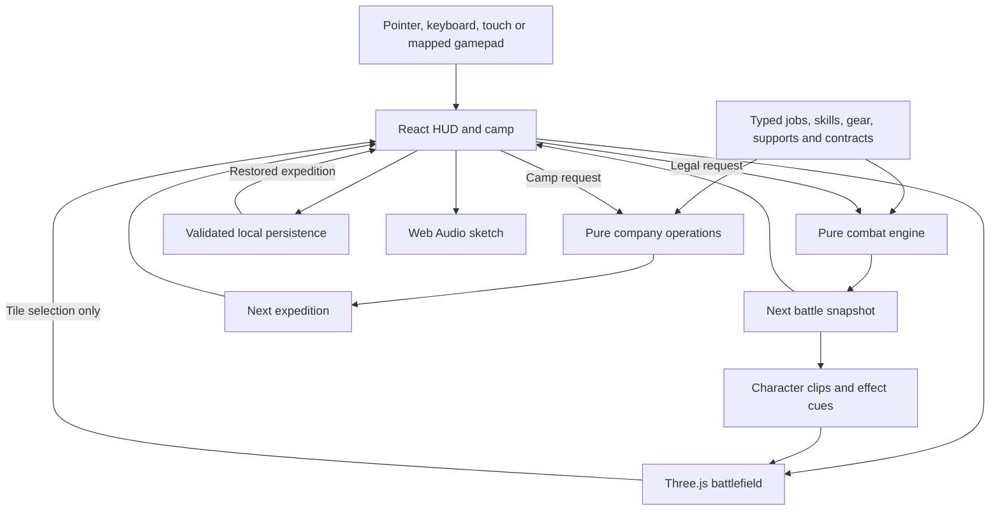
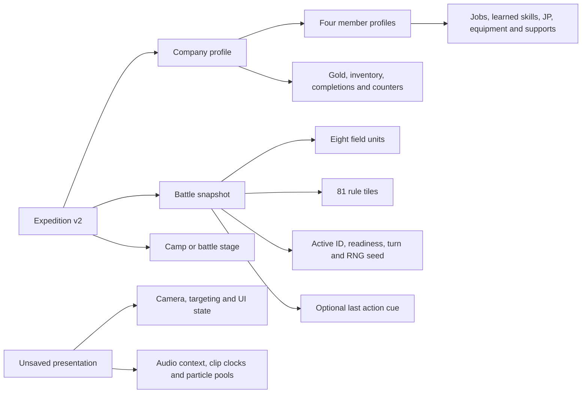
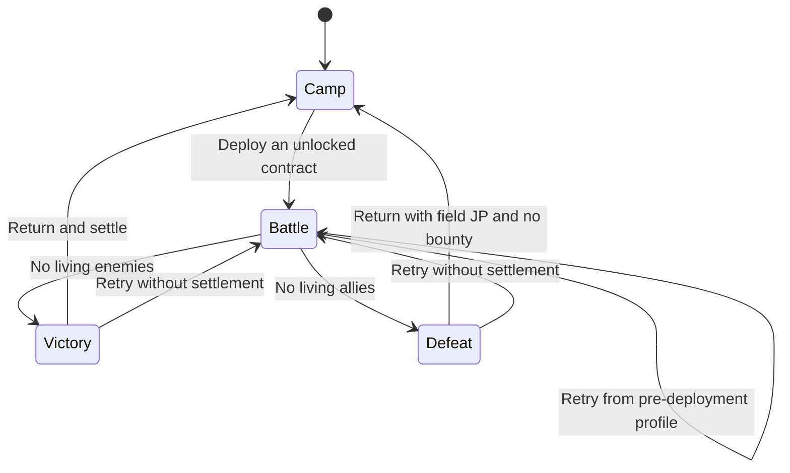
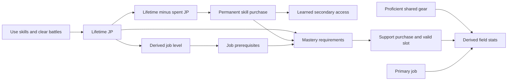
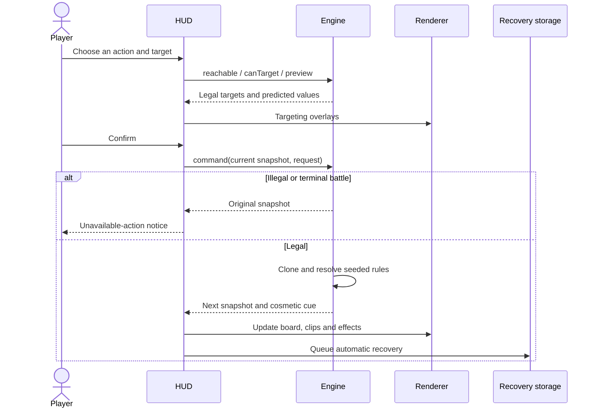
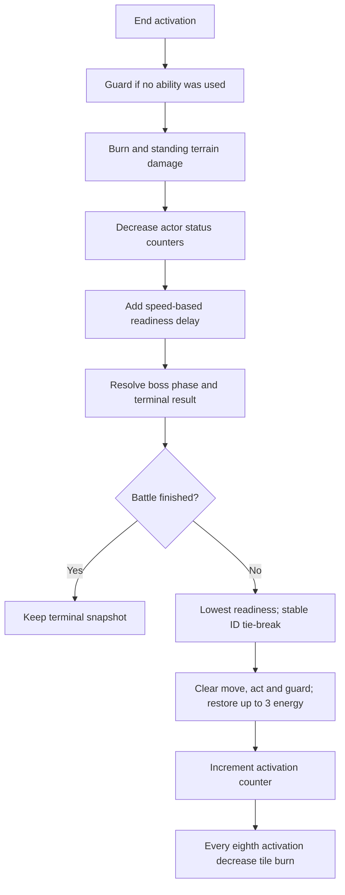
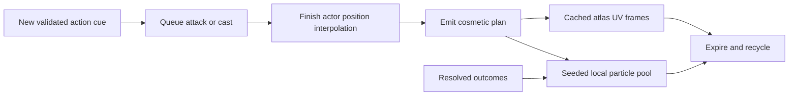
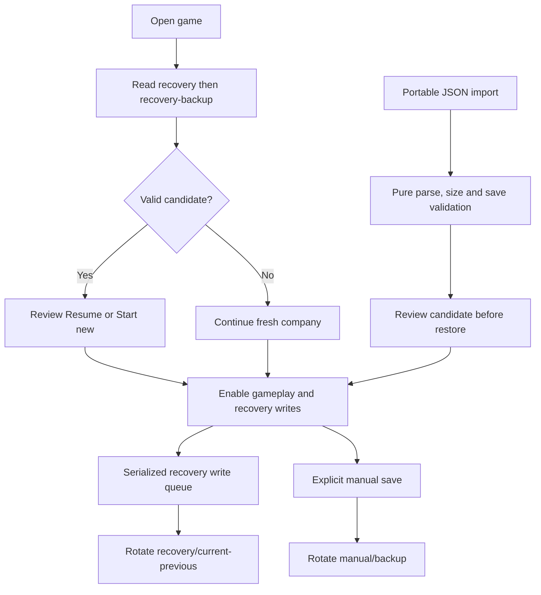
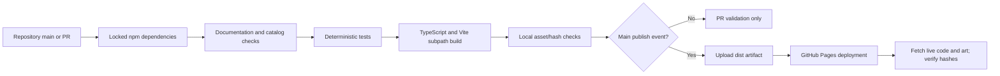

# How the game works

[Documentation index](README.md) · [Source-derived catalog](REFERENCE_CATALOG.md) · [Expansion roadmap](ROADMAP.md)

This is the current v0.8 system map. It describes implemented behavior. Proposed systems belong in the [roadmap library](roadmap/README.md); a diagram here is not a promise of the full original brief.

## System inventory

| System | Entry points | Authoritative state | Detailed reference |
| --- | --- | --- | --- |
| Company/camp | createExpedition, depart, returnToCamp, retryContract | Expedition, Company, Member | [Company](COMPANY_AND_PROGRESSION.md) |
| Job/skill learning | train, setMemberJob, availableSkills, unlocked | Lifetime/spent JP, learned IDs, job/secondary | [Jobs](JOBS_AND_ABILITIES.md) |
| Mastery/supports | mastered, learnSupport, setSupport | Learned support IDs and three slots | [Mastery](MASTERY_AND_SUPPORTS.md) |
| Equipment/economy | purchase, equip, unitStats | Inventory, gold, loadouts | [Company](COMPANY_AND_PROGRESSION.md) |
| Combat | command, reachable, canTarget, preview | Battle, Unit, Tile | [Combat](COMBAT.md) |
| Enemy choices | aiTurn | Same Battle and legal commands | [Advanced abilities](ADVANCED_ABILITIES.md) |
| Boss phase | result inside engine | Optional bossAwakened flag | [Belfry](THE_SILENT_BELFRY.md) |
| Character art | animationFrame, chooseAnimation, Battlefield | Cosmetic actor timers and texture UVs | [Animation](ANIMATION_PIPELINE.md) |
| Effects | planCombatEffect, CombatEffects | Resolved cosmetic cue and bounded local pools | [Combat effects](COMBAT_EFFECTS.md) |
| Persistence | saveGame/loadGame, saveRecovery/loadRecovery | Validated wrappers in IndexedDB | [Data/saves](DATA_AND_SAVES.md) |
| Portable files | encodeBackup, parseBackup | Envelope wrapping Expedition v2 | [Backups](BACKUPS_AND_RECOVERY.md) |
| Audio/input | AudioScore, main.tsx adapters | Session-only browser/UI state | [Player guide](PLAYER_GUIDE.md), [art/audio](ART_AND_AUDIO.md) |
| Delivery | npm scripts and Pages workflow | Repository source and dist assets | [Deployment](DEPLOYMENT.md) |

## Runtime ownership

The engine never reads the DOM or renderer clock. The view never determines damage, initiative or rewards. Enemy planning chooses commands through the same rules; it does not have a separate damage implementation.

## Saved records versus presentation

Member profiles preserve builds between contracts. Field units add coordinates, HP/energy, facing, statuses and activation flags. The company stays at its pre-deployment baseline during a fight; field JP is carried back on terminal return. Cosmetic lastAction may be saved, but load does not replay it. Presentation objects themselves are never serialized.

## Company lifecycle and rewards

| Transition | What happens | What does not happen |
| --- | --- | --- |
| New company | Four original members, 140 gold, initial shared gear and first contract access | No recruits or separate overall level |
| Deploy | Seed derives from deployment count; profile builds project into fresh fully recovered field units | Active HP/status from the previous fight is not carried into the new deployment |
| Legal skill | Primary-job lifetime JP increases by 10 | Learning does not happen automatically |
| Victory rule resolution | Each allied unit gains 60 primary-job JP once for that battle | Gold is not paid until return to camp |
| Return after victory | Copy field profiles, pay contract bounty, increment victories, record completion | First-clear relic is not granted again |
| Repeat victory | Pay the bounty and victory JP again | Completion ID is not duplicated |
| Return after defeat | Copy earned field progression | No bounty or unlock |
| Retry | Discard that attempt's gains; redeploy the saved pre-deployment company baseline | No reward settlement |
| First belfry clear | Add Bellkeeper's seal once using completion state | No random drop roll |

returnToCamp is gated by stage and terminal result. Once back at camp, repeating that operation cannot pay the same terminal snapshot twice. See the contract catalog for exact gold values.

## Learning and builds

| Concept | Current rule |
| --- | --- |
| Job level | 1 + floor(lifetime job JP / 60) |
| Spendable JP | Lifetime JP minus JP spent in that job |
| Primary skills | Native skills are available while the job is primary |
| Secondary skills | Only permanently learned skills from the chosen secondary set |
| Shared basics | Weapon strike and Lantern concord are included and deduplicated |
| Active lesson | 60 spendable JP; job unlocked and skill belongs to that job |
| Mastery | Job unlocked, at least 240 lifetime JP, all its native skills learned |
| Support lesson | Mastered source job plus 120 spendable JP |
| Support slots | Passive, reaction, movement; equipped ID must be learned and match the slot |
| Job change | Camp operation; incompatible gear is unequipped |
| Gear copies | A shared inventory copy cannot be allocated to two companions |
| Shop | Nine purchasable items; gold checked and owned count capped at 99 |

Derived movement and speed are clamped to at least one. Attack, armor and magic are clamped to at least zero. HP is base HP plus gear/support bonuses. There is no separate character-level growth, respec refund or gear crafting today.

## One command from input to result

Commands are move, skill and end. A unit can move once and act once in either order before ending. Rules commit movement atomically; rendering interpolates afterward. Rejected commands preserve the original object and resources. The UI blocks player commands during startup recovery review, enemy control or relevant dialogs.

## Movement, targeting and damage

| Stage | Current calculation or condition | Important edge |
| --- | --- | --- |
| Movement | Cardinal cost search; one per step plus one when climbing | Height difference above one is illegal |
| Occupancy | Blocked tiles, water and other units stop movement | Fallen bodies still occupy their cells |
| Distance | Manhattan distance | No diagonal step |
| LOS | Rounded intermediate samples; blockers or higher-than-eye-line terrain stop casts | Decorative meshes and units are not LOS blockers |
| Center | Existing unblocked tile, range, LOS, energy and action availability | Damage centers may be empty |
| Area | Manhattan radius; current area skills use cross shape | Allies spared by damage |
| Flank | Attacker lies behind defender's facing half-plane | Applies through the preview rule, not a manual facing command |
| Formation | Adjacent living Vanguard adds four defense in preview | Separate from guard |
| Guard | Damage multiplier 0.55 | Cleared on the unit's next activation |
| Exposure | +7 damage; Gloam adds another +12 and consumes exposure on hit | Miss does not consume it |
| Lightning synergy | ×1.5 if target stands on water or is soaked | Full general elemental resistance model is not implemented |

Damage starts with skill power + attack for physical or magic otherwise − armor − formation, adds clamped height contribution, flank and exposure, then guard/synergy multipliers. Preview rounds and clamps damage to at least one. A successful damage hit separately rolls 10% critical chance for ×1.5 rounded damage. Healing/revival and buffs use their own fixed preview paths and no accuracy roll. [COMBAT.md](COMBAT.md) contains the complete arithmetic and order.

## Initiative, statuses and reactions

The counter counts individual activations, not rounds. Slow adds its extra delay only if it remains after the end-turn decrement. Burn, slow, exposed and soaked are the current status counters. Fire can ignite grass, ice can freeze water, and lightning benefits from soaked targets.

Second wind triggers only after surviving an enemy ability hit and paying its energy cost. Close reprisal applies to a surviving adjacent Weapon strike target; native Blade Dancer riposte is separate and may stack. These fixed retaliations do not recursively trigger unlimited reaction chains. Lethal retaliation advances away from an incapacitated active actor.

Orren's surviving half-health threshold can awaken once: cleanse burn/slow, refill energy, advance readiness, grant speed through a relic and guard. The saved bossAwakened flag prevents repetition.

## Enemy planner

```mermaid
flowchart LR
    Start[Enemy activation] --> Moves[Enumerate reachable destinations]
    Moves --> ScoreMove[Score range preference, height, movement cost and fire]
    ScoreMove --> Move[Commit best move through command]
    Move --> Skills[Enumerate available skills except concord]
    Skills --> Centers[Check legal centers]
    Centers --> ScoreAction[Value damage, defeat, healing, revive and support]
    ScoreAction --> Cost[Subtract energy cost weight]
    Cost --> Pick{Positive action?}
    Pick -->|Yes| Act[Commit chosen skill through command]
    Pick -->|No| End[End activation]
    Act --> End
```

The current planner is deterministic scoring, not deep search. It handles advanced setup/support heuristics but does not plan around unimplemented objectives. Content expansion must update scoring and scenarios along with new mechanics.

## Character animation and effects

| Layer | Current behavior | Safety boundary |
| --- | --- | --- |
| Portraits/fallback | Original eight-job ready-pose atlas | Procedural fallback if loading fails |
| Character sheets | Eight states × four frames × eight jobs = 256 frames | Job appearance shared by units with that primary job |
| Clip priority | Downed, hurt, walking, queued action, winning-team victory, guard, idle | Loaded downed units hold final pose |
| Action pose | Physical skill → attack, otherwise cast | Presentation clock does not resolve the command |
| Effect sheets | Twelve clips × eight frames = 96 frames across three atlases | Thirteen recipes; two time abilities share a sequence |
| Effect phases | Cast motes, optional travel, target sequence, successful-outcome motes | Spell area remains visible on misses; successful-hit motes do not |
| Pools | 24 effect sprites and 256 particles | Recycle older visuals under extreme pressure |
| Reduced motion | Stable representative poses, no traveling particles/projectiles | No gameplay advantage or timing change |
| Teardown | Dispose maps, materials, geometry and renderer resources | A scene change must not retain active effects |

See [animation](ANIMATION_PIPELINE.md) and [combat effects](COMBAT_EFFECTS.md) for frame timings, file formats, generation prompts and workbench controls.

## Persistence and recovery

| Layer | Current version/limit | Notes |
| --- | --- | --- |
| IndexedDB | Database echoes-crown, schema 1, saves store | Four separate slots |
| Expedition / Battle | Version 2 | Optional support, boss and cosmetic fields preserve supported older records |
| Portable envelope | echoes-crown-save version 1 | Wraps Expedition v2 |
| File limit | 1 MiB measured in UTF-8 bytes | Applied on export and import |
| Legacy | Supported v1 battle migration | Preserves active resources, readiness and RNG |
| Conflict policy | Serialized writes within one page | Other same-origin tabs can still overwrite later |
| Origin | Browser profile/origin-local | No cloud synchronization |

Automatic recovery never overwrites the manual checkpoint. A malformed import does not replace the current company. Exporting a backup is the current cross-browser/device transfer path. Database schema version, game format and portable envelope version are distinct contracts.

## Audio, accessibility and delivery

Audio is an original oscillator-based Web Audio sketch with command tones. It starts through user interaction; mute/volume and other UI settings are session-only. Full mixer buses, authored soundtrack and persisted settings are proposed expansions.

Pointer/touch and battle keyboard/gamepad mappings exist. Reduced motion and text sizing exist. Full controller-driven camp use, nonvisual tactical play, physical devices and broad browser compatibility are not certified.

Markdown guides render on GitHub; Pages publishes the built game and animation review tool. There is no separate generated documentation website. See the [roadmap](ROADMAP.md) for the next expansion contracts and the [testing guide](TESTING.md) for evidence and limits.

