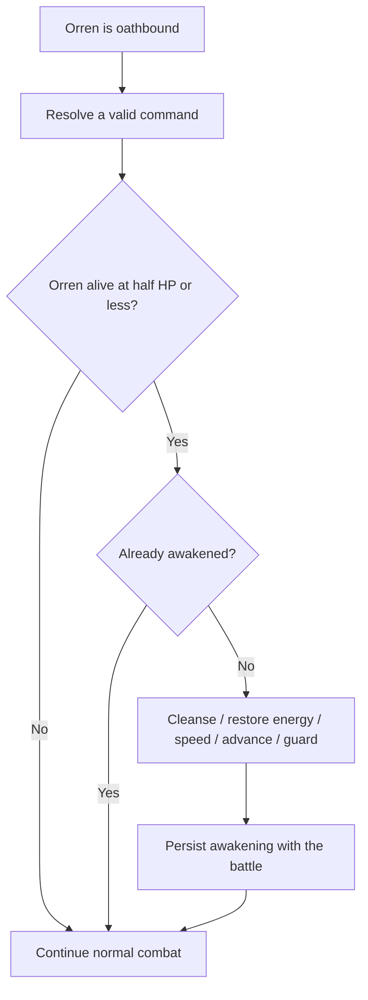

# The silent belfry

[Documentation index](README.md) · [Company and progression](COMPANY_AND_PROGRESSION.md) · [Combat](COMBAT.md)

Contract IV unlocks after clearing the Oathless redoubt. Four companions enter a 9×9 raised courtyard against Orren, Bellkeeper, a Storm Herald, a Shadowrunner and a Chronoweaver. Victory requires defeating all four enemies; killing Orren alone does not end the battle.

| Detail                | Rule                                                                                                                           |
| --------------------- | ------------------------------------------------------------------------------------------------------------------------------ |
| Orren                 | Runewarden primary, Chronoweaver secondary, 168 HP, 48 energy                                                                  |
| Native/learned skills | Stillwater, Oathguard, learned Borrowed dawn, plus universal strike/concord                                                               |
| Awakening threshold   | Alive at 84 HP or less when a valid command resolves                                                                           |
| One-time response     | Clear burn and slow; restore energy to 48; advance readiness by 25, clamped at zero; guard; equip Dawnwatch charm for +2 speed |
| Guard duration        | Until Orren's next activation, following ordinary guard rules                                                                  |
| Victory bounty        | 140 gold and the engine's normal 60 JP per companion                                                                           |
| First clear           | One Bellkeeper’s seal: relic, armor +2 and magic +3, any job                                                                   |
| Replays               | Gold/JP repeat; the unique relic does not                                                                                      |
| Save format           | v2, optional boolean `bossAwakened`; no migration needed for 0.2 saves                                                         |

The phase is deterministic. It grants no free attack, invulnerability, healing or second health bar. Lethal damage skips the awakening. A newly active Orren clears guard through normal activation rules; the one-time speed and resource changes remain. An end-turn that lets him reach the front of the timeline can therefore bring an immediate response.

Use the camp before deployment. A speed relic helps rotate healing and terrain control; a durable front line keeps the casters from being isolated. Consider clearing the support units before pushing Orren below half health. Burn and slow applied before awakening will be cleansed; the phase does not prevent reapplication afterward. The belfry is a first encounter expansion, not a balanced difficulty guarantee or the full story campaign.

Return to camp to collect the bounty and first-clear relic. The outfitter lists the seal as a contract reward, with buying disabled. Equip the owned copy from Company. Completion IDs deduplicate the relic, and an already-settled camp cannot collect the same result again.
