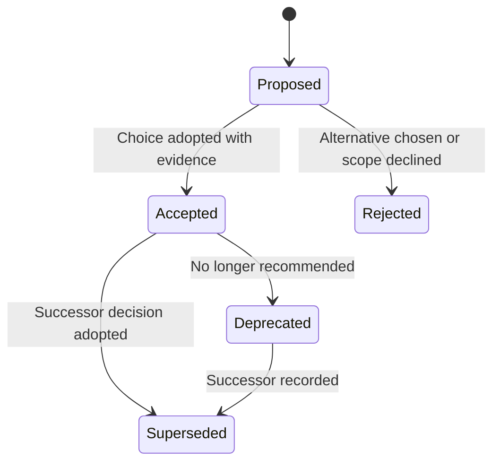
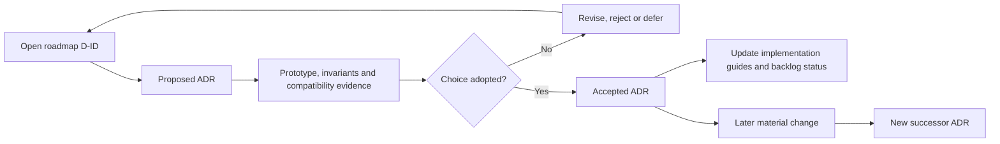

# Architecture decision records

[Documentation index](../README.md) · [Architecture](../ARCHITECTURE.md) · [Open roadmap decisions](../roadmap/DECISION_REGISTER.md) · [ADR template](template.md)

ADRs explain consequential, durable architecture choices: context, alternatives, tradeoffs, evidence and reasons to revisit. They complement the current implementation guides and roadmap; they do not replace either.

The initial accepted baseline records are **retrospective** except ADR-0001's new documentation convention. Their Recorded date is when this record was written, not an invented original decision date. Alternatives and rationale are current analysis of the implementation, not historical meeting minutes. Accepted means the choice is adopted in the documented baseline, not that every tradeoff was separately approved in a past conversation.

## Decision index

| Record | Status | Origin | Subject |
| --- | --- | --- | --- |
| [ADR-0001](0001-record-architecture-decisions.md) | Accepted | New documentation convention | Record architecture decisions in the repository |
| [ADR-0002](0002-deterministic-simulation-boundary.md) | Accepted | Retrospective | Keep deterministic simulation independent of presentation |
| [ADR-0003](0003-browser-client-stack.md) | Accepted | Retrospective | Use React, Three.js and Vite for the browser client |
| [ADR-0004](0004-separate-company-and-battle-state.md) | Accepted | Retrospective | Separate persistent company profiles from encounter snapshots |
| [ADR-0005](0005-typed-content-and-stable-identifiers.md) | Accepted | Retrospective | Use typed content records and stable persistent identifiers |
| [ADR-0006](0006-local-versioned-saves-and-recovery.md) | Accepted | Retrospective | Use validated local saves with independent recovery and portable backups |
| [ADR-0007](0007-result-driven-bounded-presentation.md) | Accepted | Retrospective | Drive cosmetic feedback from resolved results with bounded resources |
| [ADR-0008](0008-art-manifests-and-provenance.md) | Accepted | Retrospective | Ship processed art with manifests, provenance and reproducible checks |
| [ADR-0009](0009-publish-static-builds-through-actions.md) | Accepted | Retrospective | Build, validate and publish GitHub Pages through Actions |
| [ADR-0010](0010-proposed-variable-board-and-roster-contract.md) | Proposed | Roadmap proposal | Propose shared variable-board and roster contracts |
| [ADR-0011](0011-proposed-editable-game-project-and-build-artifacts.md) | Proposed | Studio planning proposal | Propose canonical editable projects and complete-game exports |
| [ADR-0012](0012-proposed-shared-music-and-sfx-graphs.md) | Proposed | Studio planning proposal | Propose shared editable music, SFX and audio runtime contracts |

| [ADR-0013](0013-native-sprite-sources-and-overrides.md) | Accepted | New implementation decision | Preserve native sprite originals with sparse RGBA overrides |

| [ADR-0014](0014-existing-game-source-adapters.md) | Accepted | New implementation decision | Adapt existing game sources into editable project previews |

| [ADR-0015](0015-scoped-rule-catalogs.md) | Accepted | New implementation decision | Resolve editable catalogs through explicit runtime context |

| [ADR-0016](0016-bounded-rectangular-maps.md) | Accepted | New implementation decision | Support bounded rectangular maps through optional dimensions |

| [ADR-0017](0017-authoring-validation-and-navigation.md) | Accepted | New implementation decision | Separate blocking source validation from advisory authoring checks |

| [ADR-0018](0018-derived-connectivity-overlays.md) | Accepted | New implementation decision | Derive grouped connectivity overlays from the current report |

| [ADR-0019](0019-bounded-custom-records-and-enemy-templates.md) | Accepted | New implementation decision | Bind custom records to shipped mechanics and spawn template snapshots |

| [ADR-0020](0020-shared-balanced-mission-presets.md) | Accepted | New implementation decision | Load canonical balanced missions through one preset factory |

| [ADR-0021](0021-multiple-native-assets-and-cosmetic-cues.md) | Accepted | New implementation decision | Store multiple native assignments and cosmetic ability cue pairs |

| [ADR-0022](0022-bounded-ability-appearance.md) | Accepted | New implementation decision | Keep bounded ability appearance outside authoritative combat state |

## When to create an ADR

| Create a record for | Usually use another document for |
| --- | --- |
| Rule/presentation ownership and determinism | Routine bug-fix details |
| Serialized state, migrations and persistent identity | Every individual balance value |
| A consequential storage, platform or delivery choice | Ordinary content additions using existing contracts |
| Resource ownership, event ordering or cross-module contracts | Asset-specific prompts and processing metadata |
| A material change to an accepted decision | Open brainstorming without a concrete alternative/decision |

Use the existing [roadmap register](../roadmap/DECISION_REGISTER.md) for D-01–D-16's open questions. An ADR may consolidate several related planning questions around one architecture choice. Adding a Proposed ADR does not accept those questions or mark their backlog items complete.

## Lifecycle

| Status | Meaning | Maintenance |
| --- | --- | --- |
| Proposed | Concrete option under review | May evolve; label unresolved choices and acceptance evidence |
| Accepted | Adopted architecture or explicitly recorded implemented baseline | Preserve rationale; correct factual errors transparently |
| Rejected | Proposal not adopted | Keep the reason and related alternative |
| Deprecated | Previously adopted approach no longer recommended | Explain remaining usage and migration implications |
| Superseded | Replaced by a newer record | Link successor and add reciprocal Supersedes metadata there |

Accept a choice when it is actually adopted through the project's normal work. An ADR is not an extra approval requirement for routine fixes. Do not label a speculative schema Accepted just because its example or blueprint is detailed.

## Create and maintain a record

1. Copy [template.md](template.md).
2. Choose the next unused four-digit ID and a short descriptive filename. IDs are permanent; gaps are allowed and old numbers are not reused.
3. Use an ISO Recorded date and state whether this is a new decision, retrospective reconstruction or proposal. If the original date is unknown, say so.
4. Explain one coherent choice, feasible alternatives, costs, verification and revisit triggers. Link code, tests, guides and relevant D-IDs/backlog items.
5. Add the record to the index with matching status.
6. For a replacement, create a new record; use reciprocal Supersedes/Superseded by links and mark the old record Superseded when the replacement is adopted.
7. Run npm run docs:adr or the full npm run docs:verify.

Keep accepted historical rationale instead of silently rewriting it to describe a new architecture. Fix broken links or factual errors as normal maintenance; record material reversals in a successor.

## Relationship to planning and implementation

Current example: [ADR-0010](0010-proposed-variable-board-and-roster-contract.md) references open D-01/D-02/D-12 and the [production-slice audit](../roadmap/PRODUCTION_SLICES.md). It remains Proposed for the broader variable-roster and engine contract. [ADR-0016](0016-bounded-rectangular-maps.md) separately adopts bounded rectangular maps with optional dimensions; [ADR-0019](0019-bounded-custom-records-and-enemy-templates.md) adds bounded hostile rosters and custom catalog IDs. General company/NPC identity and engine contracts remain future work.

## Integrity checks

npm run docs:adr checks numbered filenames/IDs, index/status agreement, required metadata/sections, Recorded dates and reciprocal supersession links with acyclic history. The existing Markdown checker checks ADR links, table shape and diagram blocks. Full Mermaid parsing is a separate verification pass. These checks verify record structure; they do not decide whether a recommendation is accepted or whether its evidence is sufficient.

