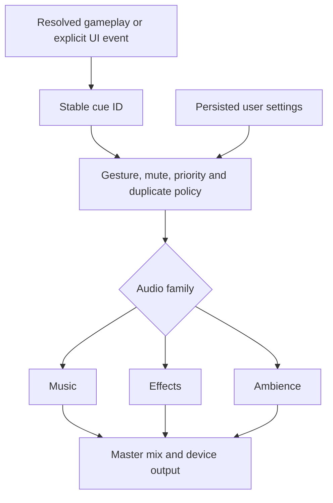

# Art, animation, effects and audio production

[Roadmap library](README.md) · [Backlog](BACKLOG.md) · [Current art/audio](../ART_AND_AUDIO.md)

Current production contracts are in [character animation](../ANIMATION_PIPELINE.md), [combat effects](../COMBAT_EFFECTS.md) and [portrait art](../SPRITE_ART.md). Everything marked target/candidate below is proposed.

For the complete creation/editing toolset, see [studio workflows](../studio/AUTHORING_WORKFLOWS.md) and the dedicated [music/SFX studio](../studio/AUDIO_STUDIO.md). The studio preserves layers, notes, sample edits, sound graphs and mixes through project/complete-game export. This is planned authoring functionality, separate from the current production scripts.

## Current asset baseline

| Family | Current quantity | Geometry/format | Boundary |
| --- | --- | --- | --- |
| Portrait/fallback atlas | Eight ready poses | 1536×1024 RGBA PNG, four columns/two rows | Job portraits, no bespoke recruit faces |
| Character animation | Eight jobs × eight states × four frames = 256 | Eight 887×1774 source PNGs; optimized WebP plus registration | Single three-quarter view; enemy mirror |
| Combat effects | Twelve clips × eight frames = 96 | Three 1254×1254 source PNGs; WebP plus hashes | Thirteen recipes; two time skills share a motif |
| Effect pools | 24 sprites, 256 particles | Shared textures and one particle geometry | Extreme bursts recycle earlier cosmetics |
| Environment | Four Veyr board variants | Procedural Three.js terrain/props | One regional visual language |
| Audio | Synthesized score sketch and command tones | Web Audio oscillators/envelopes | No authored regional soundtrack or independent mixer buses |

Source masters and exact prompts are delivered separately; runtime files and provenance guides are committed. Generated transparent images are processed for encoding/metadata without redrawing the source. Existing generated work does not imply a blanket repository license.

## Character animation expansion arithmetic

Frame counts are planning arithmetic, not assets already produced. Do not multiply every dimension until a pilot proves its value.

| Option | Calculation | Frames | Production implication |
| --- | --- | --- | --- |
| Current | 8 jobs × 8 states × 4 frames × 1 view | 256 | Existing baseline |
| Ten-job pilot, four views | 10 × 8 × 6 × 4 | 1,920 | Start by validating one job, not generating the full set |
| Twenty jobs, four views | 20 × 8 × 6 × 4 | 3,840 | Moderate cycle length and approved facing convention |
| Twenty jobs, eight views | 20 × 8 × 8 × 8 | 10,240 | Much larger art, bandwidth and review burden |
| Extra states at full eight-view option | 20 × 2 added states × 8 frames × 8 views | 2,560 additional | Run/item clips only if their mechanics justify them |

Choose four/eight world-facing directions independently from the camera's four orientations. Specify whether mirrored directions preserve weapons and asymmetrical costumes acceptably. Character variants multiply the workload again; a new costume is not free because it uses an existing job.

## Proposed state requirements

| State | Trigger | Pilot acceptance |
| --- | --- | --- |
| Idle | Living and not performing another clip | No scale/foot drift across loop boundary |
| Walk | Actual travel interpolation/path presentation | Direction and step cycle remain readable at small scale |
| Attack | Resolved physical action | Weapon contact aligns with event timing and target side |
| Cast | Skill windup/release | Shared pose can support varied spell motifs without false contact |
| Hurt | Surviving damage | Brief recoil cannot obscure an immediately following death |
| Guard | Defensive stance | Faction and guard status readable without color alone |
| Victory | Surviving winning side | Does not replay on already-resolved load |
| Downed/revive | HP transition | Final pose holds; revival returns cleanly to correct state |
| Run/item/interaction | Candidate mechanics | Produce only after actual commands and transition rules exist |
| Creature/summon states | New summon contract | Match footprint, owner cue, hit/down/expire behavior |

A pilot needs stable registration, weapon padding, camera rotation, enemy treatment, loading fallback, reduced motion and teardown checks. All directions should be reviewed at battlefield scale, not only in a large contact sheet.

## Asset production lifecycle

| Asset family | Required source metadata | Runtime metadata | Acceptance owner discipline |
| --- | --- | --- | --- |
| Characters | Identity/job, palette, direction, state and generation/author record | Frames, timing, registration, bounds, clip priority | Art + rendering + gameplay |
| Effects | Skill family, phase, shape and readability brief | Clip mapping, scale, timing, pooling/fallback | VFX + gameplay + accessibility |
| Environments | Biome, elevation rules, collision footprint and modular dimensions | Mesh/material budget and rule-to-visual mapping | Environment + level design |
| Portraits | Character identity and costume continuity | Crop, text label and fallback | Narrative + UI/art |
| Audio | Composer/source, cue ID, rights note and loop points | Mix bus, gain, trigger, cache policy | Audio + gameplay/UI |
| UI/font | Source, license and supported character set | Fallback stack and size/contrast review | UI + accessibility |

## Effects beyond v0.8

| Expansion | Gameplay dependency | Presentation requirement |
| --- | --- | --- |
| Ordered event queue | Multiple actions/reactions/objectives | Consume events once, preserve order and skip cosmetics safely |
| Status auras | Status timing registry | Start/stop/cleanse/revive handling without persistent leftovers |
| Boss warnings | Boss tactic framework | Warning area is visually distinct from guaranteed damage |
| Summon entry/exit | Owner/cap/lifetime rules | Readable ownership and stable position anchor |
| Resist/block/interrupt | Approved combat rules | Text/shape cues with correct resolved facts |
| Low-intensity profile | Measured performance and access review | Bound sprites, particles, trails and bright transitions |
| New effect families | New jobs and mechanics | Reuse clear motifs; avoid one redundant atlas per skill |

Keep authoritative timing separate. An impact animation may happen after a committed result; it must not determine whether the result occurs. Do not put combat seed consumption in cosmetic systems.

## Environment kit checklist

| Kit component | Why it matters | Review |
| --- | --- | --- |
| Ground/elevation pieces | Height must be obvious before movement | Compare visual step with legal climb cost |
| Ramps/bridges/ledges | Communicate legal routes | Path preview and collision agree |
| Foreground occluders | Preserve units and targets at every rotation | Check all camera quadrants |
| Doors/barriers | Match saved prop state | Open/destroy/reload uses the same footprint |
| Hazard surfaces | Explain rules and duration | Color plus pattern/shape/text |
| Set dressing | Support regional identity | No accidental blocker implied by a decorative mesh |
| Lighting/sky treatment | Distinguish biomes without hiding information | Contrast and low-quality profile review |
| Map overview | Explain deployment/objective geography | Preview and actual mission agree |

## Audio production plan

This mixer is a proposal, not the current oscillator implementation.

| Stage | Candidate deliverable | Exit condition |
| --- | --- | --- |
| Pilot | One battle track, one regional ambience loop and a small impact set | Original/cleared rights, clean loops, mute and resume |
| Chapter | Hub, travel, battle, boss and narrative transitions | Stable cue mapping, controlled overlaps and subtitles/text where audio conveys information |
| Campaign | Regional motifs with intentional reuse | Download/memory budgets and complete cue/provenance inventory |
| Final mix | Master levels, ducking, device review | No clipping, abrupt cutoffs or required audio-only information |
| Voice decision | Text-only or limited voiced scope | Explicit scope, rights, localization and storage costs before recording |

## Budgets and sign-off

There is no measured universal FPS or memory budget today. FND-09/QA-04 must establish reference devices and scenes before numeric thresholds are promised.

| Measurement | Record with the result | Failure response |
| --- | --- | --- |
| Initial transfer | Cache state, selected jobs/region, compressed bytes | Split/preload only necessary families |
| Decoded/GPU memory | Texture dimensions/formats, active atlas count and device | Pack/resize/LOD only after visual comparison |
| Frame time | Device/browser, viewport, particle burst, camera and percentile | Reduce pools/material/lighting cost with declared tradeoffs |
| Load latency | Network/cache state and fallback duration | Keep gameplay usable and prevent replaying stale effects |
| Audio memory | Decoded cues and active loops | Stream/cache selectively; bound simultaneous cues |
| Cleanup | Repeated battle transitions and live resource counts | Fix leaks before adding content |

Source archive, exact prompts/authoring settings, encoder command, manifest and game-scale proof belong to each approved asset family. Inspect artistic quality directly; a matching hash only proves the file is unchanged.

