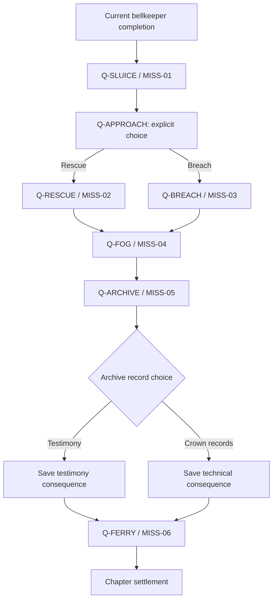
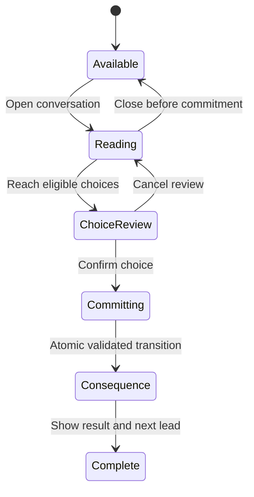
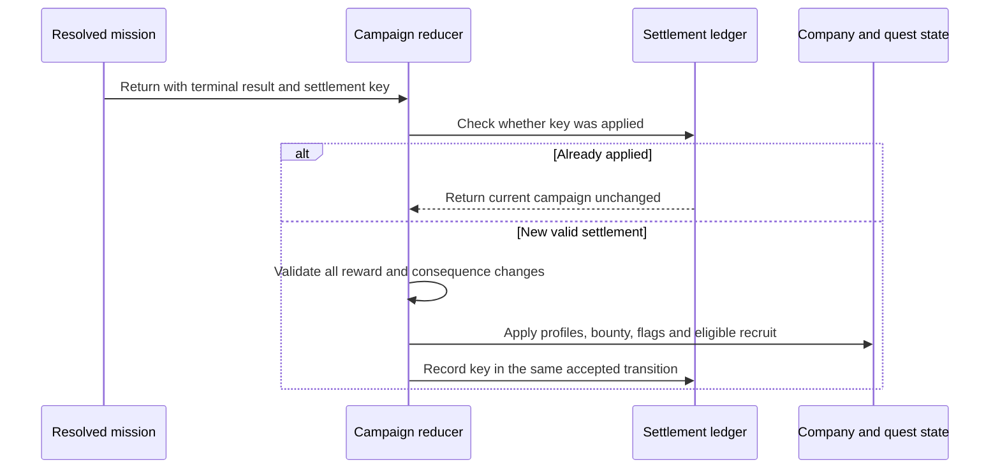

# Campaign, quest and dialogue blueprint

[Roadmap library](README.md) · [Encounter blueprints](ENCOUNTER_BLUEPRINTS.md) · [Decision register](DECISION_REGISTER.md) · [Current company rules](../COMPANY_AND_PROGRESSION.md)

**Proposed first chapter only.** Working title: The Road Beneath the Bells. All new names, dialogue and faction concepts are provisional under D-16. The current game still has four gated contracts without a quest/dialogue engine.

## Chapter intent

The company has recovered the belfry seal but must choose how to move crown records and people through a contested crossing. The chapter should connect tactical choices with visible consequences while allowing both approaches to reach its conclusion.

| Pillar | Proposed demonstration | Scope boundary |
| --- | --- | --- |
| Original consequence | Preserve testimony or technical records with understandable tradeoffs | No claim that one branch secretly contains the only valid ending |
| Company identity | Existing four companions disagree for clear reasons | Personal voice and final dialogue need authored review |
| Recruitment | Rescue route can add one candidate recruit | No full recruitment economy in the first chapter |
| Economy | Breach route can reveal a workshop/service lead | Required training and equipment stay reachable on either route |
| Tactics | Defend, route choice, waves, interactions and extraction | Author in stages; the defend pilot ships before the full chapter |
| Reliability | Reload at each choice/objective boundary | No unreviewed flag mutation in a cutscene callback |

## Quest progression

| Quest ID | Entry condition | Proposed completion | Persisted fact |
| --- | --- | --- | --- |
| Q-SLUICE | Current bellkeeper complete | MISS-01 settled | Sluice route opened |
| Q-APPROACH | Q-SLUICE complete | Explicit rescue/breach choice | Exactly one chosen approach |
| Q-RESCUE | Rescue chosen | MISS-02 settled | Candidate recruit eligibility |
| Q-BREACH | Breach chosen | MISS-03 settled | Workshop lead eligibility |
| Q-FOG | Either approach mission settled | MISS-04 settled | Shared route convergence |
| Q-ARCHIVE | Q-FOG complete | MISS-05 settled with a record choice | Exactly one selected archive record |
| Q-FERRY | Q-ARCHIVE complete | MISS-06 settled | Chapter outcome and optional extraction facts |

A branch quest can be inactive because another approach was chosen. Do not present that as failed required content or require both branch completions at convergence.

## Proposed state vocabulary

| Fact family | Candidate IDs/values | Rule |
| --- | --- | --- |
| Approach | approach = rescue or breach | Commit after explicit confirmation; mutually exclusive for one run |
| Archive | archiveRecord = testimony or crown-records | Cancel leaves no value; no default silently selected |
| Recruit | tamsin-mere eligibility / recruited ID | Stable identity; settlement grants at most once |
| Service | workshop-lead eligibility | Optional advantage with required-service alternative |
| Mission outcomes | MISS-ID plus terminal settlement key | Separate combat completion from paid campaign settlement |
| Optional extraction | Required/optional actor result IDs | Do not infer permanent profile loss |
| Discovered text | Stable codex entry IDs | Reveal only after the approved event/choice |

These are proposed facts, not current Expedition fields. Preserve the distinction between a selected choice, an objective result and a settled reward.

## Dialogue interaction

| Screen state | Required behavior | Resume rule |
| --- | --- | --- |
| Speaker text | Named speaker, readable text and optional portrait | Restore the approved dialogue checkpoint |
| Choice list | Only eligible choices; explain consequential locks before confirmation | No choice is committed merely by focus |
| Confirmation | Show route/recruit/service tradeoff in plain language | Cancel keeps previous flags and mission access |
| Result | State the chosen consequence and next destination | Reopen shows the settled choice instead of granting again |
| Locked lead | Explain prerequisite without spoilers beyond approved information | Existing chosen route stays available |

Provisional conversation beat, for voice review only:

| Speaker | Intended beat |
| --- | --- |
| Sera | The company must choose a route it can defend and live with afterward |
| Ilya | The records may explain the crown, but preserved knowledge has a cost |
| Corin | A closed gate is a tactical problem; people trapped behind it are another |
| Maelis | Rescue is a commitment, not an optional reward icon |
| Candidate recruit | Establish agency and a personal reason to join, rather than gratitude alone |

These are scene intentions, not final dialogue lines. Do not create localization keys from temporary prose or add speculative conversations to the current chronicle.

## Route/consequence matrix

| Approach | Archive choice | Required route | Optional difference | Must remain reachable |
| --- | --- | --- | --- | --- |
| Rescue | Testimony | 01 → 02 → 04 → 05 → 06 | Recruit eligibility and community testimony | Chapter finale, training and viable equipment |
| Rescue | Crown records | 01 → 02 → 04 → 05 → 06 | Recruit eligibility and technical record consequence | Same |
| Breach | Testimony | 01 → 03 → 04 → 05 → 06 | Workshop lead and community testimony | Same |
| Breach | Crown records | 01 → 03 → 04 → 05 → 06 | Workshop lead and technical record consequence | Same |

No row requires MISS-02 and MISS-03 together. Optional differences may affect dialogue, codex or future optional services; later ending prerequisites require separate review.

## Proposed settlement transaction

A recruit, gold, first-clear item and quest consequence must not be four independent callbacks that can partially repeat after a crash. Their exact storage representation depends on D-12.

## Recovery checkpoints

| Checkpoint | Required proof |
| --- | --- |
| Before approach confirmation | Both choices available; no route committed |
| After approach confirmation | Exactly one approach, other mission clearly inactive |
| Terminal rescue before return | Recruit not yet duplicated into company |
| After recruit/service settlement | One stable recruit/service fact and one paid key |
| Pending reinforcement wave | Quest progress does not spawn the wave again |
| Archive choice open | Cancel/restore preserves prior choice state |
| Archive choice committed | Same record selected; no duplicated optional reward |
| Partial ferry extraction | Objective actor records and occupancy agree |
| Chapter terminal before/after return | One final result and one chapter settlement |

## Failure and retry policy to approve

A failed mission should retain the approved current-style distinction between retrying from a pre-deployment profile and returning with earned field progression. Quest progress that belongs to an unfinished attempt must not leak into the campaign. A committed approach choice can remain a chapter choice across retries; this must be stated before the player confirms it.

Recruit death, permanent loss, reserve progression and changing approach after failure remain open decisions. The recoverable default recommendation does not itself implement those systems.

## Narrative acceptance

Review all four route/record combinations, cancel and restore paths, recruit/service eligibility, optional extraction, codex visibility and chapter convergence. A graph checker catches bad references; it cannot verify emotional coherence, character voice or whether a choice feels fair.

