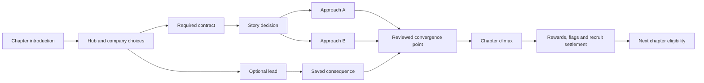
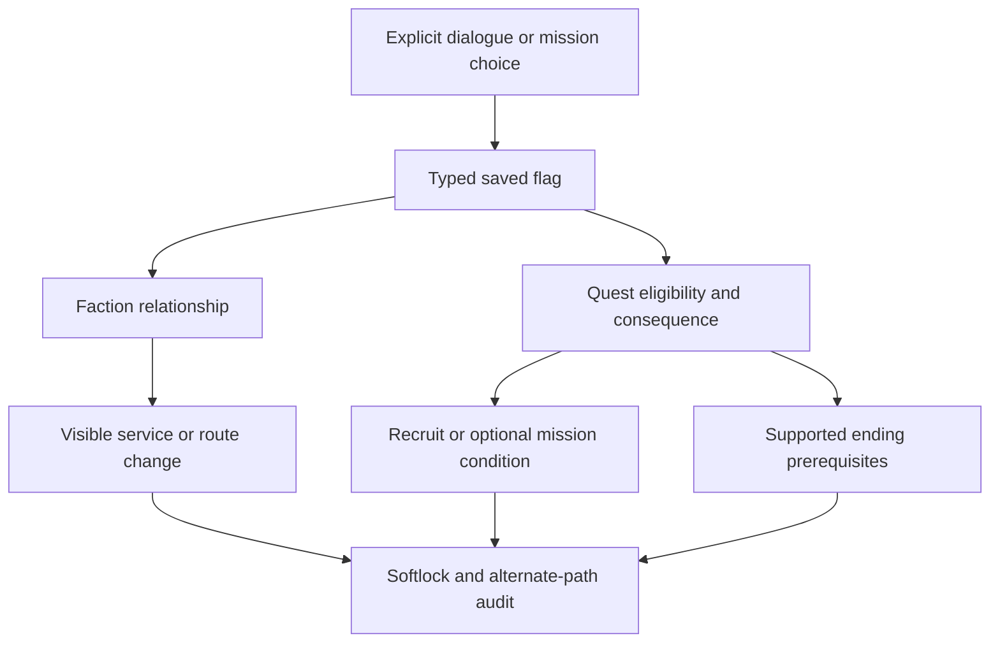

# Content and campaign expansion

[Roadmap library](README.md) · [Backlog](BACKLOG.md) · [Current catalog](../REFERENCE_CATALOG.md)

Names, counts and unlocks below are design proposals except the explicitly current eight jobs and four Veyr contracts. Future regions and factions require narrative review; they are not established canon by being listed here.

## Twenty-job roster

The first eight have current typed definitions. Proposed unlocks for later jobs are candidate design hooks, not live rules. Current precise prerequisites and native skills are generated in the catalog.

| Job | State | Tactical identity / expansion question | Candidate acquisition |
| --- | --- | --- | --- |
| Vanguard | Current | Protection and adjacent formation; deepen meaningful guard choices | Starter |
| Blade Dancer | Current | Mobile flanking and native riposte; preserve risk/reward | Starter |
| Arcanist | Current | Elemental area and terrain choices; avoid universal-best damage | Starter |
| Lifebinder | Current | Heal/revive/cleanse; add proactive decisions without mandatory healing loops | Starter |
| Shadowrunner | Current locked job | Exposure and pursuit; define stealth separately if added | Blade Dancer level 3 |
| Runewarden | Current locked job | Guard and armored magic; keep distinct from Vanguard | Vanguard 3 + Arcanist 2 |
| Storm Herald | Current locked job | Soak/lightning setup and area pressure | Arcanist 3; existing starter-secondary exception |
| Chronoweaver | Current locked job | Readiness manipulation; prevent permanent timeline locks | Arcanist 2 + Lifebinder 3 |
| Beastcaller | Planned | Bounded companion summons and positional support | Candidate: Lifebinder 3 plus wildlife pact |
| Spellblade | Planned | Chosen weapon infusions and mixed-range pressure | Candidate: Vanguard 2 + Arcanist 3 |
| Alchemist | Planned | Limited mixtures, surface setup and consumable tradeoffs | Candidate: Arcanist 2 plus crafting introduction |
| Soulkeeper | Planned | Spirit transfers and recoverable sacrifice | Candidate: Lifebinder 4 plus shrine quest |
| Rift Cartographer | Planned | Route/position manipulation with explicit occupancy rules | Candidate: Chronoweaver 4 plus exploration quest |
| Thorn Marshal | Planned | Summon formations and defensive area control | Candidate: Vanguard 4 + Beastcaller 3 |
| Ash Cantor | Planned | Sustained chanting and interruption tradeoffs | Candidate: Soulkeeper 3 + Arcanist 4 |
| Glass Ranger | Planned | Ranged refraction, lines and prepared shots | Candidate: Shadowrunner 3 + Alchemist 3 |
| Tidemason | Planned | Water and terrain construction | Candidate: Runewarden 4 + Storm Herald 3 |
| Oathbreaker | Planned | Conditional offensive commitment and defensive cost | Candidate: Blade Dancer 4 plus story choice |
| Star Shepherd | Planned | Celestial summons with distinct resource constraints | Candidate: Beastcaller 5 + Chronoweaver 4 |
| Crownless | Planned | Coordinated company actions with broad build access | Candidate: three advanced masteries and story milestone |

Ash cantor is already an enemy name; that does not implement an Ash Cantor player job. Later prerequisite levels remain proposals. Validate the graph for cycles, excessive grind and route-exclusive dead ends before adopting it.

## Ability design contract

| Required field/decision | Design question | Acceptance |
| --- | --- | --- |
| Decision value | When is this preferable to an existing action? | At least one useful tradeoff beyond a bigger damage number |
| Costs | Energy, action, item, momentum or summon cap? | Preview and rejection agree with resolution |
| Target shape | Center, line, cone, cross, self or ally? | Geometry, LOS and friendly interaction are explicit |
| Timing | Immediate, duration, charged or sustained? | Duration units and interrupt order are testable |
| Combination | Does it set up, consume or modify a condition? | Miss/immune/cleanse cases do not create free resources |
| AI | Can current or proposed AI value the action? | Useful scenario includes both player and enemy use |
| Presentation | Shared motif or unique art/audio? | Clear cast/contact/result cues and reduced-motion behavior |
| Progression | Native, learned, support or story-granted? | Ownership and migrations have a documented rule |

Candidate broad-campaign envelope: 60–80 distinct active skills, not 60–80 per job. Reuse is acceptable when identities stay clear. Count support lessons and cosmetic variants separately. Review the existing thirteen skills before expanding totals.

## Chapter structure

First authored chapter acceptance: one introduction, two connected missions, one recruit, one consequential choice, one convergence and a complete save/resume route. This is the next-slice proposal, not content already present.

## Proposed regional kits

| Region concept | Visual/tactical identity | Candidate encounters | Production prerequisites |
| --- | --- | --- | --- |
| Veyr fractures | Existing mossy ruins, stream crossings and broken oaths | Preserve four contracts; add a tested alternate objective | Current kit plus objective/deployment foundations |
| Flooded marches | Reeds, raised roads, sluices and narrow safe ground | Escort, capture sluice, evacuation | Water/prop ordering, neutral AI and marsh kit |
| Ember citadels | Ash, courtyards, furnaces and defended elevations | Breach gate, disrupt chant, survive reinforcements | Destructibles, interruption and readable fire |
| Glass desert | Reflective stone, exposed lanes and scarce cover | Caravan defense, long-range duel, route choice | Ranged LOS review, travel state and new silhouettes |
| High mountain reaches | Switchbacks, bridges, wind and separated elevations | Hold pass, rescue patrol, summit boss | Rectangular/vertical map review and chosen weather rule |
| Crown rift | Fractured geometry and unstable but clearly telegraphed rules | Multi-stage finale and optional mastery challenge | Proven objective/events, ending state and full migration coverage |

These are region concepts, not final proper names or a promise of six released maps. A region needs multiple authored encounters plus navigation, audio, readable terrain and quest integration.

## Objective and encounter coverage

| Family | Current state | Expansion slice | Required failure/resume cases |
| --- | --- | --- | --- |
| Elimination | Implemented on all four contracts | Retain as baseline and optional secondary target | Last ally/enemy, reaction kill and hazards |
| Boss threshold | Orren's saved awakening | General phase definitions and telegraphed rules | Lethal threshold hit, saved phase and interrupted effect |
| Defense/survival | Planned | Protect one zone for explicitly defined activations | Reinforcement duplication and all-defender defeat |
| Escort | Planned | One controlled or AI neutral reaches a destination | Down/revive, route blocked and escort loss at victory |
| Escape | Planned | Extract required members through a legal zone | Missing companion, partial extraction and cancellation |
| Capture/interact | Planned | One gate/relay/object with action costs | Repeated interaction and contested ownership |
| Multi-stage | Planned | Sequential objectives only after single-objective reducers pass | Phase reload and settlement once |
| Optional challenge | Planned | Extra condition with bounded reward | Failure does not corrupt required progression |

## Companion and relationship plan

The four current companions remain the narrative center: Sera Vale, Ilya Wren, Corin Ash and Maelis Reed. New recruits need a distinct role in the company and a reason to care about the crown, not only a different sprite.

| Deliverable per recruit | Acceptance |
| --- | --- |
| Identity and voice brief | Original role, motivations, vocabulary and relationship tensions |
| Recruitment route | Reachable flags, alternate/cancel behavior and stable recruit ID |
| Initial build | Valid jobs, learned skills and owned gear without duplicating inventory |
| Reserve behavior | Benched members retain builds; chosen progression policy is disclosed |
| Portrait and battle art | Consistent identity at actual game scale |
| Personal quest | One saved choice and consequence with required/optional boundaries |
| Recovery coverage | Before/after recruit, benched/deployed and branch-resume checkpoints |

Target envelope: roughly 8–12 recruitable companions for a broader campaign. Decide deployment cap separately; do not assume everyone fights simultaneously.

## Factions, quests and endings

Candidate faction roles include oathbound civic defenders, displaced frontier communities, crown scholars and opportunistic mercenary rivals. Final names, beliefs and alignments need authored review.

| Narrative invariant | Review question |
| --- | --- |
| Choices have visible consequences | Can the player recognize what changed? |
| Branches remain finite | Where do routes converge and what must stay distinct? |
| Recruitment is idempotent | Can reload or settlement grant the same member twice? |
| Faction penalties are recoverable | Is required gear/training/mission access still available? |
| Optional stories stay optional | Does the main route require their gold or flags indirectly? |
| Endings follow saved facts | Are prerequisites complete, noncontradictory and tested? |
| Localization preserves logic | Do text edits change stable choice/quest IDs? |
| Canon is deliberate | Are speculative names clearly distinguished from approved story text? |

## Content acceptance template

For every mission, record: purpose, map ID, player deployment, enemies, objective/failure order, mechanics taught, reward/first-clear policy, quest flags, narrative beats, art/audio dependencies, expected duration range to investigate, and restore checkpoints. Duration is a playtest observation, not a promised target until measured.

A mission is ready only after fresh play, retry, victory, defeat, import/resume and required branch routing work. A new job is ready only after learning, proficiency, AI, art, effects, saves and accessibility labels work. The [quality plan](RELEASE_AND_QUALITY.md) supplies the common gates.

