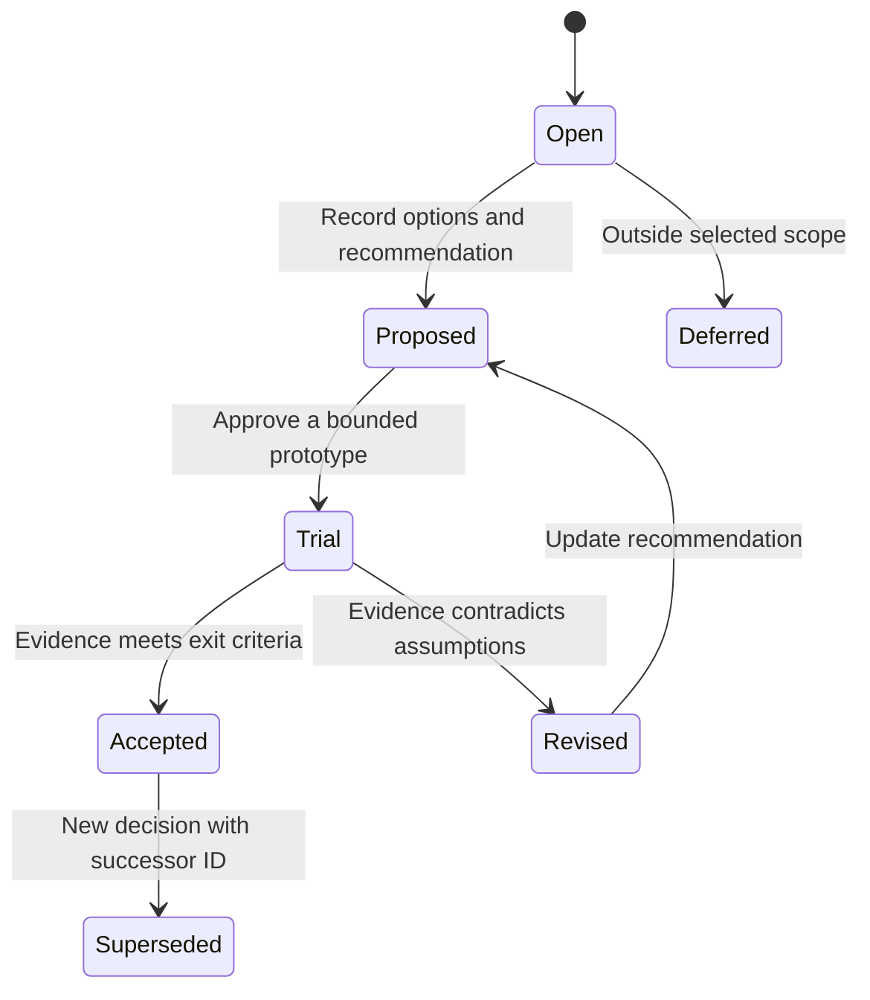

# Decision register

[Roadmap library](README.md) · [Production slices](PRODUCTION_SLICES.md) · [Backlog](BACKLOG.md)

All entries below are **open proposals**. Recommendations are starting points for review, not adopted runtime rules. Dates, approvers and an acceptance record should be added when a decision is actually made. No decision is automatically approved by a dependent blueprint.

## Decision lifecycle

## Open decisions

| ID | Topic | Recommendation to investigate | Backlog links | Acceptance evidence |
| --- | --- | --- | --- | --- |
| D-01 | Board shape | Prefer rectangular dimensions in validated map content; preserve old maps exactly. | MAP-01, MAP-02 | Two sizes pass rule, view and save fixtures. |
| D-02 | Roster identity/order | Use stable IDs with explicit simulation iteration order; deployment cap is content-driven. | CMP-01, MAP-04 | Different roster counts preserve deterministic outcomes and tie-breaking. |
| D-03 | Terminal precedence | Evaluate explicit hard-failure before objective success when both occur in one resolution. | OBJ-01, OBJ-02 | Escort/objective loss on the winning hit has one approved result. |
| D-04 | Objective/status clock | Name every counter as actor activation, completed activation or explicit objective tick; avoid vague rounds. | CBT-05, OBJ-06 | HUD, save and reducer use the same unit and boundaries. |
| D-05 | Presentation ordering | Use deduplicable ordered result batches; state commits independently of playback. | FND-05, VFX-01 | Move/cast/reaction/death/resume show no duplicates. |
| D-06 | Summon contract | Prototype one owned companion with a cap, stable ID, ordinary occupancy and explicit dismissal. | CBT-08, WRL-06 | Owner death, blocked spawn and saved lifetime are covered. |
| D-07 | Job learning model | Retain lifetime/spent JP distinction; approve node-specific costs only with migration defaults. | JOB-02, JOB-06 | Current learned skills/unlocks survive without retroactive spend. |
| D-08 | Reserve progression | Prototype reserves preserving their builds; decide shared/earned JP after chapter playtests. | CMP-03, CMP-06 | Benched characters do not force a mandatory catch-up grind. |
| D-09 | Respec policy | Favor recoverable experiments with disclosed costs; define refund scope before UI. | JOB-04, ECO-01 | No unlimited refund/arbitrage or lost prerequisite ownership. |
| D-10 | Injury/permadeath | Keep recoverable default; any permanent-loss mode is opt-in and separately save-labeled. | CMP-07, SAV-04 | No silent rule change for existing companies. |
| D-11 | Faction consequences | Use visible, bounded consequences with alternate required-service access. | NAR-06, ECO-08 | No branch blocks the only training or mandatory equipment path. |
| D-12 | Save evolution | Introduce a new game format only for an approved incompatible shape; keep envelope/DB versions separate. | SAV-01, SAV-03 | Supported fixtures upgrade and rejected imports preserve progress. |
| D-13 | Offline activation | Delay incompatible cache activation until the player can checkpoint/export and a migration path exists. | SAV-08, QA-06 | Old/new clients and interrupted updates remain recoverable. |
| D-14 | Character directions | Prove four directions on one job before choosing an eight-direction production multiplier. | ART-01, ART-03 | Feet, weapons, camera and mirrored asymmetry pass review. |
| D-15 | Performance budget | Measure reference devices before promising sprite, memory or frame-time targets. | FND-09, QA-04 | Profiles include scene, browser, cache and device metadata. |
| D-16 | Chapter/canon approval | Treat all blueprint names, dialogue and factions as provisional until an authored slice is reviewed. | NAR-05, NAR-10 | Approved canon/IDs and branch convergence are recorded. |

## Options that need explicit tradeoffs

| Decision | Option A | Option B | Review question |
| --- | --- | --- | --- |
| D-01 dimensions | Rectangular dense grid | Sparse/irregular board | Does the first alternate mission require holes, or only dimensions? |
| D-02 order | Saved explicit simulation order | Canonical order derived from stable IDs | How do migrations preserve historical RNG consumption? |
| D-03 results | Hard failure before success | Success before failure | What should happen when an escort dies on the winning action? |
| D-04 clock | Global completed activations | Explicit objective/round clock | Can the HUD explain threshold timing with variable rosters? |
| D-06 summons | Ordinary timeline unit | Owner-linked action attachment | Which model keeps occupancy, caps, save lifetime and AI tractable? |
| D-08 reserves | No passive JP | Bounded shared/catch-up progression | Does either option force repetitive battles before trying a recruit? |
| D-09 respec | Free limited reset | Disclosed gold/JP fee | Does the cost protect decisions or punish experimentation? |
| D-10 loss | Recoverable default | Separate opt-in permanent-loss mode | Can the chosen scope support every save, route and recruit consequence? |
| D-12 version | Optional backward-compatible fields | New game format with migration | Is a shape invariant genuinely changing? |
| D-14 directions | Four views | Eight views | Is the readability gain worth the frame, memory and review multiplier? |
| D-15 effects | One fixed pool profile | Measured low/high profiles | Do supported devices need a quality choice? |
| D-16 chapter | One convergent branch | Several lasting route branches | Can route QA and content production support the difference? |

## Accepted-record template

| Field | Required information |
| --- | --- |
| Identity | Existing D-ID, title, status and successor if superseded |
| Context | Player problem and relevant current behavior |
| Options | Feasible alternatives, including deferral |
| Decision | Exact rule/schema/content scope; what remains undecided |
| Evidence | Prototype/fixture/device/route observations and limitations |
| Consequences | Save changes, content/art costs, accessibility and rollback |
| Traceability | Dependent backlog, slice, mission and job blueprint IDs |
| Approval | Actual decision date and responsible reviewer; never invent ownership |

A prototype can authorize trying an option without authorizing a global migration or a full production rollout. Keep that distinction in the record.

## Revisit triggers

Reopen or supersede a decision if supported-save fixtures fail, a branch becomes unreachable, a new job requires a different ownership model, low-end measurements exceed the approved budget, or accessibility review exposes an unsupported required control. Preserve the old rationale and link the successor rather than rewriting history.

The [planning manifest](specs/plan.json) checks that decision references exist. It does not approve recommendations or certify their implementation.

