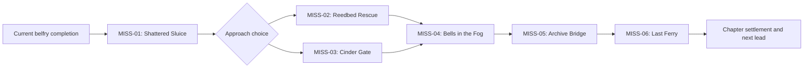
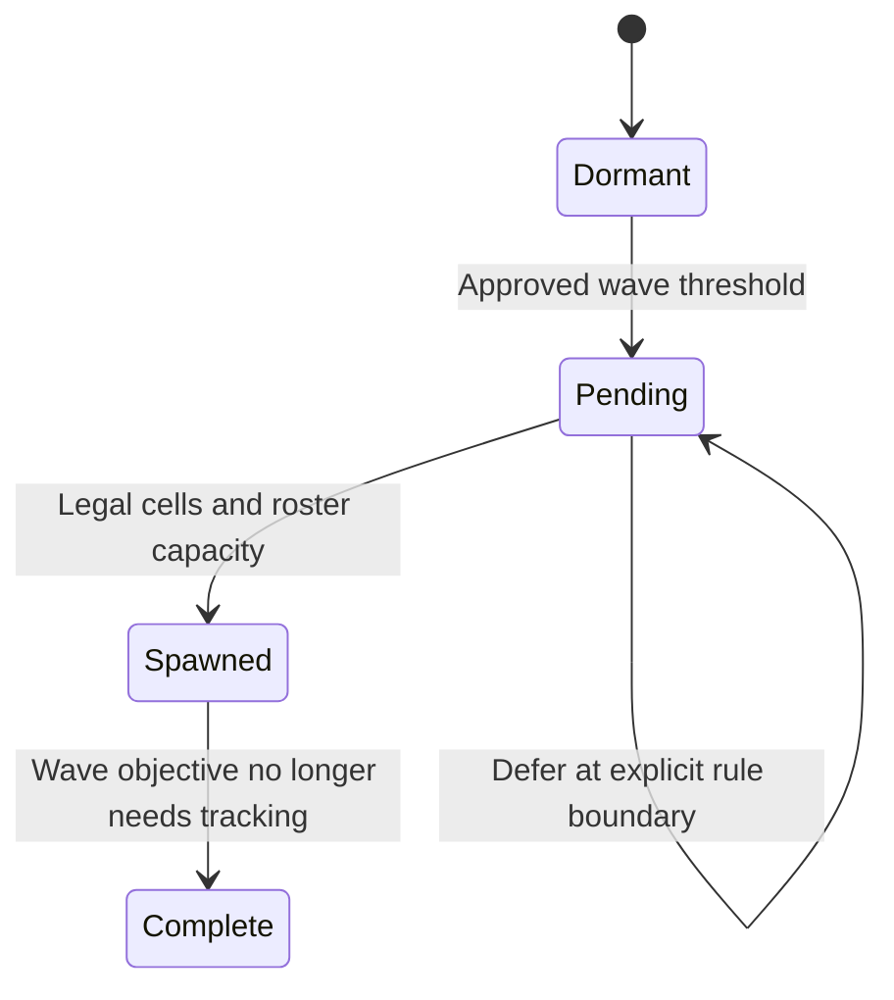

# Encounter blueprints

[Roadmap library](README.md) · [Campaign blueprint](CAMPAIGN_QUEST_BLUEPRINTS.md) · [Production slices](PRODUCTION_SLICES.md) · [Decision register](DECISION_REGISTER.md)

**All six missions are design proposals.** Names, coordinates, thresholds and rewards are candidates for a future chapter. They are not added to encounters.ts, playable content or established canon. Coordinate tables describe design zones, not complete validated tile arrays.

## Mission route

MISS-02 and MISS-03 are mutually exclusive approach candidates for one chapter run. Their consequences differ, but both reach MISS-04. Completion of either is sufficient; do not require both in the quest graph.

## Mission inventory

| ID / provisional name | Objective | Candidate size | Prerequisite | New system tested |
| --- | --- | --- | --- | --- |
| MISS-01 / The Shattered Sluice | defend | 12×8 | bellkeeper | MAP-02, MAP-03, OBJ-02 |
| MISS-02 / Reedbed Rescue | escort | 10×10 | MISS-01 | OBJ-04, AI-03, CMP-02 |
| MISS-03 / The Cinder Gate | breach | 12×10 | MISS-01 | MAP-08, WRL-05, OBJ-03 |
| MISS-04 / Bells in the Fog | survival | 9×12 | Either MISS-02 or MISS-03 | OBJ-06, AI-02, NAR-07 |
| MISS-05 / The Archive Bridge | interact | 12×8 | MISS-04 | OBJ-03, NAR-02, OBJ-05 |
| MISS-06 / The Last Ferry | escape | 14×10 | MISS-05 | OBJ-02, OBJ-08, NAR-05 |

## Shared encounter contract

| Field | Blueprint requirement |
| --- | --- |
| Identity | Stable mission ID separate from localized title |
| Board | Width/height, complete tiles, elevation/terrain and collision |
| Deployment | Valid allied zones and explicit roster/cap policy |
| Objective | Progress unit, eligible actors, success and hard-failure predicates |
| Timing | Exact boundary for counters, waves, hazards and interactions |
| Enemy plan | Roles, objective incentives, reserve/reinforcement behavior |
| Rewards | Repeatable bounty, unique completion, optional condition and settlement key |
| Story | Required flags, approach choice, recruit/service consequences and convergence |
| Presentation | Regional kit, phase/target cues, reduced motion and readable objectives |
| Recovery | Restore checkpoints before/after each irreversible transition |
| Validation | Rule fixtures, authored route review and actual control-path evidence |

Provisional gold values are intentionally not fixed here. First validate the source/sink and repeat-reward policy against the current 60/85/110/140-gold contract curve. A new mission should not silently become a required grinding source.

## MISS-01 — The Shattered Sluice

| Aspect | Candidate design |
| --- | --- |
| Purpose | Prove rectangular maps and one defend objective without new jobs or recruits |
| Board | 12×8; stream near x=5, crossings near z=3–4; raised control platform near (8,3) |
| Deployment | Four current allies around x=1, z=2–5; four defenders around x=10–11 |
| Success | Control platform remains secured through 12 completed activations |
| Clock | Increment after each legal completed activation; display progress explicitly |
| Failure | All allies defeated, or an approved platform-loss predicate becomes true |
| Enemy roles | Two approaches, one ranged pressure unit, one support unit; pursue platform under objective scoring |
| Teaching | Height, crossing choices, guard/support and explained objective timing |
| Dependencies | MAP-02/03, OBJ-01/02, AI-02; D-01/03/04 |
| Save checkpoints | Before activation 12, after terminal result, before/after camp settlement |

Platform-loss alternatives need D-03 approval: immediate enemy occupation, contested control progress or a separate durability objective. Do not implement all three simultaneously for the pilot.

| Scenario | Expected design evidence |
| --- | --- |
| Final tick with platform secure | One success transition and one settlement opportunity |
| Final tick while a hard-failure condition also resolves | Approved precedence; no contradictory success/failure UI |
| Fire/slow/reaction at activation end | Objective counter increments exactly once after approved rule resolution |
| Reload at 7/12 | Same counter, control state, units, resources and RNG |

## MISS-02 — Reedbed Rescue

| Aspect | Candidate design |
| --- | --- |
| Purpose | Introduce one recruit and objective-aware neutral movement |
| Board | 10×10; escort starts near (2,5), safe bank near (8,5); two readable approaches |
| Roster | Four allies, four enemies, one neutral escort; variable-roster validation required |
| Success | Escort reaches the safe bank under the chosen interact/automatic-entry rule |
| Failure | Escort irrecoverably lost under the approved mission policy, or no viable allied action remains |
| Approach | Rescue route; closes MISS-03 for this chapter run after explicit confirmation |
| Consequence | Candidate recruit Tamsin Mere becomes eligible once during settlement |
| Enemy roles | Interceptor pair, ranged pressure, support; no undisclosed escort-only targeting bonus |
| Dependencies | OBJ-04, AI-03, CMP-02; D-02/03/04/10 |
| Save checkpoints | Escort downed/revived, adjacent to exit, terminal rescue awaiting recruit settlement |

Tamsin is a proposed character, not an existing roster member. Initial job, gear and biography must be reviewed together. Rescue cannot manufacture owned equipment copies or duplicate the recruit on reload.

| Scenario | Expected design evidence |
| --- | --- |
| Escort route blocked by a fallen unit | Explain the obstruction; neutral AI avoids illegal movement |
| Escort downed and revived | Approved timer/eligibility resumes without duplicated state |
| Escort reaches exit on a lethal retaliation action | Explicit terminal precedence and one saved outcome |
| Settlement repeated after import | One member ID and one gear allocation |

## MISS-03 — The Cinder Gate

| Aspect | Candidate design |
| --- | --- |
| Purpose | Prove a rules-backed destructible barrier and interact command |
| Board | 12×10; gate footprint near (7,4)–(7,5), release wheel near (9,4) |
| Deployment | Allies near x=1, z=3–6; defenders behind the gate with readable ranged coverage |
| Success | Gate opened/destroyed and release wheel activated |
| Failure | Company defeat or approved critical mechanism destruction |
| Approach | Breach route; closes MISS-02 after explicit confirmation |
| Consequence | Candidate workshop access or alternate crafting lead; required services remain available elsewhere |
| Dependencies | MAP-08, WRL-05, OBJ-03; D-01/03/11 |
| Save checkpoints | Gate at partial durability, destroyed gate, wheel activated before settlement |

| Scenario | Expected design evidence |
| --- | --- |
| Barrier destroyed | Collision/pathing/visual state change together |
| Reload after destruction | Gate remains open; no repeated debris event or reset durability |
| Repeated wheel interaction | No extra action reward, quest progress or transaction |
| Mechanism destroyed by area damage | Approved rule produces a clear failure or recovery route |

Destruction must not be inferred from a missing mesh. Rule state owns occupancy and the renderer reflects it.

## MISS-04 — Bells in the Fog

| Aspect | Candidate design |
| --- | --- |
| Purpose | Rejoin approaches and test saved reinforcement waves |
| Board | 9×12; central beacon near (4,5), clearly marked reinforcement entry zones |
| Success | Survive 18 completed activations with required beacon condition intact |
| Waves | Candidate wave triggers at ticks 6 and 12; stable wave/spawn IDs |
| Cap | Prototype a bounded roster only after D-02/D-15 measurement; twelve is a candidate test cap |
| Blocked spawn | Save pending spawn intent; retry at a defined later boundary without duplicate creation |
| Enemy roles | Contest beacon, prevent static corner camping, preserve fair warning before entry |
| Dependencies | OBJ-06, AI-02, NAR-07; D-02/03/04/15 |
| Save checkpoints | Immediately before/after each wave, pending blocked spawn, final threshold tick |

A pending wave must be part of proposed saved encounter state. Animation completion, wall-clock timers and repeated scene initialization cannot spawn units.

| Scenario | Expected design evidence |
| --- | --- |
| Reload on tick 6 | Wave is either pending or spawned, never both twice |
| Entry zone occupied | Explicit bounded defer behavior; no overlap or infinite command loop |
| Cap reached | Preserve pending intent and explain delayed reinforcement |
| Last ally falls on tick 18 | Approved hard-failure/success precedence |

## MISS-05 — The Archive Bridge

| Aspect | Candidate design |
| --- | --- |
| Purpose | Combine interaction objectives with a visible narrative consequence |
| Board | 12×8; seals near (7,2)/(7,5), archive terminal near (9,3) |
| Success | Secure both seals, then choose a record at the terminal |
| Cost | Candidate interaction consumes an action at adjacent range; reject invalid repeats |
| Choice | Preserve community testimony or technical crown records; final wording is provisional |
| Optional condition | Recover an extra page without making its reward mandatory for the next mission |
| Enemy roles | Cover separate seals and challenge simultaneous access |
| Dependencies | OBJ-03, NAR-02, OBJ-05; D-03/11/16 |
| Save checkpoints | One seal complete, both complete, choice shown, choice settled |

| Scenario | Expected design evidence |
| --- | --- |
| Activate same seal twice | One objective fact and no extra payout |
| Cancel terminal dialogue | No selected record or faction change committed |
| Reload after choice | Same chosen record and visible consequence |
| Missing optional page | Required route remains reachable without grinding or replay |

The archive choice can change later dialogue, codex content or optional services. It must not require both mutually exclusive approach completions.

## MISS-06 — The Last Ferry

| Aspect | Candidate design |
| --- | --- |
| Purpose | End the chapter with extraction and explicit required/optional outcomes |
| Board | 14×10; ferry extraction near x=12–13, z=4–5 |
| Required actors | Candidate: two named ledger carriers; approve exact identities and loss policy before implementation |
| Success | Required actors alive and recorded as extracted |
| Optional condition | Recover/extract the remaining deployed companions for an extra narrative/reward outcome |
| Extraction | Rule record distinguishes extracted from defeated; profiles are not deleted |
| Failure | Required actor cannot be recovered, or no viable actor remains to complete required extraction |
| Enemy roles | Pursuit/interception and visible escape pressure without an undisclosed turn limit |
| Dependencies | OBJ-02/08, NAR-05, CMP-07; D-02/03/10 |
| Save checkpoints | Partial extraction, downed required actor, final extraction, chapter settlement |

| Scenario | Expected design evidence |
| --- | --- |
| Last required actor extracts | Objective resolves correctly even if no active allied unit remains on board |
| Required actor downed before exit | Clear revive/recovery policy; no implicit permanent-loss rule |
| Optional companion left behind | Documented optional consequence; no accidental removal of company profile |
| Reload after partial extraction | Removed occupancy and extracted identity stay consistent |
| Final success and hard failure coincide | Approved precedence, one chapter result and one settlement key |

## Encounter sign-off

Each mission needs a complete validated tile/spawn definition, objective reducer cases, intended build alternatives, AI role evidence, readable telegraphs, first-clear/repeat policy, restore checkpoints and an authored route review. Coordinate sketches and a green content graph do not prove a mission is fair or playable.

