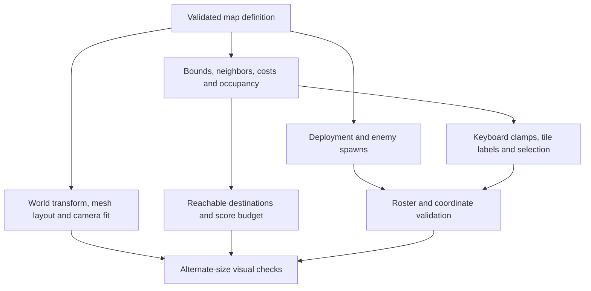
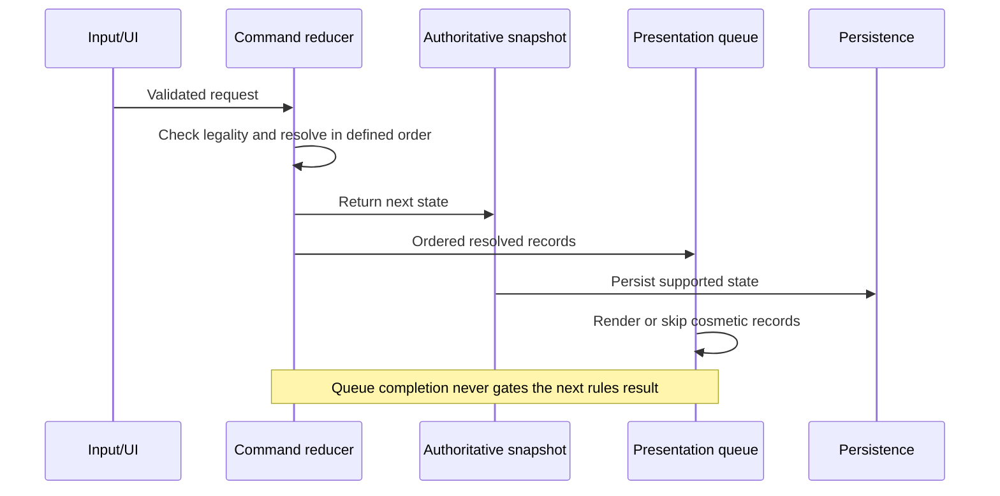
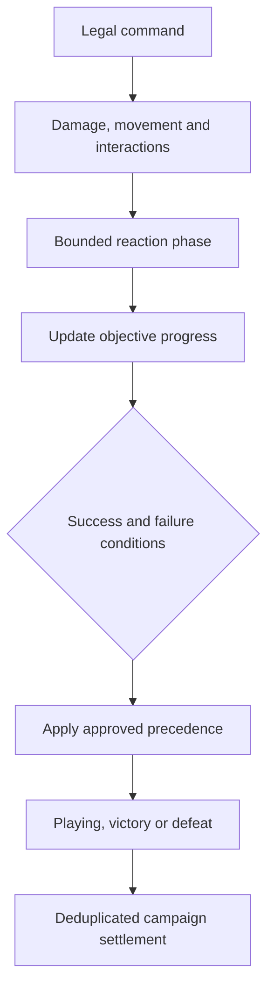
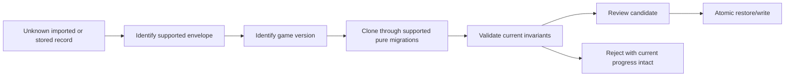

# Engine and system expansion

[Roadmap library](README.md) · [Backlog](BACKLOG.md) · [Current architecture](../ARCHITECTURE.md)

Everything in the proposed contracts below is planned. Current saves remain Expedition/Battle v2. Do not implement a conceptual field merely because it appears in this guide.

The [technical contract examples](TECHNICAL_CONTRACTS.md) and [production-slice audit](PRODUCTION_SLICES.md#slice-a--safe-expansion-seam) make the next steps concrete. [Open decisions](DECISION_REGISTER.md) must be resolved before the examples become runtime schemas.

## Current seams and proposed contracts

| Area | Current seam | Proposed extension | Gate / IDs |
| --- | --- | --- | --- |
| Board | 81 tiles, bounds 0–8, shared regional construction | MapDefinition with dimensions, validated tiles, deployment zones and prop references | M1/M3; FND-02, MAP-01–03 |
| Combat roster | Eight field units and four known companions | Stable unit IDs, variable deployed/reserve groups, explicit side/occupancy rules | M3/M4; MAP-04, CMP-01 |
| Objectives | Eliminate enemy/allied living units | Typed objective reducer with saved progress and explicit terminal precedence | M3; OBJ-01–02 |
| Commands | Move, skill, end | Add interact/use-item/summon only with cost, cancellation and legality contracts | OBJ-03, ECO-03, CBT-08 |
| Presentation | Optional latest-action cue | Ordered resolved-event batch with actor/target identity and sequence IDs | FND-05, VFX-01 |
| Status | Four counters and fixed ordering | Registry of timing, stack, cleanse and interaction rules | CBT-05–07 |
| Campaign | Fixed contract gates and completion IDs | Quest/choice/faction state, recruitment and route eligibility | NAR-01–06 |
| Economy | Gold and item-copy counts | Typed transaction ledger for crafting, consumables and unique rewards | ECO-01–10 |
| Persistence | One v1 migration and optional v2 fields | Explicit supported-version migration chain and fixture library | SAV-01–04 |
| Content | Typed in-source records | Validated authoring package with stable IDs and reference diagnostics | FND-04, FND-07 |

## Boundary rules to preserve

1. Pure rules accept a snapshot and a typed request; rejection preserves state and RNG.
2. Derived stats come from one authoritative function. UI and AI must not invent alternate formulas.
3. Previews and resolution use the same targeting, modifier and status contracts.
4. Rendering/audio consume resolved facts and may skip cosmetics under load.
5. Migration clones/validates; restore happens only after a candidate is accepted.
6. Content IDs are persistent contracts. Renames need an alias/migration decision.
7. Unit iteration/tie-breaking order must be explicit wherever it affects rolls.
8. Save schema, IndexedDB schema and export envelope have independent versions.

## Map and roster generalization

A new board size touches more than pathfinding. Use a change checklist across the whole player path.

| Contract | Decision required | Acceptance probe |
| --- | --- | --- |
| Tile coordinates | Zero-based x/z; width/height from content | Corners and absent cells reject consistently |
| Occupancy | Living, fallen, neutral, summon and prop behavior | Path preview and confirmation agree |
| World mapping | Separate tile coordinates from scene offsets | Rectangular board remains centered through rotation |
| Deployment | Roster cap, reserve eligibility, zones and duplicate IDs | Invalid selections never create a battle |
| Variable units | Saved order versus stable ID tie-break/roll order | Reordered display does not reorder simulation |
| Camera/input | Fit dimensions, labels beyond I and narrow viewports | Every legal tile remains selectable |
| Validation | Exact map cells and reference consistency | Duplicate/missing tiles fail before play |
| Migration | Keep old active battle legal | Old 9×9 saves preserve HP, coordinates and seed |

First pilot: existing 9×9 fixture plus one proposed 12×8 board. This is an engineering test size, not a promised mission layout. Keep all four existing fixtures until the new abstraction demonstrates equivalent outcomes.

## Proposed command/event pipeline

Today a command returns a Battle snapshot with a latest cosmetic cue. A future event batch should be a derived description of resolution, not a second authoritative simulation.

| Proposed record | Minimum identity/data | Must clarify before implementation |
| --- | --- | --- |
| ActionStarted | Sequence ID, actor ID, skill ID, source and target | Whether source is before/after committed movement |
| DamageResolved | Source/target IDs, hit/miss, amount, critical/resist facts | Reaction ordering and final versus raw amounts |
| StatusChanged | Target, status ID, previous/new value and cause | Duration unit, stacking and cleanse priority |
| UnitMoved | Unit, old/new coordinates, optional validated path | Path visuals versus authoritative atomic move |
| ObjectiveChanged | Objective ID and old/new progress | Which events can advance or fail it |
| UnitSpawned/Removed | Stable ID, owner, roster relation and cause | Summon/escort reward and persistence rules |
| EncounterResolved | Result, objective cause and settlement key | Exactly-once boundary and contradictory outcomes |

Keep event IDs monotonic within a battle or otherwise deduplicable. Initial load seeds the consumer cursor instead of replaying history. If records are persisted, bound their size and version them; do not turn a visual log into an unbounded save payload.

## Objectives, props and summons

This is proposed ordering. Current elimination/phase behavior remains documented in the [combat guide](../COMBAT.md). Explicitly decide simultaneous escort death/mission success and lethal boss-phase cases before implementing objective reducers.

| New system | State to define | Tricky cases |
| --- | --- | --- |
| Escort | Stable identity, side, AI control and required destination | Escort downed, revived, blocked or at exit on the final attack |
| Survival | Counter unit and remaining waves | Activations versus rounds; reload during a pending wave |
| Capture | Zone and ownership/progress | Contest, neutral occupants, ties and dead units |
| Destructible prop | Rule footprint, durability/state, interaction IDs | Removal opening a path; explosion damaging an objective |
| Summon | Owner, cap, action profile, lifetime, roster relation | Owner defeat, dismissal, blocked spawn and save during lifetime |
| Weather | Encounter rule ID, timing and modifiers | Display-only weather versus actual accuracy/terrain changes |

## Migration and transactions

A future v3 is a candidate only when fixed-shape records cannot safely express the approved expansion. Do not bump versions for cosmetic changes alone, and do not bolt new required fields onto v2 without a compatibility decision.

Transaction candidates include recruit settlement, crafting costs/output, first-clear rewards and quest flags. Each needs a stable deduplication key or equivalent invariant. Failed validation/cancellation must leave the original game unchanged.

## Architecture acceptance

| Gate | Evidence required |
| --- | --- |
| Rule equivalence | Baseline seed/command fixtures remain equivalent except explicitly approved changes |
| Save compatibility | Current and legacy fixtures preserve resources, IDs, RNG and completion state |
| Content correctness | Unknown/cyclic references fail before a mission can start |
| Complete player path | New data reaches real deployment, targeting, resolution and settlement controls |
| Performance | Command/AI latency measured with scene and device metadata |
| Failure containment | Missing optional art/audio keeps rules usable; invalid required content is rejected clearly |
| Documentation | Current guide changes only after shipping; proposal marked superseded or completed deliberately |

