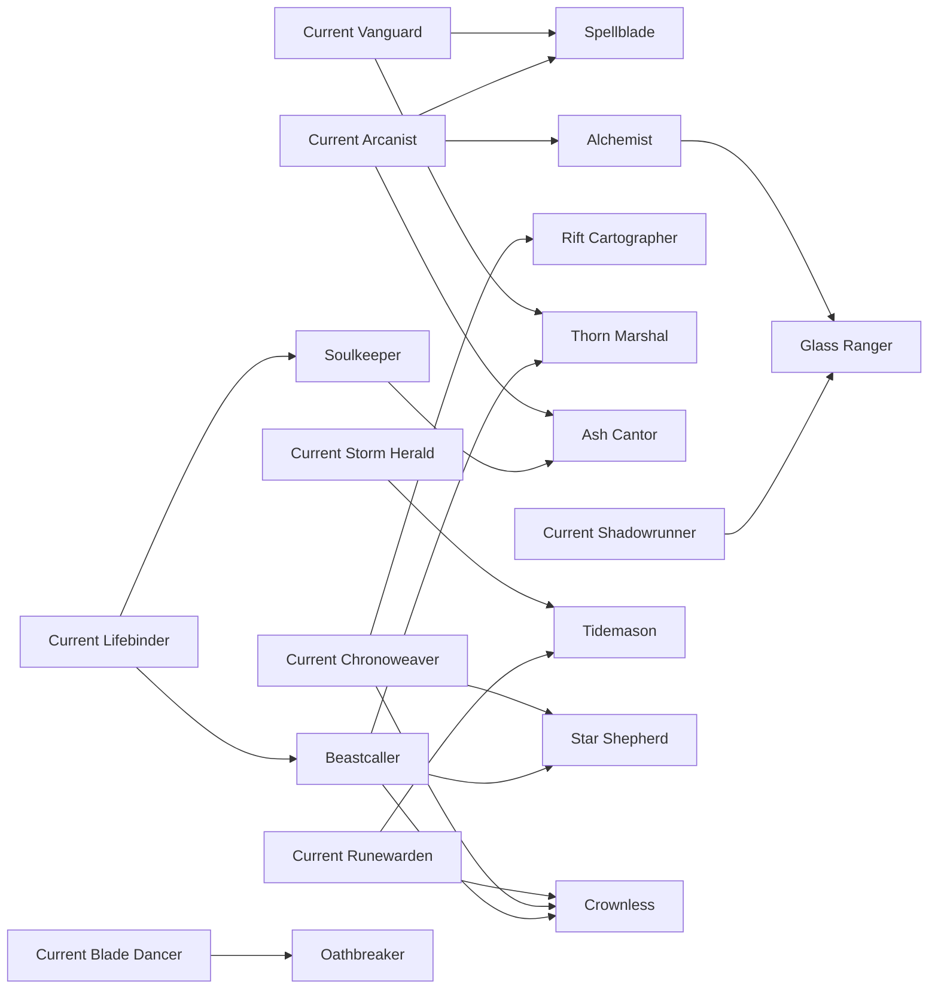
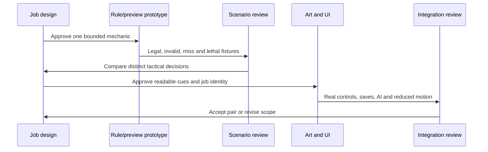

# Job and ability blueprints

[Roadmap library](README.md) · [Current job catalog](../REFERENCE_CATALOG.md#jobs) · [Content plan](CONTENT_PLAN.md) · [Decision register](DECISION_REGISTER.md)

**Twelve proposed jobs and 36 prototype abilities.** Nothing in this document adds a live JobId/SkillId, unlock or lesson. Names, energy costs, targeting and effects are design candidates. Values are not balance-tested; current eight-job rules remain unchanged.

## Rollout principles

1. Finish a complete pair before expanding the whole roster.
2. A job needs a distinct decision pattern, not only a higher stat line.
3. Keep native skills, permanent learning and secondary ownership explicit.
4. Every new mechanic requires previews, AI valuation, save defaults and presentation.
5. Prototype numbers support discussion; approve them only after scenario/playtest evidence.
6. Summons, reactions and timeline effects must have bounded loops and clear counterplay.

## Twelve-job integration map

| Proposed job | Identity | Prerequisite-job graph to review | Blocking backlog |
| --- | --- | --- | --- |
| Beastcaller | Owned companion and positional support | lifebinder | CBT-08, JOB-05, WRL-06 |
| Spellblade | One chosen weapon infusion and risk-managed melee | vanguard, arcanist | JOB-05, CBT-04, CBT-05 |
| Alchemist | Limited mixtures and deliberate surface setup | arcanist | ECO-02, ECO-03, ECO-06 |
| Soulkeeper | Recoverable spirit transfers with health tradeoffs | lifebinder | CBT-05, CBT-07, JOB-07 |
| Rift Cartographer | Short repositioning and prepared routes | chronoweaver | MAP-02, CBT-06, JOB-07 |
| Thorn Marshal | Ally/summon formations and bounded zone defense | vanguard, beastcaller | CBT-08, JOB-07, WRL-06 |
| Ash Cantor | Sustained chants and interruption choices | soulkeeper, arcanist | CBT-05, CBT-07, JOB-07 |
| Glass Ranger | Prepared ranged lines and refraction | shadowrunner, alchemist | CBT-02, MAP-08, JOB-07 |
| Tidemason | Temporary water/cover manipulation | runewarden, stormherald | CBT-06, MAP-08, JOB-07 |
| Oathbreaker | Explicit offensive commitment and defensive cost | dancer | CBT-05, JOB-07, NAR-06 |
| Star Shepherd | Limited celestial summons with timeline choices | beastcaller, chronoweaver | CBT-08, AI-06, JOB-07 |
| Crownless | Coordinated actions with team-wide opportunity cost | runewarden, chronoweaver, beastcaller | CBT-09, JOB-07, NAR-09 |

The graph lists prerequisite job identities for design validation. Exact levels, mastery conditions and story flags are not live unlocks; see the candidate acquisition table in [content planning](CONTENT_PLAN.md#twenty-job-roster). Crownless's three listed jobs are a review example of the broader advanced-mastery idea, not a final mandated trio.

## Prototype ability catalog

Costs below are initial discussion values. All abilities consume an action unless a later approved command contract explicitly states otherwise. A charge is a proposed finite reagent resource, not existing inventory support.

### Beastcaller

| Proposed ability ID / name | Candidate cost | Target | Intended rule | Counterplay / acceptance guard |
| --- | --- | --- | --- | --- |
| AB-call-reedfox / Call Reedfox | 8 EN | Empty cell, range 2 | Spawn one owned companion under the shared summon cap. | Block/contest legal spawn cells; no spawn on occupied terrain. |
| AB-pack-signal / Pack Signal | 4 EN | Owned companion, range 4 | Set its preferred target/position for its next ordinary activation. | No immediate extra action; command expires after the chosen activation. |
| AB-sheltering-call / Sheltering Call | 7 EN | Owned companion, range 3 | Grant existing-style guard and one clear defensive role. | Guard does not stack with itself and clears at the approved boundary. |

### Spellblade

| Proposed ability ID / name | Candidate cost | Target | Intended rule | Counterplay / acceptance guard |
| --- | --- | --- | --- | --- |
| AB-ember-edge / Ember Edge | 6 EN | Self | Prepare a fire rider for the next weapon attempt; consume on attempt. | A miss still consumes the preparation; no permanent free infusion. |
| AB-frost-parry / Frost Parry | 8 EN | Self | Guard with one bounded chill retaliation on a surviving adjacent hit. | Ranged pressure and nonrecursive reaction ordering limit retaliation. |
| AB-seam-strike / Seam Strike | 9 EN | Enemy, adjacent | A committed hybrid strike with partial armor bypass. | Higher cost and melee exposure; bypass amount needs balance review. |

### Alchemist

| Proposed ability ID / name | Candidate cost | Target | Intended rule | Counterplay / acceptance guard |
| --- | --- | --- | --- | --- |
| AB-reagent-flask / Reagent Flask | 6 EN + charge | Cell, range 3 | Apply a small temporary wet surface using a finite reagent charge. | Do not conjure infinite inventory or bypass required terrain routes. |
| AB-dry-salve / Dry Salve | 5 EN + charge | Ally, range 3 | Cleanse burn and the approved wet-surface/status interaction. | Single-target utility; no damage/heal refund loop. |
| AB-catalyst-break / Catalyst Break | 9 EN + charge | Prepared surface, range 3 | Consume a prepared mixture for one approved surface reaction. | Requires setup; invalid or absent surface consumes nothing. |

### Soulkeeper

| Proposed ability ID / name | Candidate cost | Target | Intended rule | Counterplay / acceptance guard |
| --- | --- | --- | --- | --- |
| AB-borrowed-vigor / Borrowed Vigor | 7 EN | Ally, range 3 | Transfer a bounded amount of caster HP; cannot reduce caster below one. | No critical healing or transfer multiplication; low-health caster cannot fund it. |
| AB-last-light-ward / Last-light Ward | 10 EN | Living ally, range 3 | Prepare one limited recovery after a surviving hit. | Cannot revive through the ward or recursively trigger itself. |
| AB-spirit-tether / Spirit Tether | 6 EN | Living ally, range 3 | Share a bounded fraction of one damage event with the caster. | Explicit order with guard/reactions; transferred damage cannot spawn another tether chain. |

### Rift Cartographer

| Proposed ability ID / name | Candidate cost | Target | Intended rule | Counterplay / acceptance guard |
| --- | --- | --- | --- | --- |
| AB-fold-step / Fold Step | 8 EN | Empty legal tile, range 3 | Reposition the caster with destination/LOS restrictions. | Cannot enter blocked/water cells or automatically activate quest objects. |
| AB-return-mark / Return Mark | 6 EN | Self tile | Save one temporary anchor eligible for a later paid return. | Anchor expires by a named actor-activation clock; occupied return is rejected. |
| AB-trail-stitch / Trail Stitch | 7 EN | Ally, range 3 | Grant one bounded route/movement benefit for the next legal move. | No repeated free teleports or extra skill actions. |

### Thorn Marshal

| Proposed ability ID / name | Candidate cost | Target | Intended rule | Counterplay / acceptance guard |
| --- | --- | --- | --- | --- |
| AB-thorn-screen / Thorn Screen | 8 EN | Cell, range 3 | Create temporary defensive cover with an explicit nonblocking pilot footprint. | Does not wall off required exits; fire/expiry interaction must be defined. |
| AB-line-oath / Line Oath | 7 EN | Allied cross, range 2 | Guard a small formation with ordinary guard semantics. | Spread, flanking and existing guard replacement limit stacking. |
| AB-briar-order / Briar Order | 9 EN | Owned companion, range 3 | Prepare one bounded zone-defense trigger for its next activation. | Shared cap/reaction limits; no damage on every render or path sample. |

### Ash Cantor

| Proposed ability ID / name | Candidate cost | Target | Intended rule | Counterplay / acceptance guard |
| --- | --- | --- | --- | --- |
| AB-ember-refrain / Ember Refrain | 6 EN | Self chant | Begin a chant that requires later action commitment to sustain. | Interrupt or force relocation; no free attack while automatically sustaining. |
| AB-ash-crescendo / Ash Crescendo | 8 EN | Enemy cross, range 3 | Spend prepared chant state for a shaped fire payoff. | Needs setup; canceled/expired chant cannot be spent. |
| AB-quiet-cadence / Quiet Cadence | 7 EN | Chanting enemy, range 3 | Interrupt an eligible sustained action. | Does not become a universal stun against every enemy ability. |

### Glass Ranger

| Proposed ability ID / name | Candidate cost | Target | Intended rule | Counterplay / acceptance guard |
| --- | --- | --- | --- | --- |
| AB-sightline / Sightline | 5 EN | Self | Prepare one accurate long-range attempt with disclosed duration. | Does not see or shoot through blockers; preparation is consumable. |
| AB-shard-line / Shard Line | 9 EN | Enemy line, range 5 | Hit a bounded ordered line with reduced later-target payoff. | Collision, target order and friendly interaction are previewed. |
| AB-mirror-pin / Mirror Pin | 8 EN | Enemy, range 4 | Apply a short movement restriction while leaving ability use available. | Named duration, cleanse rule and boss eligibility; no permanent lock. |

### Tidemason

| Proposed ability ID / name | Candidate cost | Target | Intended rule | Counterplay / acceptance guard |
| --- | --- | --- | --- | --- |
| AB-raise-weir / Raise Weir | 9 EN | Legal terrain, range 3 | Temporarily redirect water/cover with a validated footprint. | Reject map-breaking placements and preserve objective reachability. |
| AB-channel-cut / Channel Cut | 7 EN | Short path, range 4 | Create a small readable wet route for later combinations. | Finite length/duration; avoid unlimited lightning setup at no cost. |
| AB-setstone / Setstone | 8 EN | Water/approved cell, range 3 | Form one temporary traversable crossing. | Decide occupied-expiry handling before implementation; never delete an occupying unit. |

### Oathbreaker

| Proposed ability ID / name | Candidate cost | Target | Intended rule | Counterplay / acceptance guard |
| --- | --- | --- | --- | --- |
| AB-breach-vow / Breach Vow | 6 EN | Self | Trade a disclosed defense penalty for a temporary offensive commitment. | Penalty survives the action as specified; cannot cancel it for free after attacking. |
| AB-debt-strike / Debt Strike | 9 EN | Enemy, adjacent | A high-commitment strike that forfeits the caster's protection. | Remove protection in approved order before retaliation; preview the risk. |
| AB-renounce / Renounce | 10 EN | Unit, range 3 | Remove an eligible guard/pledge effect under explicit targeting rules. | Costs an action; cannot dispel story/objective flags. |

### Star Shepherd

| Proposed ability ID / name | Candidate cost | Target | Intended rule | Counterplay / acceptance guard |
| --- | --- | --- | --- | --- |
| AB-call-wisp / Call Wisp | 10 EN | Empty cell, range 2 | Summon one celestial helper using the approved shared owner-cap rule. | Changing jobs or summon families cannot bypass the cap. |
| AB-meridian / Meridian | 6 EN | Ally, range 3 | Apply a bounded readiness adjustment through the helper relationship. | Per-target limits and action cost prevent permanent timeline lock. |
| AB-eventide / Eventide | 11 EN | Owned helper / area | Dismiss a helper for a one-time localized effect. | No resource refund loop, duplicate dismissal or repeated effect after load. |

### Crownless

| Proposed ability ID / name | Candidate cost | Target | Intended rule | Counterplay / acceptance guard |
| --- | --- | --- | --- | --- |
| AB-lantern-order / Lantern Order | 10 EN | Ally, range 3 | Give one bounded next-move benefit through company coordination. | No immediate extra skill activation or infinite mutual orders. |
| AB-shared-promise / Shared Promise | 12 EN + 2 momentum | Allied area, range 3 | Spend company momentum on a defensive coordinated choice. | Competes with offensive momentum use; guard does not multiply itself. |
| AB-break-the-circle / Break the Circle | 14 EN + 3 momentum | Small formation, range 3 | Convert a prepared company formation into one reviewed coordinated payoff. | Distinct from current concord before approval; no overlapping duplicate rewards. |

## Status and resource decisions

| Mechanic family | Decision required | Hard acceptance guard |
| --- | --- | --- |
| Companion ownership | Owner, cap, initiative, lifetime and dismissal | No duplicated spawn, free replacement or separate-family cap bypass |
| Prepared action | Consumed on attempt/hit, duration and cancellation | Miss/load/job change cannot create unlimited preparation |
| Damage transfer | Guard/armor/reaction order and source attribution | No recursive transfer chain or negative damage |
| Reagent charge | Battle resource versus owned item | Reject insufficient charges atomically; no free inventory synthesis |
| Teleport/anchor | Destination legality, LOS, expiry and occupied anchor | No blocked placement, unit deletion or objective bypass |
| Temporary terrain | Footprint, rule collision, expiration and occupied cells | Preserve a valid recovery route |
| Chant | Start, sustain, payoff and interrupt timing | No automatic free attacks while sustaining |
| Immobilization | Named duration, cleanse and immunity policy | Abilities remain usable as designed; no permanent lock |
| Team coordination | Momentum spend and preparation eligibility | No mutual extra-turn or reward loop |

D-04/05/06/07/09 govern these contracts. A concept with unresolved timing/ownership is not implementation-ready merely because it has an energy cost.

## First-pair pilot: Beastcaller and Spellblade

| Workstream | Beastcaller | Spellblade | Evidence |
| --- | --- | --- | --- |
| Core decision | Where/when to place and command a companion | Whether to prepare, guard or commit to melee | Two useful choices demonstrated in contrasting scenarios |
| First implemented mechanic | One ordinary owned summon | One consumable infusion | Legal, invalid, cancel and restore fixtures |
| Deferred mechanics | Multiple creature families and deep bonding | Weapon-specific models and large infusion combinations | Explicit scope list without misleading availability |
| AI | Legal spawn/cap and useful companion command | Compare setup cost against immediate damage | Deterministic useful-choice and no-target cases |
| Art | Creature idle/walk/action/hurt/down/expiry | Existing job-scale identity plus clear infusion cue | Game-scale camera, fallback and reduced-motion review |
| Save | Owner, stable summon ID and remaining lifetime | Preparation state, consumption and expiration | Resume before/after spawn, spend and expiry |
| Counterplay | Deny space or pressure owner | Evade/guard and exploit the defensive commitment | Enemy response can make immediate offense preferable |

## Per-job acceptance card

| Check | Required scenario |
| --- | --- |
| Unlock graph | Prerequisites are reachable and acyclic; story alternative is explicit |
| Learning | Native versus permanently learned secondary access behaves as approved |
| Costs | Insufficient energy/charges/momentum reject without mutation |
| Preview | Target shape, modifiers, status/resource consequences match resolution |
| Reactions | Lethal hits, counters and transfers terminate in approved order |
| AI | At least one useful player/enemy scenario and one no-legal-target case |
| Saves | Before/after preparation, spawn, consumption, expiry and settlement |
| Equipment | Proficiency and shared-copy ownership remain valid after job changes |
| Presentation | Cast/attack/contact/down states, fallback and reduced motion |
| Accessibility | Name, role, cost, target and outcome understandable without color/audio alone |
| Balance | Compare setup/action cost and counterplay with existing jobs |

No new job should be described as complete while only its data row, portrait or three ability names exist.

