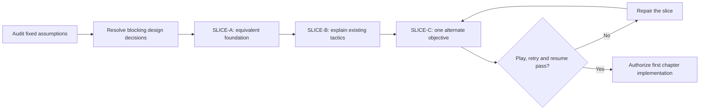
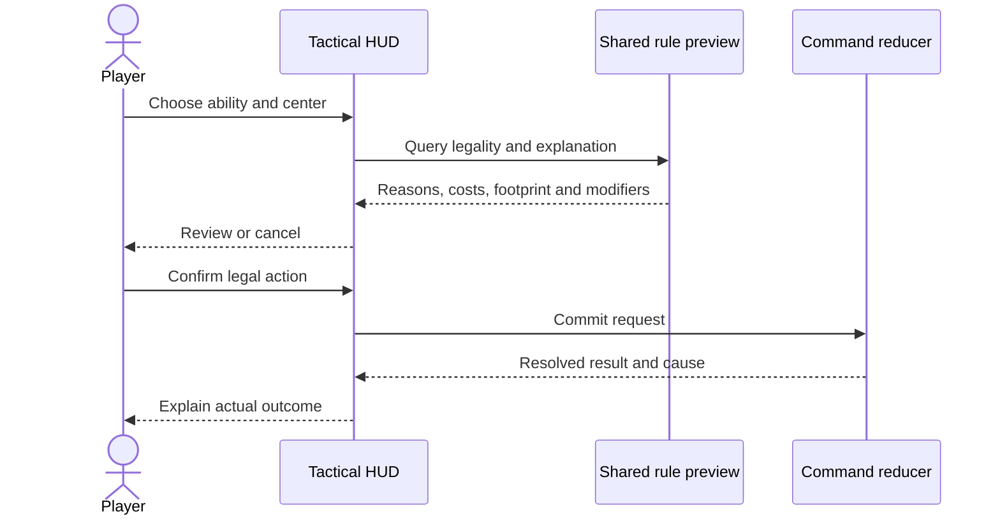

# Production slices and acceptance scenarios

[Roadmap library](README.md) · [Backlog](BACKLOG.md) · [Decision register](DECISION_REGISTER.md) · [Technical contracts](TECHNICAL_CONTRACTS.md)

**Design proposal only.** These are implementation briefs for the next three increments. They do not mark M1–M3 or their backlog items complete. No runtime or save behavior changes with this document.

## Slice map

| Slice | Purpose | Backlog coverage | Required decisions | Player/developer evidence |
| --- | --- | --- | --- | --- |
| SLICE-A | Safe expansion seam | FND-01, FND-02, MAP-01, SAV-01, QA-01 | D-01, D-02, D-12 | Existing route and saves remain equivalent after centralizing constraints |
| SLICE-B | Readable battle | CBT-01, CBT-02, UX-01, UX-02, OBJ-01, AI-01 | D-03, D-04, D-05 | Legal targets, modifiers and result causes are understandable through real controls |
| SLICE-C | Alternate-objective pilot | MAP-02, MAP-03, OBJ-02, OBJ-08, QA-02 | D-01, D-03, D-04, D-12 | One proposed 12×8 defend mission supports victory, failure, retry and resume |

The source audit below supports FND-01, but does not complete it: a full implementation audit must include consumers, tests, save fixtures and approved replacement contracts.

## SLICE-A — Safe expansion seam

### Problem and intended result

The game currently assumes four named companions, eight combatants and a 9×9 board in multiple modules. A larger map or recruit cannot be safely added by editing one encounter row. The first slice should expose those contracts without altering the existing game's command results.

| Work package | Proposed result | Scope guard |
| --- | --- | --- |
| A1: assumption inventory | Map each fixed limit to its rules, UI, rendering and save consumers | Do not replace unrelated numeric constants |
| A2: common board contract | One dimensions/coordinate interface usable by rule and presentation adapters | Do not silently accept new dimensions in old saves |
| A3: roster contract | Named original companions and explicit simulation ordering | Do not implement recruitment yet |
| A4: supported-save policy | Written version/default/migration decisions and fixtures | No version bump merely for documentation |
| A5: equivalence evidence | Four baseline replays and invalid-command snapshots | Fixtures include full state and RNG, not only victory |

### Audited current assumptions

| Source | Observed dependency | Proposed treatment | Validation to retain |
| --- | --- | --- | --- |
| [engine.ts](../../src/engine.ts) | Tile loops below nine; 81-tile/eight-unit validation; coordinates below nine | Approved board/roster schema shared by creation and validation | Existing four fixtures validate identically |
| [campaign.ts](../../src/campaign.ts) | Four profiles and explicit sera/ilya/corin/mae identity set | Separate original-roster identity from future company capacity | Legacy profiles and field projection retain builds |
| [main.tsx](../../src/main.tsx) | Keyboard/gamepad clamps at eight; selected-member default Sera | Read bounds from active content; choose a valid member by policy | Every corner and input path stays reachable |
| [scene.ts](../../src/scene.ts) | Tile/world coordinates subtract four; camera fitting assumes current terrain | Central tile-to-world transform and bounds-aware camera | Rotation, targeting and anchors agree |
| [combat-effects.ts](../../src/combat-effects.ts) | Effect target bounds end at eight | Use the same approved board bounds as targeting | No valid edge effect is dropped |
| [effect-renderer.ts](../../src/effect-renderer.ts) | Particle/sprite/ring world positions subtract four | Consume the common transform | Particles, projectiles and characters share tile centers |
| [Camp.tsx](../../src/Camp.tsx) | Sera selection reset and current regional overview | Valid member-selection policy and map-preview contract | Camp selection never references an absent recruit/profile |
| Existing tests/validators | Fixed counts are legitimate current invariants | Preserve supported old fixtures; add new-format fixtures separately | No broad removal of validation to make a pilot pass |

The particle trail divisor nine in effect-renderer.ts is a visual sampling count, not a board dimension. Damage modifier caps, hazard amounts and skill ranges are also unrelated numbers. The audit must distinguish semantics instead of replacing every literal.

### Acceptance scenarios

| ID | Given | When | Then / evidence |
| --- | --- | --- | --- |
| A-AC-01 | Current four encounter fixtures | Run the same seed and commands before/after refactoring | Same terminal snapshot, resource values and seed |
| A-AC-02 | A valid current expedition and supported legacy fixture | Decode and restore both | Original IDs, coordinates, resources and progression preserved |
| A-AC-03 | A blocked/occupied/out-of-range command | Submit through the reducer | Original state object and RNG unchanged |
| A-AC-04 | A map definition with a duplicate/missing tile | Validate proposed content | Location-specific rejection before play |
| A-AC-05 | Current 9×9 board in all camera orientations | Select corner cells with keyboard/pointer | UI coordinates and raycast tile identity agree |
| A-AC-06 | A fixed number unrelated to board size | Review the refactor diff | No accidental change to costs, damage or particle density |

Exit evidence: source audit, approved D-01/D-02/D-12 records, equivalence fixtures, current save round trips, browser corner selection and updated current docs. An unreviewed common constants file is not enough.

## SLICE-B — Readable battle

### Problem and intended result

Previews show useful values, but new mechanics would be difficult to trust without consistent explanations and objective vocabulary. Improve the current encounters before expanding rule complexity.

| Screen/control | Proposed behavior | Error/cancel behavior |
| --- | --- | --- |
| Ability selection | Show cost, range, area, target type and action availability | Preserve actor/selection when reviewing a disabled action |
| Tile targeting | Explain why a center is illegal and display the area footprint | Cancel returns to inspect without spending resources |
| Outcome preview | List relevant height, guard, formation, exposure and synergy contributions | No critical outcome presented as guaranteed |
| Objective panel | Separate progress, hard failure and optional conditions | Terminal cause remains readable after animations finish |
| Timeline | Explain readiness changes as activation timing | Do not imply real-time waiting affects turns |
| Focus path | Explicit camp/battle/modal order with visible focus | Close dialogs to a meaningful prior control |
| AI diagnostics | Developer-only candidate factors and chosen legal action | Keep diagnostic state separate from player saves |

| ID | Given | When | Then / evidence |
| --- | --- | --- | --- |
| B-AC-01 | Guarded exposed target on higher ground | Preview and execute a legal skill | Displayed modifiers explain the noncritical resolution |
| B-AC-02 | Empty damage center beside enemies | Preview an area spell | Valid terrain cast and enemy-only footprint are clear |
| B-AC-03 | Insufficient energy or blocked LOS | Attempt targeting | Specific reason; no state/RNG change |
| B-AC-04 | Current controller/keyboard focus path | Open/close settings and backups | Input is gated and prior focus returns correctly |
| B-AC-05 | A missed attack | Read result and effect feedback | No guaranteed-hit wording or successful-hit particle claim |
| B-AC-06 | Loaded resolved battle | Inspect objective/result panel | Correct saved cause; no replayed action or reward |

Exit evidence: matching preview/result cases, legal/illegal/cancel paths and complete keyboard navigation through the current route. Full physical-controller or screen-reader certification remains a separate gate.

## SLICE-C — Alternate-objective pilot

Candidate content: MISS-01, The Shattered Sluice. It uses a proposed 12×8 board and a defend objective. Names, dimensions, threshold and balance are provisional.

| Component | Proposed contract |
| --- | --- |
| Entry | Unlocked after current bellkeeper completion |
| Deployment | Keep four current companions for the pilot; do not add recruitment simultaneously |
| Objective | Hold the control platform through 12 completed activations |
| Counter | Increment after a legal end-of-activation resolution; never on animation completion |
| Failure candidate | All allies defeated or control platform lost under an approved explicit rule |
| Simultaneous result | Recommended hard failure before threshold success; D-03 must approve |
| Rewards | Provisional bounty and unique-completion key; tuning is separate from settlement correctness |
| Retry | Restore pre-deployment profile and objective baseline; discard attempt gains |
| Resume | Restore map, progress, seed, units and terminal/campaign settlement state exactly |

| ID | Given | When | Then / evidence |
| --- | --- | --- | --- |
| C-AC-01 | Valid 12×8 mission | Deploy and select all corners | Rules, labels, world anchors and camera agree |
| C-AC-02 | Progress at 11/12 | Complete one legal activation | Exactly one objective tick and a single terminal result |
| C-AC-03 | Final ally falls on threshold tick | Resolve hazards/reactions | Approved precedence yields one unambiguous result |
| C-AC-04 | Saved progress at 7/12 | Close and resume | Counter, actors, resources and seed are unchanged |
| C-AC-05 | Terminal victory awaiting return | Import/reload and return twice | Intended bounty once for that terminal settlement |
| C-AC-06 | Failed or active attempt | Retry | Fresh objective progress and original company baseline |

This slice deliberately excludes escort AI, destructibles, recruitment, weather, new jobs and procedural maps. Those systems require their own contracts; combining them would obscure whether the objective/map foundation works.

## Review package and handoff

| Artifact | Required content |
| --- | --- |
| Design brief | Slice ID, linked backlog/decisions, exact player path and explicit deferrals |
| Rule/data diff | Ownership, schema/defaults, command rejection, iteration and terminal ordering |
| Fixtures | Inputs/expected transitions for every listed acceptance scenario |
| Browser evidence | Real controls, narrow layout, corner selection, reduced motion and recovery |
| Docs | Current guide updated only after implementation; proposals preserved with status |
| Release evidence | CI result, published asset checks and supported-save notes |

No estimate here converts S/M/L backlog sizes into calendar dates. Slice approval should follow demonstrated acceptance, not the volume of code or documentation.

