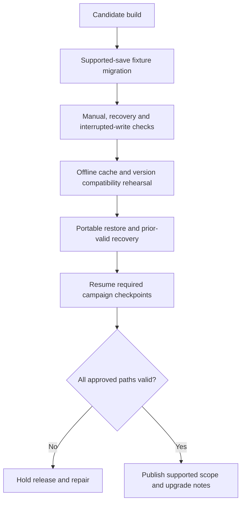
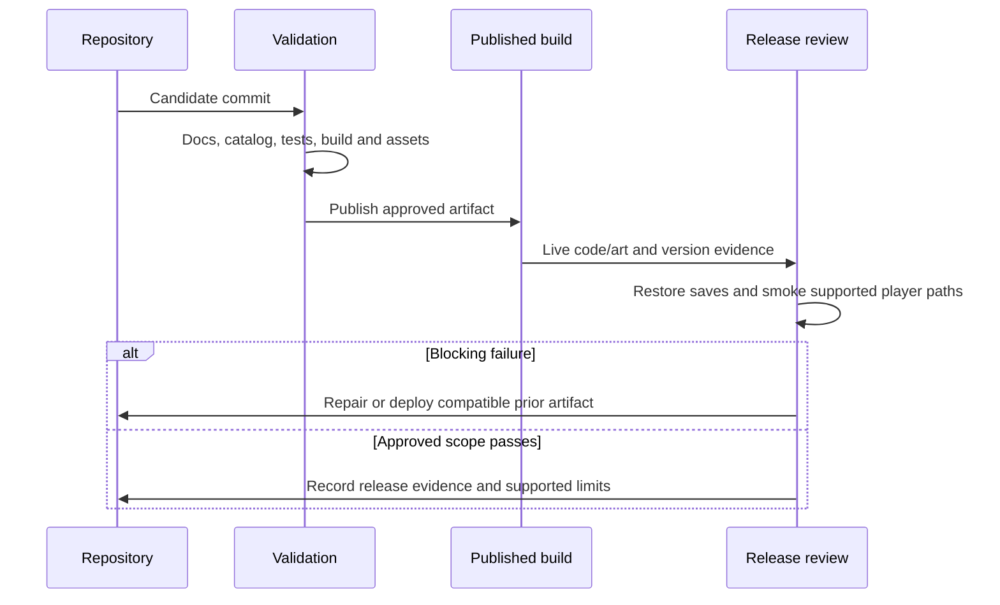

# Quality, compatibility and release plan

[Roadmap library](README.md) · [Backlog](BACKLOG.md) · [Current testing](../TESTING.md) · [Deployment](../DEPLOYMENT.md)

This is the proposed acceptance framework for expansion. Current evidence remains 62 automated cases plus documented browser/asset checks. No checklist here certifies untested hardware, accessibility conformance, performance or commercial readiness.

## Evidence ladder

| Level | Evidence | What it establishes | What it cannot establish alone |
| --- | --- | --- | --- |
| Rules | Pure deterministic cases and invariant scenarios | Correct transitions, rejection and seed behavior for covered cases | Fun, readable visuals or device usability |
| Content | ID/prerequisite/quest graph checks | References and required routes are structurally valid | Encounter quality or narrative coherence |
| Integration | Real UI actions, storage and renderer checks | Systems connect through the intended player path | Every route or physical hardware |
| Presentation | Contact sheets, game-scale captures and motion review | Readability, registration and effect behavior | Stable FPS across devices |
| Performance | Reproducible reference-device measurements | Cost under specified scene/settings | Universal minimum requirements |
| Playtest | Observed builds, routes and player comprehension | Difficulty, pacing and decision value | Deterministic rule correctness |
| Release rehearsal | Install/update/restore/rollback and provenance review | Operational delivery of approved scope | Future migration safety without new tests |

## Regression matrix

| Area | Normal path | Edge/failure path | Required evidence |
| --- | --- | --- | --- |
| Movement | Legal climb, descent and occupied paths | Fallen body, absent tile and invalid destination | Pure fixtures plus targeting UI |
| Combat previews | Height, guard, flank, formation and synergy | Minimum damage, miss, critical and resistance proposal | Preview/resolution agreement |
| Reactions | Support activation and paid costs | Lethal counter, no recursion, defeated actor | Ordered transition cases |
| Objectives | Progress and terminal success | Simultaneous failure, escort death and unreachable exit | Objective reducer and route fixture |
| Deployment | Legal selected roster and cells | Duplicates, over-cap, no viable units | Profile/field validation and UI |
| AI | Role and objective choices | No targets, hazard, revive and interruption | Deterministic scenarios and budget measurement |
| Learning | Native/secondary skills and supports | Unknown IDs, spent-JP bounds and changed job | Ownership/slot/proficiency cases |
| Economy | Buy/equip/craft/reward | Shared-copy duplication, repeat settlement and insufficient materials | Transaction invariants |
| Recruitment | New member and initial gear | Replayed settlement, reserve/deploy and branch cancellation | Stable-ID and idempotency fixtures |
| Narrative | Choices, flags and convergence | Unreachable branches, unsupported ending state | Graph checks and authored route review |
| Saves | Manual, recovery and portable restore | Corruption, interrupted write, stale tab and unsupported version | Stored and imported fixtures |
| Presentation | All states, recipes and camera directions | Missing atlas, scene disposal and reduced motion | Motion/game-scale capture and resource counts |
| Audio | Gesture start, mute, mix and loops | Suspended context, background/resume and unavailable output | Browser/device observations |
| Input | Camp → deploy → battle → settle | Modal focus, remap conflict and device disconnect | Full control-path review |
| Hosting | Repository-subpath build and live files | Missing chunk/art, update mismatch and rollback | Workflow result and fetched checksums |

Tests must assert behavior and invariants, not merely repeat implementation formulas. Add cases when a new rule, failure or unresolved risk justifies them. A larger test count is not a coverage percentage.

## Browser and device certification

Populate this matrix with actual results; until then entries are candidate targets.

| Candidate target | Input to test | Scenarios | Evidence to record |
| --- | --- | --- | --- |
| Desktop Chromium | Mouse + keyboard | Camp, battle, dialogs, backups, effect stress | OS/device, browser version, viewport and result |
| Desktop Firefox | Mouse + keyboard | WebGL, storage, downloads and audio resume | Same plus differences/fallbacks |
| Desktop Safari | Trackpad + keyboard | WebGL, IndexedDB and file export/import | Actual tested hardware/version |
| iOS/iPadOS browser | Touch | Target/confirm, rotation, text scale, storage lifecycle | Physical device and gesture observations |
| Android browser | Touch | Same plus reduced-quality profile and background/resume | Physical device and thermal/latency context |
| Controller | Actual mapped hardware | Entire camp-to-settlement path and disconnect | Controller/browser/OS mapping |
| Assistive technology | Keyboard + selected screen reader | Navigation, labels, dialogs and tactical alternative | Tested combinations and unresolved limits |

CSS viewport checks are useful but do not certify a phone, tablet or controller. A canvas aria label is not a complete nonvisual tactical interface. Publish only the support matrix actually demonstrated.

## Accessibility acceptance

| Concern | Gate |
| --- | --- |
| Keyboard | Every shipped action reachable; visible focus; no modal trap |
| Targeting | Clear tile/unit identity, legal-action reasons and confirmation |
| Color | Faction, status, danger and objective meaning also use shape/text |
| Text | Supported size range does not clip commands or hide critical information |
| Motion | Reduced motion removes moving effects/camera transitions as specified |
| Intensity | Any added flash/screen movement has a bounded/disableable policy |
| Audio | Critical rules/telegraphs remain available visually or textually |
| Touch | Targets and gestures avoid accidental irreversible commands |
| Controller | Complete navigation and recovery after disconnect |
| Nonvisual play | Explicitly evaluate/implement an alternative and document its actual limits |

Do not claim a formal accessibility standard has been met without the corresponding audit.

## Balance and economy investigations

| Question | Scenario set | Decision |
| --- | --- | --- |
| Are several builds viable? | Different primary/secondary/support/gear combinations per required mission | Adjust counters and cost curves instead of requiring one build |
| Is setup rewarded fairly? | Soak/lightning, exposure/pursuit, guard/support and future combos | Compare total actions/resources, not only peak damage |
| Can timeline effects lock opponents? | Repeated haste/delay with fastest legal loadouts | Cap/rework only with transparent rules |
| Does failure preserve a viable path? | No gold, defeat, exhausted consumables, missing optional recruit | Provide a recovery route without mandatory grinding |
| Are repeat rewards exploitable? | Retry, return, import and repeated first-clear attempts | Preserve intended repeats; reject duplicate settlement |
| Do new jobs remain distinct? | Compare actions and positioning opportunities with existing jobs | Consolidate redundant skills before adding totals |
| Is difficulty clear? | Same mission across approved profiles | Disclose changes and retain save compatibility |

Keep seeds, loadouts, route state and observations with conclusions. Simulations can find degenerate loops; they cannot substitute for player comprehension and pacing tests.

## Save and offline release gates

A service worker/PWA is planned. Before adding it, decide which assets are cached, when a new build activates, how old clients obtain compatible chunks, what happens offline during an update, and how a user exports/restores before an incompatible change. Cache success is not enough if the game can no longer read a saved company.

Cloud sync is optional/deferred unless explicitly chosen. It would require separate account, privacy, conflict, failure and cost decisions; local backups must remain usable.

## Risk register

| Risk | Early signal | Mitigation / acceptance owner discipline |
| --- | --- | --- |
| Fixed board assumptions | Alternate size selects/renders wrong cells | MAP-01–03 audit; engine + rendering |
| Fixed companion identities | Recruit rejected by validators | CMP-01 with migration fixtures; systems |
| Preview drift | New modifier appears only in resolution | Shared rule path; gameplay |
| Event loss/replay | Counter or effect missing/duplicated | Ordered deduplicable queue; rendering |
| Save incompatibility | Old fixture changes resources or fails | SAV-01–04; persistence |
| Multi-tab overwrite | Two open games silently race | Explicit revision policy; persistence |
| Reward duplication | Reload/return repeats unique grants | Settlement ledger; campaign/economy |
| Branch softlock | Required quest/gear becomes unreachable | Graph checks and authored routes; narrative |
| Job scope explosion | Data jobs lack art/AI/save coverage | Ship validated pairs; design/production |
| Directional art explosion | Thousands of unreviewed frames | One-job pilot and frame arithmetic; art |
| GPU memory/bandwidth | Atlas count dominates low-end scenes | Reference profiling and budget profiles; rendering |
| Inaccessible canvas flow | Controls exist but tactical choices cannot be understood | Alternative interaction evaluation; UX |
| Offline stale build | Cached client and save formats diverge | Activation/migration/rollback rehearsal; delivery |
| Timeline/summon loops | Scenario never terminates or yields free rewards | Bounded contracts and complete simulations; gameplay |
| Unclear asset rights | No provenance for shipped material | Inventory and explicit license decision; production |
| Balance by test count | Passing cases cited as proof of fairness | Diverse scenario/playtest evidence; QA/design |

## Milestone and release checklist

| Gate | Required artifacts | Block release when |
| --- | --- | --- |
| Feature slice | Player path, rule/data contract, invalid path, save decision | Only a menu/mockup/data row exists |
| Chapter | Complete branch route, recruit/reward tests, restore checkpoints | Required content is unreachable or consequence state is lost |
| Presentation | Runtime/source manifests, provenance, fallback and motion review | Missing core assets or unbounded resources |
| Beta | Explicit content scope, defect triage, compatibility matrix and balance observations | Known integrity, progression or control blockers |
| Release candidate | Final supported-save fixtures, notices/license decision, deploy/live checks and rollback rehearsal | Progress can be lost, supported controls fail, or distribution rights remain unresolved |
| Release | Versioned artifacts, release notes, support limits and recovery instructions | Scope or compatibility claims exceed evidence |

## Defect and scope policy

P0 defects include lost/corrupted progress, duplicate unique settlement, deterministic divergence, unrecoverable progression blocks and unsupported required controls. Fix them before expanding content. P1 defects break an important supported path with a workaround; resolve or explicitly narrow the supported scope. Cosmetic defects are prioritized by readability and frequency, not only visual impact.

A deferred roadmap item is not automatically a release blocker if the chosen scope does not depend on it. Update prerequisites, player-facing claims and release notes together. Preserve all deferred IDs for future planning.

## Release rehearsal

The current Pages workflow already validates, deploys and checks live assets. Release certification adds route/device/migration/provenance evidence; it is not achieved merely by a green workflow.

