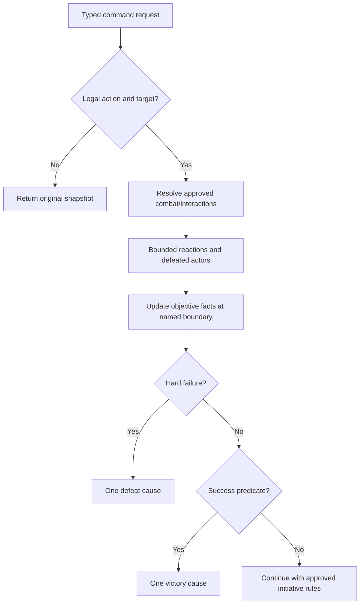

# Proposed technical contracts and data examples

[Roadmap library](README.md) · [Production slices](PRODUCTION_SLICES.md) · [Engine plan](ENGINE_AND_SYSTEMS.md) · [Current saves](../DATA_AND_SAVES.md)

**Proposal examples only.** These snippets are not supported runtime schemas, game saves or portable backups. They are not accepted by the current import flow. The planning manifest uses its own format and never changes Expedition v2.

## Current versus proposed ownership

| Contract | Current authority | Proposed seam |
| --- | --- | --- |
| Map size | Fixed creation/validation and view assumptions | Validated MapDefinition consumed by rule and presentation adapters |
| Roster | Fixed profiles/units with current ID constraints | Stable member/unit identity plus explicit simulation order and deployment |
| Objective | Elimination and special boss phase | Typed objective state reducer and terminal cause |
| Interaction | Move/skill/end only | Validated interact/item/extract commands with action costs |
| Presentation | Latest action cue | Ordered deduplicable result batch |
| Campaign | Completion IDs and company state | Quest facts, branch selection and settlement ledger |
| Persistence | Supported v1 migration and optional v2 fields | Approved future migration chain, not silent shape relaxation |

## MapDefinition proposal

The example is a design header. A playable definition additionally requires all validated tile records, deployment cells, enemy definitions and objective data.

```json
{
  "proposalSchemaVersion": 1,
  "id": "MISS-01",
  "size": { "width": 12, "height": 8 },
  "terrainKit": "proposed-marsh-sluice",
  "deploymentZone": "west-bank",
  "objectiveId": "hold-sluice",
  "simulationOrderPolicy": "explicit-saved-order"
}
```

| Invariant | Candidate check | Failure behavior |
| --- | --- | --- |
| Dimensions | Positive bounded integers chosen by approved content policy | Reject before battle creation |
| Tiles | Exactly one cell per required coordinate | Reject duplicate/missing/extra cells |
| Elevation | Finite approved rule range and legal neighbor semantics | Identify invalid tile |
| Spawn cells | Existing, unblocked, compatible and unoccupied | Reject invalid deployment |
| IDs | Stable and unique across the appropriate namespace | Actionable content diagnostic |
| Objectives | Referenced units/props/zones exist | Reject unresolved references |
| Required route | Approved static reachability probe | Flag for designer review; not a proof of solvability |

### Coordinate transform

Candidate shared transform:

```ts
worldX = tileX - (width - 1) / 2;
worldZ = tileZ - (height - 1) / 2;
```

This preserves the current center offset of four for a 9×9 board. A 12×8 board centers on 5.5/3.5. Height scaling remains a separate presentation parameter. Keyboard bounds use width−1/height−1; targeting, particles, projectiles, rings and map previews must consume the same board contract.

Do not replace visual sampling constants or damage caps with map dimensions merely because they share a numeric literal.

## Roster and simulation order

| Proposed field/concept | Purpose | Migration requirement |
| --- | --- | --- |
| Member ID | Persistent company identity | Retain original companion IDs |
| Field unit ID | Encounter identity, including summons/escorts | Never reuse a dismissed/dead ID in the same battle without an explicit policy |
| Deployed IDs | Selected company members | Reject duplicates and missing profiles |
| Simulation order | Stable iteration when multiple targets consume RNG | Preserve legacy unit order when migrating existing fights |
| Readiness tie-break | Explicit deterministic policy | Equivalent old fixtures retain outcomes |
| Extracted IDs | Alive actors removed from active board occupancy | Distinguish extracted from defeated and reserve units |
| Owner ID | Summon relationship | Validate owner, cap and dismissal semantics |

Changing only array display order must not accidentally change combat RNG consumption. A proposed canonical order for new content does not authorize sorting old active battles during migration.

## ObjectiveState proposal

```json
{
  "proposalSchemaVersion": 1,
  "objectiveId": "hold-sluice",
  "kind": "defend",
  "progress": { "completedActivations": 7, "target": 12 },
  "controlZone": "sluice-platform",
  "result": "playing",
  "terminalCause": null
}
```

This is an illustrative record, not a validated import. D-03 must select exact failure/success predicates, and D-04 must approve counter timing.



This graph is the recommended ordering candidate, not a description of an already implemented objective engine.

## Command contract table

| Proposed request | Preconditions | Cost/commit boundary | Rejection invariant |
| --- | --- | --- | --- |
| Interact | Actor eligible, adjacent/in range, prop active and not already completed | Spend action only after valid state transition | No resource or quest change |
| Use item | Owned stack, correct target and allowed battle phase | Decrement one item atomically with effect | No item loss on invalid use |
| Summon | Owner/cap valid, legal empty cell and sufficient resources | Allocate stable ID once with paid action | No partial spawn or cap bypass |
| Extract | Eligible actor inside valid zone and objective permits extraction | Mark extracted and remove occupancy in one transition | No profile deletion or double extraction |
| Sustain/interrupt | Relevant prepared state and named timing window | Approved action/status update | No free automatic additional activation |

## Resolved event batch proposal

```json
{
  "proposalSchemaVersion": 1,
  "battleId": "example-battle",
  "stateRevision": 18,
  "events": [
    {
      "eventId": "example-battle:18:0",
      "kind": "damage-resolved",
      "actorId": "sera",
      "targetId": "example-enemy",
      "result": "hit",
      "amount": 24
    },
    {
      "eventId": "example-battle:18:1",
      "kind": "objective-changed",
      "objectiveId": "hold-sluice",
      "causeEventId": "example-battle:18:0"
    }
  ]
}
```

The sample demonstrates identity/order, not a final exhaustive event vocabulary or actual damage expectation. Events describe authoritative results. Their animation duration must never determine whether damage, a wave or settlement occurs.

| Consumer rule | Required behavior |
| --- | --- |
| Initial load | Initialize cursor from saved state; do not replay old effects |
| Repeated snapshot | Consume event ID at most once |
| Missing actor/asset | Skip or use fallback without changing rules |
| Multiple reactions | Preserve approved cause/order with bounded queue behavior |
| Interrupted view | Resume current state without manufacturing old visuals |
| Persistence | Bound retained records if saved; choose schema/version explicitly |

## Proposed settlement transaction

| Phase | Candidate responsibility | Error behavior |
| --- | --- | --- |
| Identify | Mission attempt and stable settlement key | Reject unknown/mismatched attempt |
| Check | Confirm terminal result and not-yet-settled key | Already applied returns current campaign |
| Plan | Derive profiles, bounty, unique items, recruit and flags | Validate all proposed changes before commit |
| Commit | Produce one accepted campaign transition plus ledger key | No partial independent callbacks |
| Store | Persist via approved checkpoint transaction | Surface write failure and preserve prior valid recovery |

## Migration fixture package

| Fixture | What must be preserved |
| --- | --- |
| Current camp | Original four profiles, treasury, inventory, learned skills and contract completions |
| Active current battle | Tile/unit order, positions, HP/energy, statuses, move/act flags and seed |
| Supported legacy battle | Existing migration behavior without retroactive gear/stat changes |
| Terminal victory awaiting return | Earned field JP, rewarded flag and no duplicated bounty |
| Boss phase | Awakening flag and altered readiness/resources |
| Cosmetic cue | Optional target/outcomes tolerated; old action not replayed |
| Future partial objective | Exact approved progress/terminal cause and pending waves |
| Future recruit settlement | Stable identity and one gear allocation/ledger key |

## Planning manifest

[specs/plan.json](specs/plan.json) is machine-readable **design metadata**, not content loaded by the game. It links documents, backlog IDs, decisions, three slices, six missions, twelve job proposals and 36 ability concepts. A documentation check validates identity/reference consistency, prerequisite acyclicity and the explicit approach routes. It does not simulate the missions, approve costs or prove narrative quality.

